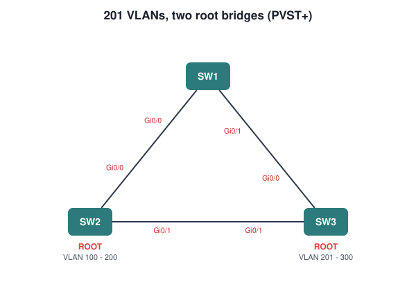
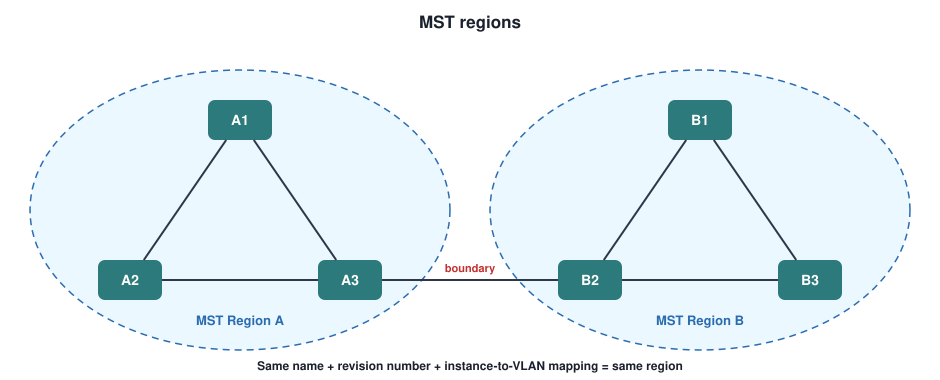
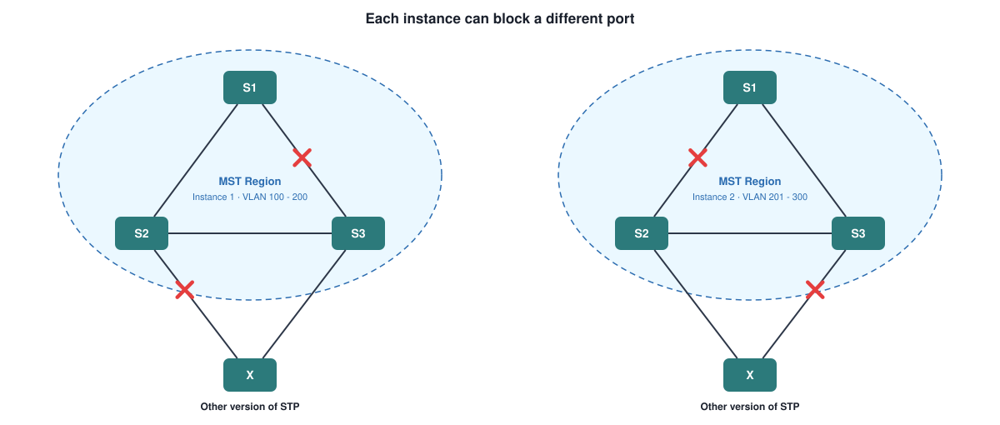
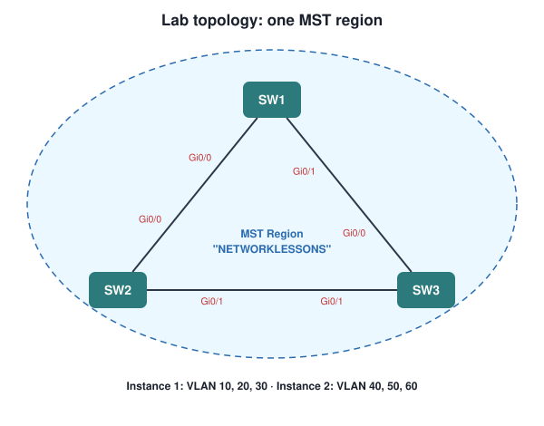
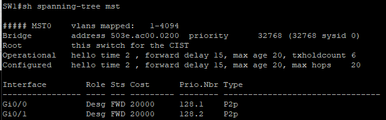
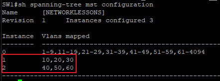
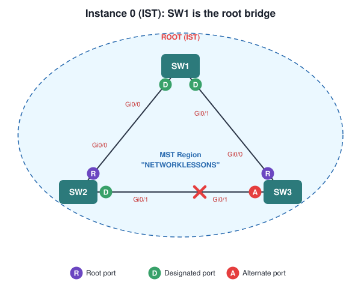
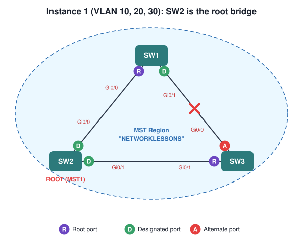
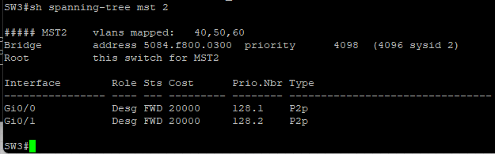
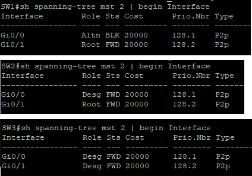

# Multiple Spanning-Tree (MST)

[한국어](../01-Multiple-Spanning-Tree.md) | [English](01-Multiple-Spanning-Tree.en.md) | [日本語](01-Multiple-Spanning-Tree.ja.md) | **简体中文** | [Español](01-Multiple-Spanning-Tree.es.md) | [Français](01-Multiple-Spanning-Tree.fr.md)

Cisco Catalyst 交换机默认运行 **PVST+** 或 **Rapid PVST+**（Per VLAN Spanning Tree）。也就是说，**每个 VLAN 都有一个自己的 spanning-tree 实例**。有 20 个 VLAN，就有 20 个 spanning-tree 在运行。本文介绍把多个 VLAN 归入一个实例的 **MST（Multiple Spanning Tree）**，并通过实验确认它的配置和工作方式。

## 本实验使用的命令

| 命令 | 用途 |
| --- | --- |
| `spanning-tree mode mst` | 启用 MST |
| `spanning-tree mst configuration` | 进入 MST 配置模式 |
| `name` / `revision` / `instance N vlan …` | region 名称、revision 编号、实例与 VLAN 的映射 |
| `spanning-tree mst N priority P` | 设置实例 N 的 bridge priority |
| `show spanning-tree mst configuration` | 查看 region 配置和映射 |
| `show spanning-tree mst [N]` | 查看各实例的 root bridge 和端口角色 |

---

## 1. PVST+ 的问题：每个 VLAN 都要计算

每个 VLAN 单独计算 spanning-tree 有问题吗？和往常一样，**要看情况**。来看一个例子。

这里有三台交换机和很多 VLAN：VLAN 100～300，一共 **201 个**。使用 PVST 或 Rapid PVST 时，每个 VLAN 计算一次，也就是 **201 次计算**，会消耗大量 CPU 和内存。

如果 SW2 是 VLAN 100～200 的 root bridge，SW3 是 VLAN 201～300 的 root bridge，拓扑会是这样：

- **VLAN 100～200**：SW2 是 root bridge。SW1 的 Gi0/1 或 SW3 的 Gi0/0 中会有一个被阻塞。虽然计算了 100 次，结果却全部**相同**。
- **VLAN 201～300**：SW3 是 root bridge。SW1 或 SW2 的 Gi0/0 会被阻塞。

结果**只有两种**，却有 200 多个 spanning-tree 实例在运行。这是在浪费 CPU 和内存。

---

## 2. MST 的概念：实例与 region

**MST** 解决了这个问题。它不再为每个 VLAN 计算 spanning-tree，而是创建**实例（instance）**，再把 VLAN **映射**到实例上。对于上面的网络，可以这样做：

- Instance 1：VLAN 100～200
- Instance 2：VLAN 201～300

这样，所有 VLAN **只需计算两次（两个实例）**。

### MST region

MST 以 **region** 的概念工作。运行 MST 的交换机需要弄清楚邻居是否也在运行 MST。

下面这些属性**全部相同**时，交换机属于同一个 region。region 可以只有一个，也可以有多个。

| 属性 | 说明 |
| --- | --- |
| MST configuration name | 用来标识 region 的名称，可以随意设定。 |
| MST configuration revision number | 同样是随意设定的数字，用于每次修改配置时递增；只要 region 内所有交换机一致即可。 |
| MST instance to VLAN mapping table | 决定哪个 VLAN 放进哪个实例的表，需要自己配置。 |

属性不同时，该交换机被视为位于 **region 的边界（boundary）**。在边界上，它可以连接另一个 MST region，也可以与运行其他版本 spanning-tree 的交换机通信。

### IST（Internal Spanning Tree）

region 内始终有**一个 spanning-tree 实例**负责构建无环拓扑。配置 MST 后，总会有一个默认实例计算 region 内的拓扑，称为 **IST（Internal Spanning Tree）**。Cisco 默认使用 **instance 0** 作为 IST，IST 运行 **rapid spanning-tree**。

在此基础上，可以创建 instance 1（VLAN 100～200）和 instance 2（VLAN 201～300）。根据每个实例由哪台交换机担任 root bridge，**被阻塞的端口也会不同**。

region 外的交换机看不到 region 内部的样子。对外部交换机来说，MST region 就像**一台大交换机**，也就是一个“黑盒”。

> MST 与 PVST+ 如何协同工作的细节，请见 [02. MST and PVST+ Interoperability](../../02-MST-and-PVST-Interoperability/README/02-MST-and-PVST-Interoperability.zh-CN.md)。

---

## 3. MST 配置

实验使用下面的拓扑。

用以下属性创建一个 region：

- MST configuration name：**NETWORKLESSONS**
- MST configuration revision number：**1**（随意设定的数字）
- 实例与 VLAN 的映射：**Instance 1** = VLAN 10、20、30 / **Instance 2** = VLAN 40、50、60

首先在三台交换机上启用 MST。

查看默认的 MST 实例。

`show spanning-tree mst configuration` 可以查看 MST 实例。还没有创建任何实例，所以只有 **instance 0**，所有 VLAN（1-4094）都映射到 instance 0。

`show spanning-tree mst` 也能看到 VLAN 映射和 root bridge 信息。添加实例之前先做准备工作：把交换机之间的链路配置为 trunk。

创建 VLAN 10～60。

现在配置 MST 和实例。

用 `spanning-tree mst configuration` 进入 MST 配置模式，用 `name` 设置名称，用 `revision` 设置编号，再用 `instance` 命令把 VLAN 映射到实例。验证一下结果。

现在有三个实例（0、1、2）。VLAN 10、20、30 映射到 instance 1，VLAN 40、50、60 映射到 instance 2，**其余 VLAN 仍全部在 instance 0** 中。

---

## 4. 按实例更改 root bridge

### Instance 0（IST）：让 SW1 成为 root bridge

为了让 SW1 成为 region 内的 root bridge，修改 **IST（instance 0）** 的 priority。

验证一下。

SW1 是 IST 的 root bridge。输出中显示为 **CIST**（Common and Internal Spanning Tree）。来看接口。

知道了所有接口的状态后，把 IST 画成图。

### Instance 1：让 SW2 成为 root bridge

接着修改 SW2 的 priority，让 **SW2** 成为 instance 1 的 root bridge。

确认 SW2 已成为 instance 1 的 root bridge。

来看接口。

把 instance 1 的端口角色画出来如下。**它的拓扑与 instance 0 不同。**

### Instance 2：让 SW3 成为 root bridge

最后，让 **SW3** 成为 instance 2 的 root bridge。

SW3 现在是 instance 2 的 root bridge。

来看接口。

这是 instance 2 的拓扑。

把 instance 1 和 2 并排比较一下。

为每个实例指定不同的 root bridge，就会得到**不同的拓扑**：

- **Instance 1**：SW3 的 Gi0/0 在 VLAN 10、20、30 中被阻塞。
- **Instance 2**：SW1 的 Gi0/0 在 VLAN 40、50、60 中被阻塞。

---

## 5. 如果加入一台 PVST 交换机？

把运行 PVST 的交换机 SW4 加入拓扑会怎样？

把 SW2 和 SW3 的 Gi0/2 配置为 trunk。

SW4 的 Gi0/0 和 Gi0/1 也配置为 trunk。

Cisco 交换机默认的 spanning-tree 模式就是 **PVST**，所以不需要修改。

在 SW4 上添加 VLAN 10～60。

与 SW2、SW3 的 trunk 已建立，SW4 也知道所有 VLAN。现在看看 SW4 眼中的拓扑。先看 **VLAN 1**（映射到 instance 0）。

SW4 把 **SW1**（503e.ac00.0200）视为 root bridge。Gi0/0 处于转发（Root），Gi0/1 处于阻塞（Alternate）。

接下来是映射到 instance 1 的 **VLAN 10**。

我们把 instance 1 的 root bridge 设为 SW2，但 SW4 在 VLAN 10 中仍把 **SW1** 视为 root bridge。这完全正常：MST 只向 region 外通告 **IST 的 BPDU**，所以 SW4 看不到 instance 1 或 instance 2 的任何信息。

> 原文（NetworkLessons）写的是 SW4 在 VLAN 10 中把 SW2 视为 root，但实验输出中 Root ID 的地址是 SW1（503e.ac00.0200）。本文以实验输出为准。

再看看映射到 instance 2 的 **VLAN 40**。

VLAN 40 属于 instance 2（root bridge 是 SW3），但 SW4 依然把 **SW1** 视为 root bridge。SW4 **对所有 VLAN 收到的都是同一个 BPDU**。

---

## 总结

- **PVST+ / Rapid PVST+** 为每个 VLAN 计算一个 spanning-tree。VLAN 多时，即使结果相同也会浪费 CPU 和内存。
- **MST** 把 VLAN 映射到**实例**，只按实例的数量进行计算。
- **name、revision 编号、实例与 VLAN 的映射**全部相同的交换机构成同一个 **region**；只要有一项不同，就是 region 边界。
- region 内始终有 **IST（instance 0）**，运行 rapid spanning-tree，在输出中显示为 **CIST**。
- 用 `spanning-tree mst N priority P` 为每个实例指定不同的 root bridge，各实例就会阻塞不同的端口，实现**负载均衡**。
- 从 region 外看，整个 region 就像**一台交换机**，只有 **IST 的 BPDU** 会离开 region。所以 PVST 交换机在所有 VLAN 中看到的都是 IST 的 root bridge。
