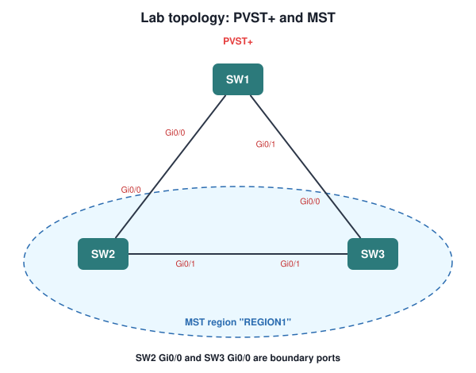
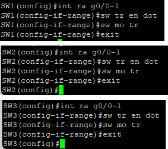
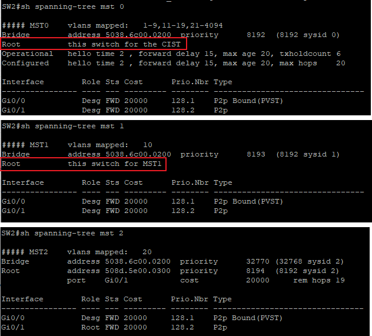
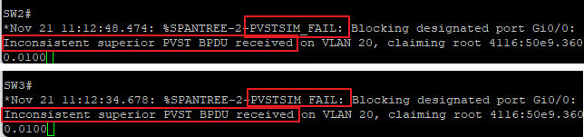
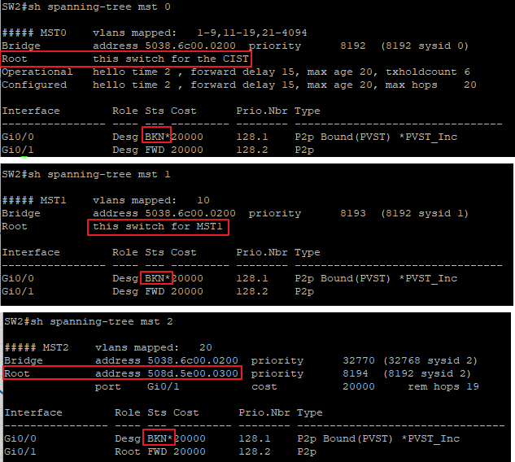
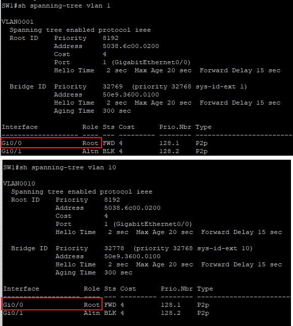
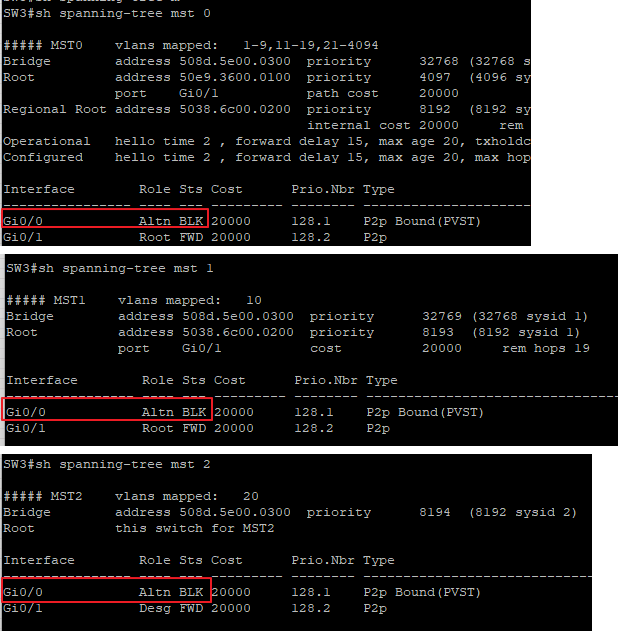
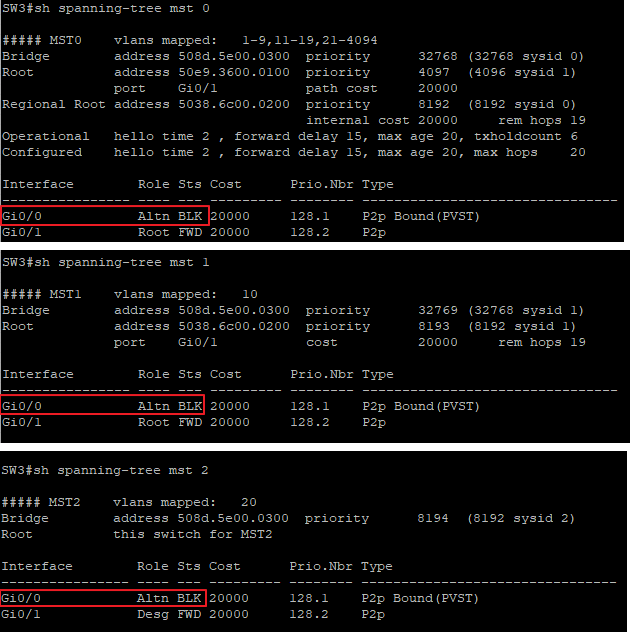

# MST and PVST+ Interoperability

**한국어** | [English](README/02-MST-and-PVST-Interoperability.en.md) | [日本語](README/02-MST-and-PVST-Interoperability.ja.md) | [简体中文](README/02-MST-and-PVST-Interoperability.zh-CN.md) | [Español](README/02-MST-and-PVST-Interoperability.es.md) | [Français](README/02-MST-and-PVST-Interoperability.fr.md)

**MST** 와 **PVST+** 는 둘 다 루프 없는 L2 토폴로지를 만들지만 접근 방식이 다릅니다. MST는 여러 VLAN을 인스턴스 하나에 매핑해서 spanning-tree 인스턴스 수를 줄이고, PVST+는 **VLAN마다** 인스턴스를 하나씩 계산합니다. 두 방식은 서로 호환되지만, 두 프로토콜이 만나는 링크에서 어떻게 동작해야 할까요? 이 문서에서는 **PVST simulation** 과 경계 포트의 검사 규칙을 정리하고, 실습으로 확인합니다.

> MST의 기본 개념은 [01. Multiple Spanning-Tree (MST)](../01-Multiple-Spanning-Tree/01-Multiple-Spanning-Tree.md) 를 먼저 보세요.

## 이번 실습에서 보는 메시지와 상태

| 표시 | 의미 |
| --- | --- |
| `Bound(PVST)` | PVST+ 쪽과 연결된 **경계(boundary) 포트** |
| `%SPANTREE-2-PVSTSIM_FAIL` | PVST simulation 검사 실패 |
| `BKN*` / `*PVST_Inc` | 포트가 **broken** 상태로 차단됨 (PVST inconsistency) |
| `%SPANTREE-2-PVSTSIM_OK` | inconsistency가 해제됨 |
| `Mstr` | 인스턴스의 **Master port** (region 밖의 root로 향하는 경계 포트) |

---

## 1. 문제: 정보를 1:1로 바꿀 수 없다

PVST+는 **VLAN마다 BPDU** 를 보냅니다. MST는 받은 BPDU를 그 VLAN이 매핑된 인스턴스로 따로 처리할 수 있습니다. 하지만 MST에는 VLAN마다 인스턴스가 있는 것이 아니라서, **어떤 BPDU를 보내야 할지**가 문제입니다.

두 VLAN이 MST에서는 같은 인스턴스를 쓰는데, PVST+ 쪽에서는 서로 다른 root bridge와 root port를 쓸 수도 있습니다. 그러면 MST는 BPDU에 어떤 정보를 담아야 할까요? MST와 PVST+의 정보를 **1:1로 대응시키는 것은 불가능**합니다.

### MST → PVST+: PVST simulation

그래서 MST region이 PVST+ 토폴로지와 연결되면, MST는 **PVST simulation mechanism** 으로 PVST+를 흉내 냅니다.

- MST region은 PVST+ 스위치와 연결된 인터페이스로 **VLAN마다 PVST+ BPDU** 를 보냅니다.
- 이 BPDU들은 모두 **같은 정보**를 담고 있고, **같은 root bridge** 를 알립니다.
- PVST+ 쪽과 연결된 인터페이스를 **경계 인터페이스/포트(boundary interface/port)** 라고 합니다.

PVST+라고 적었지만 **PVRST+(Rapid PVST+)** 도 지원합니다. 다만 MST는 PVST+ 기능만 쓰기 때문에 성능 차이는 없습니다.

PVST+ 스위치는 MST로부터 VLAN마다 **같은 정보의 BPDU** 를 받으므로, 모든 VLAN에서 root bridge와 root port를 **똑같이** 고릅니다.

그럼 MST가 simulated PVST+ BPDU에 담는 정보는 어디서 올까요? region 안의 모든 MST 스위치가 같은 정보에 합의해야 하므로 **IST의 정보** 를 씁니다. region 안에서 IST의 root bridge로 뽑힌 스위치가 PVST+ BPDU에서도 root bridge로 쓰입니다.

### PVST+ → MST: VLAN 1 BPDU로 포트 역할을 정한다

반대 방향은 어떨까요? MST는 경계 인터페이스의 포트 역할(root, designated, non-designated)을 **VLAN 1 BPDU의 정보만 보고 모든 VLAN에 대해** 한 번에 정합니다.

이것은 위험합니다. 모든 VLAN이 같은 root bridge와 root port를 쓴다고 가정하는 셈이기 때문입니다. PVST+ 쪽이 모든 VLAN에서 이 포트 역할에 동의하는지 알 수 없습니다. 그래서 MST는 PVST+가 동의하는지 확인하는 **간단한 검사**를 합니다. 포트 역할마다 살펴보겠습니다.

---

## 2. 경계 포트의 검사 규칙

| 경계 포트 역할 | MST가 하는 검사 | 실패하면 |
| --- | --- | --- |
| Designated port | 자신의 **IST BPDU** 가 경계 포트에서 받은 **모든 VLAN의 PVST+ BPDU보다 superior** 여야 합니다. | broken(차단) |
| Root port | **VLAN 1을 제외한 모든 VLAN의 PVST+ BPDU** 가 **VLAN 1의 PVST+ BPDU와 같거나 superior** 여야 합니다. | inconsistency 오류, broken(차단) |
| Non-designated port | 추가 검사 없음 (원래 차단된 포트) | — |

### Designated port

MST가 경계 포트를 designated port로 쓰려면 다음 조건을 확인합니다.

- **IST의 MST BPDU가 경계 인터페이스에서 받은 모든 VLAN의 PVST+ BPDU보다 superior** 여야 합니다.

MST는 자신의 IST BPDU를 VLAN마다 받은 PVST+ BPDU와 모두 비교합니다. 자신의 BPDU가 superior면 PVST+도 이 포트 역할에 동의한다는 뜻이므로 경계 인터페이스를 안전하게 designated port로 만듭니다. 그렇지 않으면 PVST+가 동의하지 않는다는 뜻이므로 경계 인터페이스를 차단합니다. 이때 인터페이스 상태는 **broken** 으로 표시됩니다.

### Root port

경계 인터페이스가 받은 **VLAN 1 BPDU** 가 모든 경계 인터페이스 중에서 **가장 좋은 BPDU** 라면 root port가 될 수 있습니다. 즉 VLAN 1의 root bridge가 **PVST+ 도메인** 에 있다는 뜻입니다. 이때 인터페이스는 **모든 VLAN** 에서 Forwarding 상태가 됩니다.

까다로운 상황입니다. MST는 모든 VLAN의 root bridge가 PVST+ 도메인에 있다고 보고 경계 인터페이스를 모든 VLAN의 root port로 만들지만, 실제로는 그렇지 않을 수 있습니다. 그래서 MST는 다음을 검사합니다.

- **VLAN 1을 제외한 모든 VLAN의 PVST+ BPDU가 VLAN 1의 PVST+ BPDU와 같거나 superior** 여야 합니다.

MST는 경계 인터페이스로 받은 모든 PVST+ BPDU가 VLAN 1 BPDU보다 superior인지 확인합니다. 그렇다면 경계 인터페이스를 안전하게 root port로 만듭니다. 그렇지 않으면 **inconsistency 오류** 를 알리고, 인터페이스를 차단해서 **broken** 상태로 만듭니다.

주의할 점이 하나 있습니다. PVST+는 **system ID extension** 을 써서 VLAN 번호를 bridge ID에 넣습니다. 그래서 VLAN이 다르면 PVST+ BPDU 값이 **같을 수 없습니다.** 결국 VLAN 1이 아닌 VLAN의 PVST+ BPDU는 priority가 VLAN 1보다 **최소 4096 낮아야** 합니다.

### Non-designated port

경계 인터페이스가 자신의 IST BPDU보다 superior한 VLAN 1 PVST+ BPDU를 받았지만, root port가 될 만큼 좋지는 않다면 **모든 VLAN에서 non-designated port** 가 됩니다.

MST는 PVST+ 도메인도 이 포트를 non-designated로 보는지 확인해야 하는데, 모든 PVST+ BPDU를 들어 보면 쉽게 알 수 있습니다. PVST+ BPDU가 자신의 BPDU보다 superior면 non-designated port가 될 수 있습니다. Cisco 스위치는 여기에 **추가 검사를 하지 않습니다.** 설령 superior BPDU를 받아서 PVST inconsistency 오류로 broken이 되더라도, 어차피 차단된 포트라서 상관없습니다.

> **권장**: MST region이 네트워크의 **root bridge** 가 되도록 구성하는 것이 가장 쉽습니다. PVST+ 도메인에 root bridge가 있으면 MST는 모든 VLAN에 같은 root port를 씁니다. root bridge가 MST region에 있으면 PVST+ 스위치에서 VLAN마다 cost를 바꿔 다른 root port를 쓰게 해서 **부하 분산**을 할 수 있습니다.

---

## 3. 실습 구성

실습에는 스위치 세 대를 씁니다.

SW1은 PVST+로 동작하고(출력에는 `protocol ieee` 로 표시), SW2와 SW3는 MST로 동작합니다. MST 인스턴스는 0, 1, 2 세 개이고, VLAN 10과 20을 씁니다. 먼저 인터페이스를 trunk로 설정합니다.

VLAN을 추가합니다.

기본 구성이 끝났습니다.

---

## 4. 시나리오 1: MST region이 root bridge

첫 번째 시나리오에서는 **MST region을 root bridge** 로 씁니다. VLAN은 이렇게 매핑합니다.

- VLAN 10 → instance 1
- VLAN 20 → instance 2

SW2는 instance 0과 1의 root bridge가 됩니다.

SW3는 instance 2의 root bridge가 됩니다.

SW1은 기본 priority 그대로 PVST+로 동작합니다. 각 스위치가 보는 토폴로지를 확인합니다.

흥미로운 결과입니다. 앞에서 설명한 것처럼 MST는 모든 VLAN에 **IST 정보** 를 보냅니다. 그래서 VLAN 20의 root bridge가 SW3인데도 SW1은 **모든 VLAN에서 SW2**(5038.6c00.0200)를 root bridge로 봅니다.

SW2를 봅니다.

SW2는 **CIST(instance 0)** 와 instance 1의 root bridge입니다. 경계 포트 Gi0/0에는 `Bound(PVST)` 가 표시됩니다. SW3도 봅니다.

SW3는 instance 0에서 SW2를 **root bridge이자 regional root bridge** 로 보고, instance 1에서도 SW2를 root bridge로 봅니다. instance 2에서는 SW3 자신이 root bridge입니다.

### SW1을 한 VLAN의 root bridge로 만들면?

이제 SW1을 VLAN 20의 root bridge로 만들어 보겠습니다.

바로 SW2와 SW3에 다음 메시지가 나옵니다.

**PVST simulation이 실패**했습니다. 경계 인터페이스가 designated port가 되려면 MST IST BPDU가 모든 PVST+ BPDU보다 superior여야 하는데, 지금은 VLAN 20에서 그렇지 않습니다. 그래서 SW2의 경계 인터페이스가 **broken** 상태가 됩니다.

SW3도 마찬가지입니다.

Gi0/0은 **모든 인스턴스/VLAN에서 BKN(broken)** 상태가 됩니다.

다시 SW1의 VLAN 20 priority를 높이면(값을 크게 하면) SW2와 SW3가 다시 root bridge가 됩니다.

SW1은 다시 MST region을 root bridge로 봅니다. SW2와 SW3가 받는 모든 PVST+ BPDU가 MST IST BPDU보다 inferior가 되었으므로 **inconsistency가 해제**됩니다.

### cost로 부하 분산하기

MST region을 root bridge로 두는 것이 **best practice** 입니다. 관리가 간단하고 부하 분산도 할 수 있습니다. 예를 들어 PVST+ 도메인이 VLAN 20에서는 다른 root port를 쓰게 하고 싶다면 cost를 조정합니다.

SW1은 VLAN 20에서 Gi0/1을 root port로 씁니다.

VLAN 20의 root port는 **Gi0/1** 이 되었고, 다른 VLAN은 여전히 **Gi0/0** 을 root port로 씁니다.

> 원문에는 "VLAN 60"과 "다른 VLAN도 Gi0/1"이라고 적혀 있지만, 실습 출력대로 VLAN 20은 Gi0/1, VLAN 1과 10은 Gi0/0이 root port입니다.

---

## 5. 시나리오 2: PVST+ 도메인이 root bridge

root bridge를 **PVST+ 도메인** 에 둘 수도 있습니다. 어떻게 하는지 보겠습니다. SW1을 VLAN 1의 root bridge로 만듭니다.

SW1의 VLAN 1 priority를 바꾸자마자 SW2가 경고합니다.

MST의 **root port 검사** 때문입니다. root port가 되려면 VLAN 1을 제외한 모든 PVST+ BPDU가 VLAN 1 PVST+ BPDU와 같거나 superior여야 합니다. 그런데 VLAN 10과 20은 아직 기본 priority 32768이라서 조건을 만족하지 못합니다. 그래서 SW2는 경계 인터페이스를 **broken** 상태로 둡니다.

SW3를 봅니다.

SW3의 Gi0/0은 **alternate port** 라서 어차피 차단되어 있습니다. 처음에는 헷갈릴 수 있습니다. SW1이 root bridge인데 SW3의 root port는 SW2와 연결된 Gi0/1입니다. SW2가 **regional root bridge** 이기 때문입니다. MST는 PVST+ 쪽에 **스위치 한 대**처럼 보인다는 점을 떠올리면 이해가 쉽습니다. SW1 입장에서는 이렇게 보입니다.

이를 해결하려면 SW1에서 **VLAN 1을 제외한 모든 VLAN** 의 priority를 더 낮춰야 합니다.

이제 SW2의 root port 검사를 만족합니다.

상태가 정상으로 돌아왔습니다.

경계 인터페이스가 **모든 VLAN에서 Forwarding** 상태입니다. instance 0에서는 Root, instance 1과 2에서는 **Mstr(Master)** 로 표시됩니다. SW3의 포트는 그대로입니다.

### PVST+ 트래픽이 들어오는 위치 바꾸기

PVST+ 쪽 트래픽이 MST region으로 들어오는 위치도 바꿀 수 있습니다. 예를 들어 SW3로 들어오게 해 보겠습니다.

SW2와 SW3는 이제 이렇게 보입니다.

위 출력에서 중요한 변화가 두 가지 있습니다.

- SW2의 Gi0/0이 **alternate port** 가 되었습니다.
- SW2의 priority가 더 좋은데도 **SW3가 regional root bridge** 가 되었습니다.

SW3가 regional root bridge가 된 이유는 **CIST regional root bridge와 IST root bridge가 같은 스위치에 있어야** 하기 때문입니다. SW3를 봅니다.

SW3가 regional root bridge이고, SW1과 연결된 인터페이스가 Forwarding 상태입니다.

---

## 핵심 정리

- MST와 PV(R)ST+는 호환되지만 정보를 1:1로 바꿀 수 없습니다. 그래서 MST는 **PVST simulation** 으로 경계 포트에서 **VLAN마다 PVST+ BPDU** 를 보내고, 그 내용은 모두 **IST 정보** 입니다.
- PVST+ → MST 방향에서는 **VLAN 1 PVST+ BPDU** 로 경계 포트의 역할(root, designated, non-designated)을 모든 VLAN에 대해 정합니다.
- **Designated port 검사**: IST BPDU가 받은 모든 VLAN의 PVST+ BPDU보다 superior여야 합니다.
- **Root port 검사**: VLAN 1을 제외한 모든 VLAN의 PVST+ BPDU가 VLAN 1 BPDU와 같거나 superior여야 합니다. extended system ID 때문에 같을 수는 없으므로, 다른 VLAN의 priority를 VLAN 1보다 **최소 4096 낮게** 설정합니다.
- 검사에 실패하면 `PVSTSIM_FAIL` 과 함께 경계 포트가 **BKN(broken)** 이 되고, 조건을 만족하면 `PVSTSIM_OK` 로 해제됩니다.
- **MST region을 root bridge로 두는 것이 best practice** 입니다. PVST+ 쪽에서 VLAN별 cost로 부하 분산도 할 수 있습니다.
- CIST regional root bridge와 IST root bridge는 **같은 스위치** 여야 해서, PVST+ 트래픽이 들어오는 스위치가 regional root가 됩니다.
