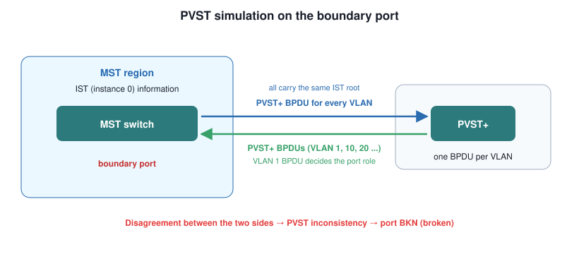
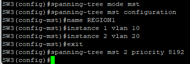
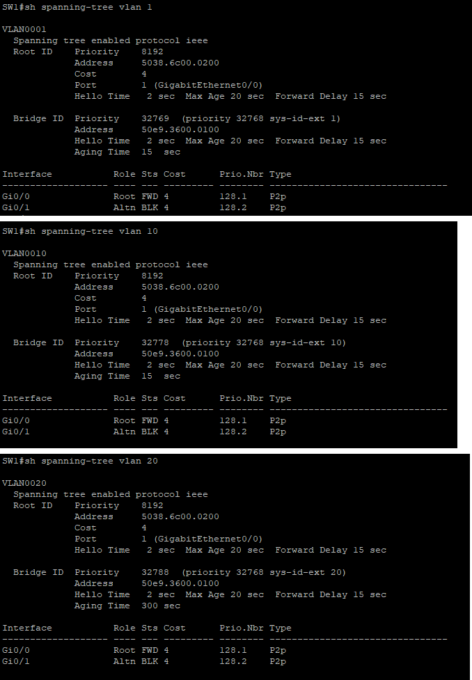
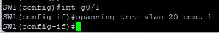
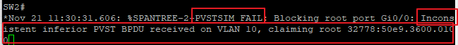
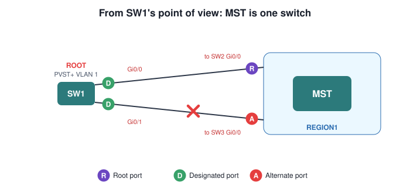
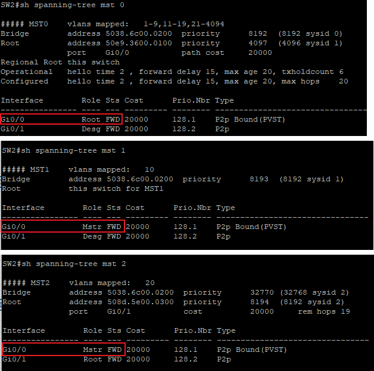

# MST and PVST+ Interoperability

[한국어](../02-MST-and-PVST-Interoperability.md) | **English** | [日本語](02-MST-and-PVST-Interoperability.ja.md) | [简体中文](02-MST-and-PVST-Interoperability.zh-CN.md) | [Español](02-MST-and-PVST-Interoperability.es.md) | [Français](02-MST-and-PVST-Interoperability.fr.md)

**MST** and **PVST+** both build loop-free layer 2 topologies, but they take different approaches. MST maps several VLANs to one instance to reduce the number of spanning-tree instances, while PVST+ calculates one instance **per VLAN**. The two are compatible — but how should they behave on the link where they meet? This page explains the **PVST simulation** and the checks done on boundary ports, then verifies them in a lab.

> Read [01. Multiple Spanning-Tree (MST)](../../01-Multiple-Spanning-Tree/README/01-Multiple-Spanning-Tree.en.md) first for the MST basics.

## Messages and states seen in this lab

| Shown as | Meaning |
| --- | --- |
| `Bound(PVST)` | A **boundary port** connected to the PVST+ side |
| `%SPANTREE-2-PVSTSIM_FAIL` | The PVST simulation check failed |
| `BKN*` / `*PVST_Inc` | The port is blocked in the **broken** state (PVST inconsistency) |
| `%SPANTREE-2-PVSTSIM_OK` | The inconsistency is cleared |
| `Mstr` | The instance's **master port** (the boundary port toward a root outside the region) |

---

## 1. The problem: no 1:1 translation

PVST+ sends **a BPDU for each VLAN**. MST could process each one with the instance that VLAN is mapped to. But MST doesn't have an instance per VLAN, so the question is **what BPDUs it should send**.

Two VLANs may share the same MST instance yet use different root bridges and root ports in the PVST+ domain. Which information should MST put in its BPDUs? A **1:1 mapping between MST and PVST+ information is impossible**.

### MST → PVST+: the PVST simulation

So when an MST region connects to a PVST+ topology, MST imitates PVST+ with the **PVST simulation mechanism**:

- The MST region sends **a PVST+ BPDU for each VLAN** on interfaces connected to PVST+ switches.
- These BPDUs all carry **the same information** and advertise **the same root bridge**.
- Interfaces connected to the PVST+ side are called **boundary interfaces/ports**.

I'm talking about PVST+, but **PVRST+ (Rapid PVST+)** is supported too. MST only uses PVST+ features, though, so there's no performance difference.

Because PVST+ switches receive BPDUs from MST for every VLAN with **the same information**, they make **the same decisions** for root bridge and root port in every VLAN.

Where does the information in the simulated PVST+ BPDUs come from? All MST switches in the region must agree on it, so MST uses **the IST's information**. The switch elected root bridge of the IST in the region is also the root bridge advertised in the PVST+ BPDUs.

### PVST+ → MST: the VLAN 1 BPDU decides the port role

What about the other direction? MST decides the port role of the boundary interface (root, designated, non-designated) **for all VLANs at once, looking only at the VLAN 1 BPDU**.

That's risky: it assumes every VLAN uses the same root bridge and root ports. We don't know whether the PVST+ side agrees on that port role for every VLAN. So MST runs a few **simple checks** to see if PVST+ agrees. Let's go through each port role.

---

## 2. Checks on the boundary port

| Boundary port role | Check done by MST | If it fails |
| --- | --- | --- |
| Designated port | Its **IST BPDU** must be **superior to the PVST+ BPDU of every VLAN** received on the boundary port. | broken (blocked) |
| Root port | The **PVST+ BPDUs of all VLANs except VLAN 1** must be **identical or superior to the VLAN 1 PVST+ BPDU**. | inconsistency error, broken (blocked) |
| Non-designated port | No extra check (the port is blocked anyway) | — |

### Designated port

For MST to use the boundary port as a designated port, it checks:

- **The MST BPDU from the IST must be superior to every PVST+ BPDU of every VLAN received on the boundary interface.**

MST compares its IST BPDU with all the PVST+ BPDUs it receives, one per VLAN. If its own BPDU is superior, PVST+ agrees on the port role, and the boundary interface can safely become a designated port. If not, PVST+ doesn't agree, so the boundary interface is blocked. The interface status then shows **broken**.

### Root port

The boundary interface can become a root port if the **VLAN 1 BPDU** it receives is **the best BPDU** on any of its boundary interfaces. That means the root bridge for VLAN 1 is in the **PVST+ domain**. The interface then goes into the forwarding state for **all VLANs**.

This is tricky. MST acts as if every VLAN has its root bridge in the PVST+ domain and makes the boundary interface the root port for all VLANs — but that might not be true. So MST checks:

- **The PVST+ BPDUs for all VLANs except VLAN 1 must be identical or superior to the PVST+ VLAN 1 BPDU.**

MST listens to every PVST+ BPDU it receives on the boundary interface and checks that they are superior to the VLAN 1 BPDU. If so, the boundary interface can safely become a root port. If not, the switch reports an **inconsistency error**, and the interface is blocked in the **broken** state.

One caveat: PVST+ uses the **system ID extension**, which puts the VLAN number into the bridge ID. So PVST+ BPDUs from different VLANs **can never be identical**. In practice, the PVST+ BPDUs of the non-VLAN 1 VLANs need a priority **at least 4096 lower** than VLAN 1.

### Non-designated port

If the boundary interface receives a VLAN 1 PVST+ BPDU that is superior to its own IST BPDU but not good enough to become a root port, it becomes a **non-designated port for all VLANs**.

MST has to check whether the PVST+ domain also sees this as a non-designated port, which it can do easily by listening to all the PVST+ BPDUs. If they are superior to its own BPDU, it can become a non-designated port. Cisco switches **don't do any additional check** here. Even if a superior BPDU caused a PVST inconsistency error and broken mode, the port is blocked anyway, so it doesn't matter.

> **Recommendation**: it's easiest to design the network so that the MST region is the **root bridge**. If the PVST+ domain has the root bridge, MST uses the same root port for all VLANs. If the root bridge is in the MST region, you can change the cost per VLAN on the PVST+ switches to use different root ports and get some **load balancing**.

---

## 3. Lab setup

The lab uses three switches.

SW1 runs PVST+ (shown as `protocol ieee` in the output), and SW2 and SW3 run MST. There are three MST instances (0, 1, 2), and we use VLANs 10 and 20. First, configure the interfaces as trunks.

Add the VLANs.

The basic configuration is done.

---

## 4. Scenario 1: the MST region is the root bridge

In the first scenario, **the MST region is the root bridge**. The VLANs are mapped like this:

- VLAN 10 → instance 1
- VLAN 20 → instance 2

SW2 becomes the root bridge for instances 0 and 1.

SW3 becomes the root bridge for instance 2.

SW1 runs PVST+ with its default priority. Let's see what each switch thinks of the topology.

Interesting. As explained earlier, MST sends **the IST information** for every VLAN. So even though SW3 is the root bridge for VLAN 20, SW1 sees **SW2** (5038.6c00.0200) as the root bridge for **all VLANs**.

Here is SW2.

SW2 is the root bridge for the **CIST (instance 0)** and instance 1. The boundary port Gi0/0 shows `Bound(PVST)`. Here is SW3.

In instance 0, SW3 sees SW2 as **both the root bridge and the regional root bridge**; in instance 1, SW2 is also the root bridge. In instance 2, SW3 itself is the root bridge.

### What if SW1 becomes the root for one VLAN?

Now let's make SW1 the root bridge for VLAN 20.

As soon as we do this, this message appears on SW2 and SW3:

**The PVST simulation fails.** For the boundary interface to be a designated port, the MST IST BPDU must be superior to every PVST+ BPDU, which is no longer true for VLAN 20. As a result, the boundary interface on SW2 goes into the **broken** state.

And on SW3 as well:

Gi0/0 is **BKN (broken) for all instances/VLANs**.

If we raise SW1's VLAN 20 priority again (make the value higher), SW2 and SW3 become the root bridges again.

SW1 sees the MST region as the root bridge again. Every PVST+ BPDU that SW2 and SW3 receive is inferior to the MST IST BPDU, so **the inconsistency is cleared**.

### Load balancing with cost

Having the MST region as the root bridge is the **best practice**. It's simple to maintain and allows load balancing. For example, to make the PVST+ domain use a different root port for VLAN 20, we play with the cost:

SW1 now uses Gi0/1 as its root port for VLAN 20.

**Gi0/1** is now the root port for VLAN 20, while the other VLANs still use **Gi0/0** as their root port.

> The original text says "VLAN 60" and "the other VLANs also use Gi0/1", but in the lab output VLAN 20 uses Gi0/1 and VLANs 1 and 10 use Gi0/0 as their root port.

---

## 5. Scenario 2: the PVST+ domain is the root bridge

The root bridge can also be in the **PVST+ domain**. Let's see how to make that work. Make SW1 the root bridge for VLAN 1.

As soon as SW1's VLAN 1 priority changes, SW2 starts complaining.

This is MST's **root port check**. To become a root port, every PVST+ BPDU except VLAN 1 must be identical or superior to the VLAN 1 PVST+ BPDU. VLANs 10 and 20 still have the default priority of 32768, so the condition isn't met. SW2 therefore puts its boundary interface in the **broken** state.

Here is SW3.

Gi0/0 on SW3 is an **alternate port**, so it's blocked anyway. This might confuse you at first: SW1 is the root bridge, but SW3's root port is Gi0/1, the interface toward SW2. That's because SW2 is the **regional root bridge**. Remember that MST presents itself to PVST+ as **a single switch**. From SW1's perspective, it looks like this:

To fix this, lower the priority on SW1 for **all VLANs except VLAN 1** even further.

This satisfies the root port check on SW2.

Things look good now.

The boundary interface is **forwarding for all VLANs**: Root in instance 0 and **Mstr (master)** in instances 1 and 2. The ports on SW3 remain the same.

### Changing where PVST+ traffic enters

You can also influence where PVST+ traffic enters the MST region. For example, let's make it enter through SW3.

This is what SW2 and SW3 look like now.

The output above shows two important changes:

- Gi0/0 on SW2 is now an **alternate port**.
- **SW3 is now the regional root bridge**, even though SW2 has a better priority.

SW3 becomes the regional root bridge because **the CIST regional root bridge and the IST root bridge have to be the same switch**. Let's look at SW3.

SW3 is the regional root bridge, and its interface toward SW1 is forwarding.

---

## Summary

- MST and PV(R)ST+ are compatible, but their information can't be translated 1:1. So MST uses the **PVST simulation** to send **a PVST+ BPDU per VLAN** on the boundary port, all filled with **IST information**.
- From PVST+ to MST, the **VLAN 1 PVST+ BPDU** decides the boundary port's role (root, designated, non-designated) for all VLANs.
- **Designated port check**: the IST BPDU must be superior to the PVST+ BPDUs of every VLAN received.
- **Root port check**: the PVST+ BPDUs of all VLANs except VLAN 1 must be identical or superior to the VLAN 1 BPDU. Because of the extended system ID they can't be identical, so set the other VLANs' priority **at least 4096 lower** than VLAN 1.
- If a check fails, `PVSTSIM_FAIL` appears and the boundary port goes **BKN (broken)**; once the condition is met, `PVSTSIM_OK` clears it.
- **Making the MST region the root bridge is the best practice**, and the PVST+ side can load-balance with per-VLAN cost.
- The CIST regional root bridge and the IST root bridge must be **the same switch**, so the switch where PVST+ traffic enters becomes the regional root.
