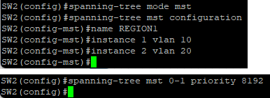
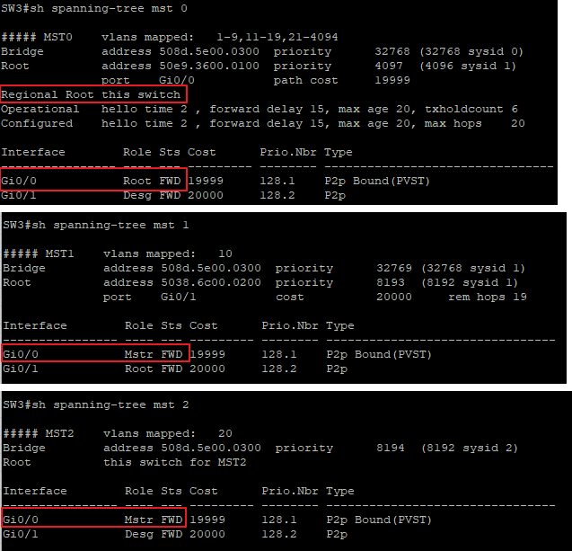

# MST and PVST+ Interoperability

[한국어](../02-MST-and-PVST-Interoperability.md) | [English](02-MST-and-PVST-Interoperability.en.md) | [日本語](02-MST-and-PVST-Interoperability.ja.md) | [简体中文](02-MST-and-PVST-Interoperability.zh-CN.md) | **Español** | [Français](02-MST-and-PVST-Interoperability.fr.md)

**MST** y **PVST+** construyen topologías de capa 2 sin bucles, pero con enfoques distintos. MST asigna varias VLAN a una instancia para reducir el número de instancias de spanning-tree, mientras que PVST+ calcula una instancia **por VLAN**. Son compatibles, pero ¿cómo deben comportarse en el enlace donde se encuentran? Esta página explica la **PVST simulation** y las comprobaciones de los puertos de límite, y luego las verifica en un laboratorio.

> Lee primero [01. Multiple Spanning-Tree (MST)](../../01-Multiple-Spanning-Tree/README/01-Multiple-Spanning-Tree.es.md) para los conceptos básicos de MST.

## Mensajes y estados que veremos en este laboratorio

| Se muestra como | Significado |
| --- | --- |
| `Bound(PVST)` | Un **puerto de límite (boundary)** conectado al lado PVST+ |
| `%SPANTREE-2-PVSTSIM_FAIL` | Ha fallado la comprobación de la PVST simulation |
| `BKN*` / `*PVST_Inc` | El puerto está bloqueado en estado **broken** (PVST inconsistency) |
| `%SPANTREE-2-PVSTSIM_OK` | La inconsistencia se ha resuelto |
| `Mstr` | El **master port** de la instancia (el puerto de límite hacia un root fuera de la región) |

---

## 1. El problema: no hay traducción 1:1

PVST+ envía **una BPDU por cada VLAN**. MST podría procesar cada una con la instancia a la que está asignada esa VLAN. Pero MST no tiene una instancia por VLAN, así que la pregunta es **qué BPDU debe enviar**.

Dos VLAN pueden compartir la misma instancia MST y, sin embargo, usar root bridges y root ports distintos en el dominio PVST+. ¿Qué información debe poner MST en sus BPDU? **Es imposible hacer una correspondencia 1:1 entre la información de MST y la de PVST+**.

### MST → PVST+: la PVST simulation

Por eso, cuando una región MST se conecta a una topología PVST+, MST imita a PVST+ con el **mecanismo de PVST simulation**:

- La región MST envía **una BPDU PVST+ por cada VLAN** en las interfaces conectadas a switches PVST+.
- Todas esas BPDU llevan **la misma información** y anuncian **el mismo root bridge**.
- Las interfaces conectadas al lado PVST+ se llaman **interfaces/puertos de límite (boundary interface/port)**.

Hablo de PVST+, pero **PVRST+ (Rapid PVST+)** también es compatible. Sin embargo, MST solo usa funciones de PVST+, así que no hay diferencia de rendimiento.

Como los switches PVST+ reciben de MST BPDU para cada VLAN con **la misma información**, toman **las mismas decisiones** de root bridge y root port en todas las VLAN.

¿De dónde sale la información de las BPDU PVST+ simuladas? Todos los switches MST de la región deben estar de acuerdo, así que MST usa **la información de la IST**. El switch elegido como root bridge de la IST en la región es también el root bridge anunciado en las BPDU PVST+.

### PVST+ → MST: la BPDU de la VLAN 1 decide el rol del puerto

¿Y en el otro sentido? MST decide el rol del puerto de la interfaz de límite (root, designated, non-designated) **para todas las VLAN a la vez, mirando solo la BPDU de la VLAN 1**.

Es arriesgado: supone que todas las VLAN usan el mismo root bridge y los mismos root ports. No sabemos si el lado PVST+ está de acuerdo con ese rol en todas las VLAN. Por eso MST hace unas **comprobaciones sencillas** para ver si PVST+ está de acuerdo. Veamos cada rol de puerto.

---

## 2. Comprobaciones en el puerto de límite

| Rol del puerto de límite | Comprobación de MST | Si falla |
| --- | --- | --- |
| Designated port | Su **BPDU de la IST** debe ser **superior a la BPDU PVST+ de cada VLAN** recibida en el puerto de límite. | broken (bloqueado) |
| Root port | Las **BPDU PVST+ de todas las VLAN salvo la VLAN 1** deben ser **idénticas o superiores a la BPDU PVST+ de la VLAN 1**. | error de inconsistencia, broken (bloqueado) |
| Non-designated port | Sin comprobación adicional (el puerto está bloqueado de todos modos) | — |

### Designated port

Para que MST use el puerto de límite como designated port, comprueba lo siguiente:

- **La BPDU MST de la IST debe ser superior a todas las BPDU PVST+ de todas las VLAN recibidas en la interfaz de límite.**

MST compara su BPDU de la IST con todas las BPDU PVST+ que recibe, una por VLAN. Si la suya es superior, PVST+ está de acuerdo con el rol, y la interfaz de límite puede convertirse en designated port con seguridad. Si no, PVST+ no está de acuerdo y la interfaz de límite se bloquea. Su estado aparece entonces como **broken**.

### Root port

La interfaz de límite puede convertirse en root port si la **BPDU de la VLAN 1** que recibe es **la mejor BPDU** de todas sus interfaces de límite. Eso significa que el root bridge de la VLAN 1 está en el **dominio PVST+**. La interfaz pasa entonces al estado forwarding para **todas las VLAN**.

Es una situación delicada. MST actúa como si todas las VLAN tuvieran su root bridge en el dominio PVST+ y convierte la interfaz de límite en root port para todas ellas, pero puede que no sea así. Por eso MST comprueba:

- **Las BPDU PVST+ de todas las VLAN excepto la VLAN 1 deben ser idénticas o superiores a la BPDU PVST+ de la VLAN 1.**

MST escucha todas las BPDU PVST+ que recibe en la interfaz de límite y comprueba que sean superiores a la BPDU de la VLAN 1. Si lo son, la interfaz de límite puede ser root port con seguridad. Si no, el switch informa de un **error de inconsistencia** y la interfaz se bloquea en estado **broken**.

Una advertencia: PVST+ usa la **system ID extension**, que mete el número de VLAN en el bridge ID. Por eso las BPDU PVST+ de VLAN distintas **nunca pueden ser idénticas**. En la práctica, las BPDU PVST+ de las VLAN que no son la 1 necesitan una priority **al menos 4096 más baja** que la de la VLAN 1.

### Non-designated port

Si la interfaz de límite recibe una BPDU PVST+ de la VLAN 1 superior a su propia BPDU de la IST, pero no lo bastante buena para ser root port, se convierte en **non-designated port para todas las VLAN**.

MST tiene que comprobar si el dominio PVST+ también la considera non-designated, cosa fácil escuchando todas las BPDU PVST+. Si son superiores a su propia BPDU, puede ser non-designated port. Los switches Cisco **no hacen ninguna comprobación adicional** aquí. Aunque una BPDU superior provocara un error de PVST inconsistency y el modo broken, el puerto está bloqueado de todos modos, así que no importa.

> **Recomendación**: lo más sencillo es diseñar la red para que la región MST sea el **root bridge**. Si el root bridge está en el dominio PVST+, MST usa el mismo root port para todas las VLAN. Si está en la región MST, puedes cambiar el cost por VLAN en los switches PVST+ para usar root ports distintos y conseguir algo de **equilibrio de carga**.

---

## 3. Montaje del laboratorio

El laboratorio usa tres switches.

SW1 ejecuta PVST+ (en la salida aparece como `protocol ieee`), y SW2 y SW3 ejecutan MST. Hay tres instancias MST (0, 1, 2) y usamos las VLAN 10 y 20. Primero configuramos las interfaces como trunk.

Añadimos las VLAN.

La configuración básica está lista.

---

## 4. Escenario 1: la región MST es el root bridge

En el primer escenario, **la región MST es el root bridge**. Las VLAN se asignan así:

- VLAN 10 → instance 1
- VLAN 20 → instance 2

SW2 se convierte en root bridge de las instancias 0 y 1.

SW3 se convierte en root bridge de la instance 2.

SW1 ejecuta PVST+ con su priority predeterminada. Veamos qué piensa cada switch de la topología.

Interesante. Como explicamos, MST envía **la información de la IST** para todas las VLAN. Así que, aunque SW3 es el root bridge de la VLAN 20, SW1 ve a **SW2** (5038.6c00.0200) como root bridge de **todas las VLAN**.

Este es SW2.

SW2 es el root bridge de la **CIST (instance 0)** y de la instance 1. El puerto de límite Gi0/0 muestra `Bound(PVST)`. Este es SW3.

En la instance 0, SW3 ve a SW2 como **root bridge y regional root bridge**; en la instance 1, SW2 también es el root bridge. En la instance 2, el root bridge es el propio SW3.

### ¿Y si SW1 pasa a ser root de una VLAN?

Hagamos ahora que SW1 sea el root bridge de la VLAN 20.

En cuanto lo hacemos, aparece este mensaje en SW2 y SW3:

**La PVST simulation falla.** Para que la interfaz de límite sea designated port, la BPDU de la IST de MST debe ser superior a todas las BPDU PVST+, y eso ya no se cumple en la VLAN 20. En consecuencia, la interfaz de límite de SW2 pasa al estado **broken**.

Y también en SW3:

Gi0/0 queda **BKN (broken) en todas las instancias/VLAN**.

Si volvemos a subir la priority de SW1 en la VLAN 20 (un valor más alto), SW2 y SW3 vuelven a ser los root bridges.

SW1 vuelve a ver la región MST como root bridge. Todas las BPDU PVST+ que reciben SW2 y SW3 son inferiores a la BPDU de la IST de MST, así que **la inconsistencia se resuelve**.

### Equilibrio de carga con el cost

Que la región MST sea el root bridge es la **buena práctica**. Es fácil de mantener y permite equilibrar la carga. Por ejemplo, para que el dominio PVST+ use otro root port en la VLAN 20, jugamos con el cost:

SW1 usa ahora Gi0/1 como root port para la VLAN 20.

**Gi0/1** es ahora el root port de la VLAN 20, mientras que las demás VLAN siguen usando **Gi0/0** como root port.

> El texto original dice "VLAN 60" y que "las demás VLAN también usan Gi0/1", pero en la salida del laboratorio la VLAN 20 usa Gi0/1 y las VLAN 1 y 10 usan Gi0/0 como root port.

---

## 5. Escenario 2: el dominio PVST+ es el root bridge

El root bridge también puede estar en el **dominio PVST+**. Veamos cómo hacerlo funcionar. Hacemos que SW1 sea el root bridge de la VLAN 1.

En cuanto cambia la priority de la VLAN 1 en SW1, SW2 empieza a quejarse.

Es la **comprobación de root port** de MST. Para ser root port, todas las BPDU PVST+ salvo la de la VLAN 1 deben ser idénticas o superiores a la BPDU PVST+ de la VLAN 1. Las VLAN 10 y 20 siguen con la priority predeterminada de 32768, así que no se cumple. Por eso SW2 pone su interfaz de límite en estado **broken**.

Este es SW3.

Gi0/0 en SW3 es un **alternate port**, así que está bloqueado de todos modos. Al principio puede confundir: SW1 es el root bridge, pero el root port de SW3 es Gi0/1, la interfaz hacia SW2. Se debe a que SW2 es el **regional root bridge**. Recuerda que MST se presenta ante PVST+ como **un único switch**. Desde el punto de vista de SW1 se ve así:

Para arreglarlo, bajamos aún más la priority en SW1 para **todas las VLAN excepto la VLAN 1**.

Esto cumple la comprobación de root port en SW2.

Ahora todo tiene buen aspecto.

La interfaz de límite está en **forwarding para todas las VLAN**: Root en la instance 0 y **Mstr (master)** en las instancias 1 y 2. Los puertos de SW3 siguen igual.

### Cambiar por dónde entra el tráfico PVST+

También puedes influir en por dónde entra el tráfico PVST+ en la región MST. Por ejemplo, hagamos que entre por SW3.

Así quedan ahora SW2 y SW3.

La salida anterior muestra dos cambios importantes:

- Gi0/0 en SW2 es ahora un **alternate port**.
- **SW3 es ahora el regional root bridge**, aunque SW2 tiene mejor priority.

SW3 pasa a ser el regional root bridge porque **el CIST regional root bridge y el IST root bridge tienen que estar en el mismo switch**. Veamos SW3.

SW3 es el regional root bridge, y su interfaz hacia SW1 está en forwarding.

---

## Resumen

- MST y PV(R)ST+ son compatibles, pero su información no se puede traducir 1:1. Por eso MST usa la **PVST simulation** para enviar **una BPDU PVST+ por VLAN** en el puerto de límite, todas con **información de la IST**.
- De PVST+ a MST, la **BPDU PVST+ de la VLAN 1** decide el rol del puerto de límite (root, designated, non-designated) para todas las VLAN.
- **Comprobación de designated port**: la BPDU de la IST debe ser superior a las BPDU PVST+ de todas las VLAN recibidas.
- **Comprobación de root port**: las BPDU PVST+ de todas las VLAN salvo la VLAN 1 deben ser idénticas o superiores a la de la VLAN 1. Por el extended system ID no pueden ser idénticas, así que hay que fijar la priority de las demás VLAN **al menos 4096 por debajo** de la VLAN 1.
- Si falla una comprobación, aparece `PVSTSIM_FAIL` y el puerto de límite pasa a **BKN (broken)**; cuando se cumple la condición, `PVSTSIM_OK` lo resuelve.
- **Que la región MST sea el root bridge es la buena práctica**, y el lado PVST+ puede equilibrar la carga con el cost por VLAN.
- El CIST regional root bridge y el IST root bridge deben ser **el mismo switch**, así que el switch por donde entra el tráfico PVST+ se convierte en el regional root.
