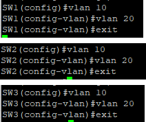
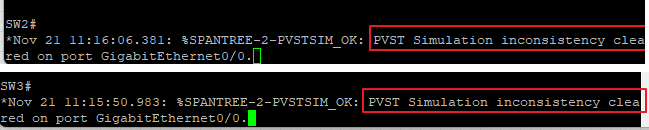
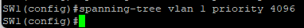

# MST and PVST+ Interoperability

[한국어](../02-MST-and-PVST-Interoperability.md) | [English](02-MST-and-PVST-Interoperability.en.md) | [日本語](02-MST-and-PVST-Interoperability.ja.md) | [简体中文](02-MST-and-PVST-Interoperability.zh-CN.md) | [Español](02-MST-and-PVST-Interoperability.es.md) | **Français**

**MST** et **PVST+** construisent tous deux des topologies de couche 2 sans boucle, mais selon des approches différentes. MST associe plusieurs VLAN à une instance pour réduire le nombre d'instances de spanning-tree, tandis que PVST+ calcule une instance **par VLAN**. Les deux sont compatibles, mais comment doivent-ils se comporter sur le lien où ils se rencontrent ? Cette page explique la **PVST simulation** et les vérifications faites sur les ports de limite, puis les observe en labo.

> Lisez d'abord [01. Multiple Spanning-Tree (MST)](../../01-Multiple-Spanning-Tree/README/01-Multiple-Spanning-Tree.fr.md) pour les bases de MST.

## Messages et états vus dans ce labo

| Affiché comme | Signification |
| --- | --- |
| `Bound(PVST)` | Un **port de limite (boundary)** connecté au côté PVST+ |
| `%SPANTREE-2-PVSTSIM_FAIL` | La vérification de la PVST simulation a échoué |
| `BKN*` / `*PVST_Inc` | Le port est bloqué à l'état **broken** (PVST inconsistency) |
| `%SPANTREE-2-PVSTSIM_OK` | L'incohérence est levée |
| `Mstr` | Le **master port** de l'instance (le port de limite vers un root hors de la région) |

---

## 1. Le problème : pas de traduction 1:1

PVST+ envoie **une BPDU par VLAN**. MST pourrait traiter chacune avec l'instance à laquelle cette VLAN est associée. Mais MST n'a pas une instance par VLAN, d'où la question : **quelles BPDU doit-il envoyer ?**

Deux VLAN peuvent partager la même instance MST tout en utilisant des root bridges et des root ports différents dans le domaine PVST+. Quelle information MST doit-il mettre dans ses BPDU ? **Une correspondance 1:1 entre les informations MST et PVST+ est impossible**.

### MST → PVST+ : la PVST simulation

Ainsi, quand une région MST se connecte à une topologie PVST+, MST imite PVST+ grâce au **mécanisme de PVST simulation** :

- La région MST envoie **une BPDU PVST+ pour chaque VLAN** sur les interfaces connectées aux commutateurs PVST+.
- Ces BPDU portent toutes **la même information** et annoncent **le même root bridge**.
- Les interfaces connectées au côté PVST+ s'appellent **interfaces/ports de limite (boundary interface/port)**.

Je parle de PVST+, mais **PVRST+ (Rapid PVST+)** est aussi pris en charge. MST n'utilise toutefois que les fonctions de PVST+, il n'y a donc aucune différence de performances.

Comme les commutateurs PVST+ reçoivent de MST des BPDU pour chaque VLAN portant **la même information**, ils prennent **les mêmes décisions** de root bridge et de root port dans toutes les VLAN.

D'où vient l'information des BPDU PVST+ simulées ? Tous les commutateurs MST de la région doivent s'accorder, donc MST utilise **l'information de l'IST**. Le commutateur élu root bridge de l'IST dans la région est aussi le root bridge annoncé dans les BPDU PVST+.

### PVST+ → MST : la BPDU de la VLAN 1 décide du rôle du port

Et dans l'autre sens ? MST décide du rôle de l'interface de limite (root, designated, non-designated) **pour toutes les VLAN à la fois, en ne regardant que la BPDU de la VLAN 1**.

C'est risqué : cela suppose que toutes les VLAN utilisent le même root bridge et les mêmes root ports. On ne sait pas si le côté PVST+ est d'accord avec ce rôle dans toutes les VLAN. MST effectue donc quelques **vérifications simples** pour savoir si PVST+ est d'accord. Passons en revue chaque rôle de port.

---

## 2. Vérifications sur le port de limite

| Rôle du port de limite | Vérification faite par MST | En cas d'échec |
| --- | --- | --- |
| Designated port | Sa **BPDU de l'IST** doit être **supérieure à la BPDU PVST+ de chaque VLAN** reçue sur le port de limite. | broken (bloqué) |
| Root port | Les **BPDU PVST+ de toutes les VLAN sauf la VLAN 1** doivent être **identiques ou supérieures à la BPDU PVST+ de la VLAN 1**. | erreur d'incohérence, broken (bloqué) |
| Non-designated port | Pas de vérification supplémentaire (le port est bloqué de toute façon) | — |

### Designated port

Pour que MST utilise le port de limite comme designated port, il vérifie :

- **La BPDU MST de l'IST doit être supérieure à toutes les BPDU PVST+ de toutes les VLAN reçues sur l'interface de limite.**

MST compare sa BPDU de l'IST à toutes les BPDU PVST+ reçues, une par VLAN. Si la sienne est supérieure, PVST+ est d'accord avec le rôle, et l'interface de limite peut devenir designated port en toute sécurité. Sinon, PVST+ n'est pas d'accord et l'interface de limite est bloquée. Son état s'affiche alors **broken**.

### Root port

L'interface de limite peut devenir root port si la **BPDU de la VLAN 1** qu'elle reçoit est **la meilleure BPDU** de toutes ses interfaces de limite. Cela signifie que le root bridge de la VLAN 1 se trouve dans le **domaine PVST+**. L'interface passe alors à l'état forwarding pour **toutes les VLAN**.

C'est une situation délicate. MST fait comme si toutes les VLAN avaient leur root bridge dans le domaine PVST+ et transforme l'interface de limite en root port pour toutes, ce qui n'est peut-être pas le cas. MST vérifie donc :

- **Les BPDU PVST+ de toutes les VLAN sauf la VLAN 1 doivent être identiques ou supérieures à la BPDU PVST+ de la VLAN 1.**

MST écoute toutes les BPDU PVST+ reçues sur l'interface de limite et vérifie qu'elles sont supérieures à la BPDU de la VLAN 1. Si c'est le cas, l'interface de limite peut devenir root port en toute sécurité. Sinon, le commutateur signale une **erreur d'incohérence** et l'interface est bloquée à l'état **broken**.

Une mise en garde : PVST+ utilise la **system ID extension**, qui intègre le numéro de VLAN dans le bridge ID. Les BPDU PVST+ de VLAN différentes **ne peuvent donc jamais être identiques**. En pratique, les BPDU PVST+ des VLAN autres que la 1 doivent avoir une priority **inférieure d'au moins 4096** à celle de la VLAN 1.

### Non-designated port

Si l'interface de limite reçoit une BPDU PVST+ de la VLAN 1 supérieure à sa propre BPDU de l'IST, mais pas assez bonne pour devenir root port, elle devient **non-designated port pour toutes les VLAN**.

MST doit vérifier que le domaine PVST+ la considère aussi comme non-designated, ce qu'il fait facilement en écoutant toutes les BPDU PVST+. Si elles sont supérieures à sa propre BPDU, elle peut devenir non-designated port. Les commutateurs Cisco **ne font aucune vérification supplémentaire** ici. Même si une BPDU supérieure provoquait une erreur de PVST inconsistency et le mode broken, le port est bloqué de toute façon, donc cela n'a pas d'importance.

> **Recommandation** : le plus simple est de concevoir le réseau pour que la région MST soit le **root bridge**. Si le root bridge est dans le domaine PVST+, MST utilise le même root port pour toutes les VLAN. S'il est dans la région MST, on peut modifier le cost par VLAN sur les commutateurs PVST+ pour utiliser des root ports différents et obtenir une certaine **répartition de charge**.

---

## 3. Mise en place du labo

Le labo utilise trois commutateurs.

SW1 exécute PVST+ (affiché `protocol ieee` dans la sortie), et SW2 et SW3 exécutent MST. Il y a trois instances MST (0, 1, 2) et nous utilisons les VLAN 10 et 20. D'abord, configurons les interfaces en trunk.

Ajoutons les VLAN.

La configuration de base est prête.

---

## 4. Scénario 1 : la région MST est le root bridge

Dans le premier scénario, **la région MST est le root bridge**. Les VLAN sont associées ainsi :

- VLAN 10 → instance 1
- VLAN 20 → instance 2

SW2 devient le root bridge des instances 0 et 1.

SW3 devient le root bridge de l'instance 2.

SW1 exécute PVST+ avec sa priority par défaut. Voyons ce que chaque commutateur pense de la topologie.

Intéressant. Comme expliqué plus haut, MST envoie **l'information de l'IST** pour toutes les VLAN. Ainsi, même si SW3 est le root bridge de la VLAN 20, SW1 voit **SW2** (5038.6c00.0200) comme root bridge de **toutes les VLAN**.

Voici SW2.

SW2 est le root bridge de la **CIST (instance 0)** et de l'instance 1. Le port de limite Gi0/0 affiche `Bound(PVST)`. Voici SW3.

Dans l'instance 0, SW3 voit SW2 comme **root bridge et regional root bridge** ; dans l'instance 1, SW2 est aussi le root bridge. Dans l'instance 2, c'est SW3 lui-même qui est root bridge.

### Et si SW1 devient root d'une VLAN ?

Faisons maintenant de SW1 le root bridge de la VLAN 20.

Aussitôt, ce message apparaît sur SW2 et SW3 :

**La PVST simulation échoue.** Pour que l'interface de limite soit designated port, la BPDU de l'IST de MST doit être supérieure à toutes les BPDU PVST+, ce qui n'est plus vrai pour la VLAN 20. L'interface de limite de SW2 passe donc à l'état **broken**.

Ainsi que sur SW3 :

Gi0/0 est **BKN (broken) pour toutes les instances/VLAN**.

Si l'on remonte la priority de SW1 pour la VLAN 20 (valeur plus élevée), SW2 et SW3 redeviennent les root bridges.

SW1 voit de nouveau la région MST comme root bridge. Toutes les BPDU PVST+ reçues par SW2 et SW3 sont inférieures à la BPDU de l'IST de MST, donc **l'incohérence est levée**.

### Répartition de charge avec le cost

Faire de la région MST le root bridge est la **bonne pratique**. C'est simple à maintenir et cela permet de répartir la charge. Par exemple, pour que le domaine PVST+ utilise un autre root port pour la VLAN 20, on joue sur le cost :

SW1 utilise maintenant Gi0/1 comme root port pour la VLAN 20.

**Gi0/1** est désormais le root port de la VLAN 20, tandis que les autres VLAN utilisent toujours **Gi0/0** comme root port.

> Le texte d'origine indique « VLAN 60 » et « les autres VLAN utilisent aussi Gi0/1 », mais dans la sortie du labo la VLAN 20 utilise Gi0/1 et les VLAN 1 et 10 utilisent Gi0/0 comme root port.

---

## 5. Scénario 2 : le domaine PVST+ est le root bridge

Le root bridge peut aussi se trouver dans le **domaine PVST+**. Voyons comment faire. Faisons de SW1 le root bridge de la VLAN 1.

Dès que la priority de la VLAN 1 change sur SW1, SW2 commence à se plaindre.

C'est la **vérification du root port** de MST. Pour devenir root port, toutes les BPDU PVST+ sauf celle de la VLAN 1 doivent être identiques ou supérieures à la BPDU PVST+ de la VLAN 1. Les VLAN 10 et 20 ont encore la priority par défaut de 32768, la condition n'est donc pas remplie. SW2 place par conséquent son interface de limite à l'état **broken**.

Voici SW3.

Gi0/0 sur SW3 est un **alternate port**, il est donc bloqué de toute façon. Cela peut surprendre au début : SW1 est le root bridge, mais le root port de SW3 est Gi0/1, l'interface vers SW2. C'est parce que SW2 est le **regional root bridge**. Rappelez-vous que MST se présente à PVST+ comme **un seul commutateur**. Du point de vue de SW1, cela ressemble à ceci :

Pour corriger cela, abaissons encore la priority sur SW1 pour **toutes les VLAN sauf la VLAN 1**.

La vérification du root port sur SW2 est maintenant satisfaite.

Tout est rentré dans l'ordre.

L'interface de limite est en **forwarding pour toutes les VLAN** : Root dans l'instance 0 et **Mstr (master)** dans les instances 1 et 2. Les ports de SW3 restent les mêmes.

### Changer le point d'entrée du trafic PVST+

On peut aussi influencer l'endroit par où le trafic PVST+ entre dans la région MST. Par exemple, faisons-le entrer par SW3.

Voici maintenant SW2 et SW3.

La sortie ci-dessus montre deux changements importants :

- Gi0/0 sur SW2 est maintenant un **alternate port**.
- **SW3 est maintenant le regional root bridge**, alors que SW2 a une meilleure priority.

SW3 devient le regional root bridge parce que **le CIST regional root bridge et l'IST root bridge doivent être le même commutateur**. Regardons SW3.

SW3 est le regional root bridge, et son interface vers SW1 est en forwarding.

---

## Résumé

- MST et PV(R)ST+ sont compatibles, mais leurs informations ne se traduisent pas 1:1. MST utilise donc la **PVST simulation** pour envoyer **une BPDU PVST+ par VLAN** sur le port de limite, toutes remplies avec **l'information de l'IST**.
- De PVST+ vers MST, la **BPDU PVST+ de la VLAN 1** décide du rôle du port de limite (root, designated, non-designated) pour toutes les VLAN.
- **Vérification du designated port** : la BPDU de l'IST doit être supérieure aux BPDU PVST+ de toutes les VLAN reçues.
- **Vérification du root port** : les BPDU PVST+ de toutes les VLAN sauf la VLAN 1 doivent être identiques ou supérieures à celle de la VLAN 1. À cause de l'extended system ID elles ne peuvent pas être identiques, il faut donc régler la priority des autres VLAN **au moins 4096 plus bas** que la VLAN 1.
- En cas d'échec, `PVSTSIM_FAIL` apparaît et le port de limite passe **BKN (broken)** ; une fois la condition remplie, `PVSTSIM_OK` lève l'incohérence.
- **Faire de la région MST le root bridge est la bonne pratique**, et le côté PVST+ peut répartir la charge avec un cost par VLAN.
- Le CIST regional root bridge et l'IST root bridge doivent être **le même commutateur** ; le commutateur par lequel entre le trafic PVST+ devient donc le regional root.
