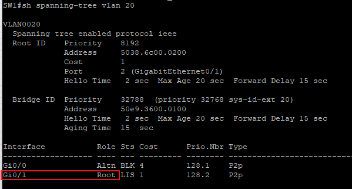
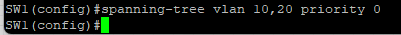
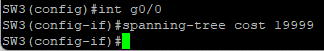

# MST and PVST+ Interoperability

[한국어](../02-MST-and-PVST-Interoperability.md) | [English](02-MST-and-PVST-Interoperability.en.md) | **日本語** | [简体中文](02-MST-and-PVST-Interoperability.zh-CN.md) | [Español](02-MST-and-PVST-Interoperability.es.md) | [Français](02-MST-and-PVST-Interoperability.fr.md)

**MST** と **PVST+** はどちらもループのない L2 トポロジーを作りますが、アプローチが違います。MST は複数の VLAN を 1 つのインスタンスに対応付けて spanning-tree インスタンスの数を減らし、PVST+ は **VLAN ごと**にインスタンスを 1 つずつ計算します。両者は互換性がありますが、2 つのプロトコルが出会うリンクではどう動作すべきでしょうか？ このページでは **PVST simulation** と境界ポートのチェックを整理し、実習で確認します。

> MST の基本は [01. Multiple Spanning-Tree (MST)](../../01-Multiple-Spanning-Tree/README/01-Multiple-Spanning-Tree.ja.md) を先に読んでください。

## この実習で見るメッセージと状態

| 表示 | 意味 |
| --- | --- |
| `Bound(PVST)` | PVST+ 側とつながる**境界（boundary）ポート** |
| `%SPANTREE-2-PVSTSIM_FAIL` | PVST simulation のチェックに失敗 |
| `BKN*` / `*PVST_Inc` | ポートが **broken** 状態でブロックされている（PVST inconsistency） |
| `%SPANTREE-2-PVSTSIM_OK` | inconsistency が解消された |
| `Mstr` | インスタンスの **Master port**（region 外の root に向かう境界ポート） |

---

## 1. 問題: 情報を 1:1 で変換できない

PVST+ は **VLAN ごとに BPDU** を送ります。MST は受け取った BPDU を、その VLAN が対応付けられたインスタンスで個別に処理できます。しかし MST には VLAN ごとのインスタンスがあるわけではないので、**どんな BPDU を送るべきか**が問題になります。

2 つの VLAN が MST では同じインスタンスを使っていても、PVST+ 側ではそれぞれ別の root bridge や root port を使っているかもしれません。では MST は BPDU にどの情報を入れればよいのでしょうか？ MST と PVST+ の情報を **1:1 で対応させることは不可能**です。

### MST → PVST+: PVST simulation

そこで MST region が PVST+ トポロジーとつながると、MST は **PVST simulation mechanism** で PVST+ をまねます。

- MST region は、PVST+ スイッチとつながるインターフェイスに **VLAN ごとの PVST+ BPDU** を送ります。
- これらの BPDU はすべて**同じ情報**を持ち、**同じ root bridge** を通知します。
- PVST+ 側とつながるインターフェイスを**境界インターフェイス/ポート（boundary interface/port）** と呼びます。

PVST+ と書いていますが、**PVRST+（Rapid PVST+）** もサポートされます。ただし MST は PVST+ の機能しか使わないので、性能の差はありません。

PVST+ スイッチは MST から VLAN ごとに**同じ情報の BPDU** を受け取るので、すべての VLAN で root bridge や root port を**同じように**選びます。

では、MST が simulated PVST+ BPDU に入れる情報はどこから来るのでしょうか？ region 内のすべての MST スイッチが同じ情報に合意する必要があるので、**IST の情報**を使います。region 内で IST の root bridge に選ばれたスイッチが、PVST+ BPDU でも root bridge として使われます。

### PVST+ → MST: VLAN 1 の BPDU でポートの役割を決める

逆方向はどうでしょうか？ MST は境界インターフェイスのポートの役割（root、designated、non-designated）を、**VLAN 1 の BPDU の情報だけを見て、すべての VLAN について**一度に決めます。

これは危険です。すべての VLAN が同じ root bridge や root port を使うと仮定していることになるからです。PVST+ 側がすべての VLAN でこのポートの役割に同意しているかはわかりません。そこで MST は、PVST+ が同意しているかを確かめる**簡単なチェック**を行います。ポートの役割ごとに見ていきましょう。

---

## 2. 境界ポートのチェック

| 境界ポートの役割 | MST が行うチェック | 失敗すると |
| --- | --- | --- |
| Designated port | 自分の **IST BPDU** が、境界ポートで受け取った**すべての VLAN の PVST+ BPDU より superior** でなければなりません。 | broken（ブロック） |
| Root port | **VLAN 1 以外のすべての VLAN の PVST+ BPDU** が、**VLAN 1 の PVST+ BPDU と同じか superior** でなければなりません。 | inconsistency エラー、broken（ブロック） |
| Non-designated port | 追加チェックなし（もともとブロックされるポート） | — |

### Designated port

MST が境界ポートを designated port として使うには、次の条件を確認します。

- **IST の MST BPDU が、境界インターフェイスで受け取ったすべての VLAN の PVST+ BPDU より superior** でなければなりません。

MST は自分の IST BPDU を、VLAN ごとに受け取った PVST+ BPDU とすべて比較します。自分の BPDU が superior なら、PVST+ もこのポートの役割に同意しているということなので、境界インターフェイスを安全に designated port にします。そうでなければ PVST+ が同意していないということなので、境界インターフェイスをブロックします。このときインターフェイスの状態は **broken** と表示されます。

### Root port

境界インターフェイスが受け取った **VLAN 1 の BPDU** が、すべての境界インターフェイスの中で**最もよい BPDU** なら root port になれます。つまり VLAN 1 の root bridge が **PVST+ ドメイン**にあるということです。このときインターフェイスは**すべての VLAN** で Forwarding 状態になります。

これは厄介な状況です。MST はすべての VLAN の root bridge が PVST+ ドメインにあるとみなして境界インターフェイスをすべての VLAN の root port にしますが、実際はそうでないかもしれません。そこで MST は次のチェックをします。

- **VLAN 1 以外のすべての VLAN の PVST+ BPDU が、VLAN 1 の PVST+ BPDU と同じか superior** でなければなりません。

MST は境界インターフェイスで受け取ったすべての PVST+ BPDU が VLAN 1 の BPDU より superior かを確認します。そうであれば境界インターフェイスを安全に root port にします。そうでなければ **inconsistency エラー**を報告し、インターフェイスをブロックして **broken** 状態にします。

注意点が 1 つあります。PVST+ は **system ID extension** を使い、VLAN 番号を bridge ID に入れます。そのため VLAN が違えば PVST+ BPDU の値が**同じになることはありません**。結局、VLAN 1 以外の VLAN の PVST+ BPDU は、priority を VLAN 1 より**少なくとも 4096 低く**する必要があります。

### Non-designated port

境界インターフェイスが自分の IST BPDU より superior な VLAN 1 の PVST+ BPDU を受け取ったものの、root port になるほどよくはない場合、**すべての VLAN で non-designated port** になります。

MST は PVST+ ドメインもこのポートを non-designated と見ているかを確認する必要がありますが、すべての PVST+ BPDU を聞けば簡単にわかります。PVST+ BPDU が自分の BPDU より superior なら non-designated port になれます。Cisco スイッチはここで**追加のチェックをしません**。仮に superior な BPDU を受け取って PVST inconsistency エラーで broken になっても、もともとブロックされているポートなので問題ありません。

> **推奨**: MST region がネットワークの **root bridge** になるように構成するのがいちばん簡単です。PVST+ ドメインに root bridge があると、MST はすべての VLAN で同じ root port を使います。root bridge が MST region にあれば、PVST+ スイッチで VLAN ごとに cost を変えて別の root port を使わせ、**負荷分散**ができます。

---

## 3. 実習の構成

実習ではスイッチを 3 台使います。

SW1 は PVST+ で動作し（出力では `protocol ieee` と表示）、SW2 と SW3 は MST で動作します。MST インスタンスは 0、1、2 の 3 つで、VLAN 10 と 20 を使います。まずインターフェイスを trunk に設定します。

VLAN を追加します。

基本の構成ができました。

---

## 4. シナリオ 1: MST region が root bridge

最初のシナリオでは **MST region を root bridge** にします。VLAN は次のように対応付けます。

- VLAN 10 → instance 1
- VLAN 20 → instance 2

SW2 は instance 0 と 1 の root bridge になります。

SW3 は instance 2 の root bridge になります。

SW1 は既定の priority のまま PVST+ で動作します。各スイッチから見たトポロジーを確認します。

興味深い結果です。前に説明したとおり、MST はすべての VLAN に **IST の情報**を送ります。そのため VLAN 20 の root bridge が SW3 であっても、SW1 は**すべての VLAN で SW2**（5038.6c00.0200）を root bridge と見ています。

SW2 を見てみます。

SW2 は **CIST（instance 0）** と instance 1 の root bridge です。境界ポート Gi0/0 には `Bound(PVST)` と表示されます。SW3 も見てみます。

SW3 は instance 0 で SW2 を **root bridge かつ regional root bridge** と見ており、instance 1 でも SW2 を root bridge と見ています。instance 2 では SW3 自身が root bridge です。

### SW1 を 1 つの VLAN の root bridge にすると？

では SW1 を VLAN 20 の root bridge にしてみます。

すぐに SW2 と SW3 に次のメッセージが出ます。

**PVST simulation が失敗**しました。境界インターフェイスが designated port になるには MST IST BPDU がすべての PVST+ BPDU より superior でなければなりませんが、いまは VLAN 20 でそうなっていません。その結果、SW2 の境界インターフェイスは **broken** 状態になります。

SW3 も同じです。

Gi0/0 は**すべてのインスタンス/VLAN で BKN（broken）** 状態になります。

SW1 の VLAN 20 の priority を再び上げると（値を大きくすると）、SW2 と SW3 がまた root bridge になります。

SW1 は再び MST region を root bridge と見ます。SW2 と SW3 が受け取るすべての PVST+ BPDU が MST IST BPDU より inferior になったので、**inconsistency が解消**されます。

### cost で負荷分散する

MST region を root bridge にしておくのが **best practice** です。管理が簡単で、負荷分散もできます。たとえば PVST+ ドメインに VLAN 20 だけ別の root port を使わせたい場合は、cost を調整します。

SW1 は VLAN 20 で Gi0/1 を root port として使います。

VLAN 20 の root port は **Gi0/1** になり、ほかの VLAN は引き続き **Gi0/0** を root port として使っています。

> 原文には「VLAN 60」「ほかの VLAN も Gi0/1」とありますが、実習出力では VLAN 20 が Gi0/1、VLAN 1 と 10 が Gi0/0 を root port にしています。

---

## 5. シナリオ 2: PVST+ ドメインが root bridge

root bridge を **PVST+ ドメイン**に置くこともできます。やり方を見てみましょう。SW1 を VLAN 1 の root bridge にします。

SW1 の VLAN 1 の priority を変えたとたん、SW2 が警告を出します。

MST の **root port チェック**のためです。root port になるには、VLAN 1 以外のすべての PVST+ BPDU が VLAN 1 の PVST+ BPDU と同じか superior でなければなりません。ところが VLAN 10 と 20 はまだ既定の priority 32768 なので、条件を満たしません。そのため SW2 は境界インターフェイスを **broken** 状態にしています。

SW3 を見てみます。

SW3 の Gi0/0 は **alternate port** なので、どのみちブロックされています。最初は混乱するかもしれません。SW1 が root bridge なのに、SW3 の root port は SW2 につながる Gi0/1 です。これは SW2 が **regional root bridge** だからです。MST は PVST+ 側に**スイッチ 1 台**として見えることを思い出すとわかりやすいでしょう。SW1 から見ると次のようになります。

これを解決するには、SW1 で **VLAN 1 以外のすべての VLAN** の priority をさらに下げます。

これで SW2 の root port チェックを満たします。

状態が正常に戻りました。

境界インターフェイスは**すべての VLAN で Forwarding** 状態です。instance 0 では Root、instance 1 と 2 では **Mstr（Master）** と表示されます。SW3 のポートはそのままです。

### PVST+ のトラフィックが入る場所を変える

PVST+ 側のトラフィックが MST region に入る場所も変えられます。たとえば SW3 から入るようにしてみます。

SW2 と SW3 はこうなりました。

上の出力には重要な変化が 2 つあります。

- SW2 の Gi0/0 が **alternate port** になりました。
- SW2 のほうが priority がよいのに、**SW3 が regional root bridge** になりました。

SW3 が regional root bridge になったのは、**CIST regional root bridge と IST root bridge が同じスイッチでなければならない**からです。SW3 を見てみます。

SW3 が regional root bridge で、SW1 につながるインターフェイスが Forwarding 状態です。

---

## まとめ

- MST と PV(R)ST+ は互換性がありますが、情報を 1:1 で変換できません。そこで MST は **PVST simulation** で境界ポートに **VLAN ごとの PVST+ BPDU** を送り、その中身はすべて **IST の情報**です。
- PVST+ → MST の方向では、**VLAN 1 の PVST+ BPDU** で境界ポートの役割（root、designated、non-designated）をすべての VLAN について決めます。
- **Designated port のチェック**: IST BPDU が、受け取ったすべての VLAN の PVST+ BPDU より superior でなければなりません。
- **Root port のチェック**: VLAN 1 以外のすべての VLAN の PVST+ BPDU が VLAN 1 の BPDU と同じか superior でなければなりません。extended system ID のため同じにはできないので、ほかの VLAN の priority を VLAN 1 より**少なくとも 4096 低く**設定します。
- チェックに失敗すると `PVSTSIM_FAIL` とともに境界ポートが **BKN（broken）** になり、条件を満たすと `PVSTSIM_OK` で解消されます。
- **MST region を root bridge にするのが best practice** です。PVST+ 側で VLAN ごとの cost による負荷分散もできます。
- CIST regional root bridge と IST root bridge は**同じスイッチ**でなければならないので、PVST+ のトラフィックが入るスイッチが regional root になります。
