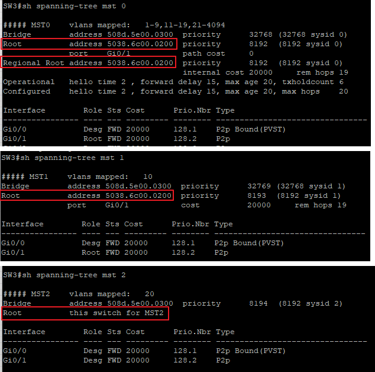
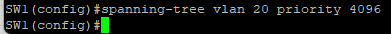
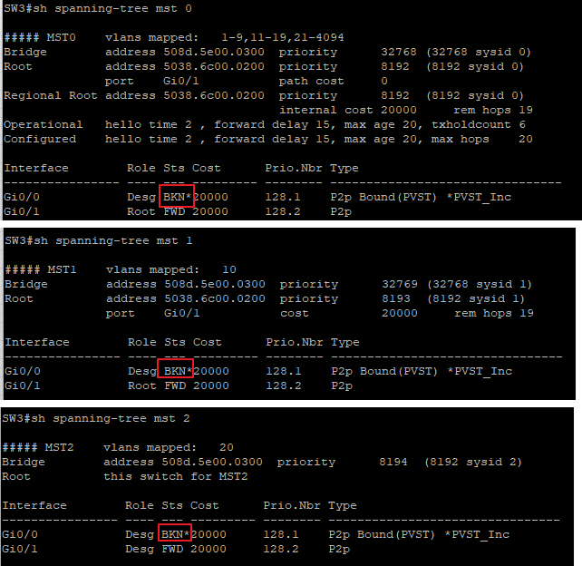
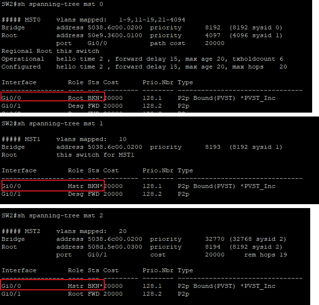
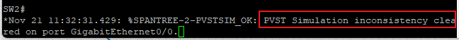
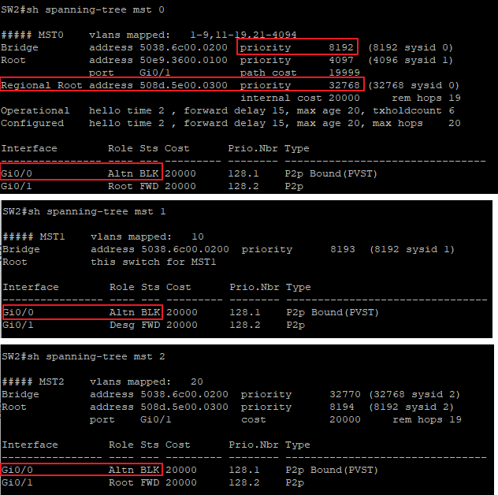

# MST and PVST+ Interoperability

[한국어](../02-MST-and-PVST-Interoperability.md) | [English](02-MST-and-PVST-Interoperability.en.md) | [日本語](02-MST-and-PVST-Interoperability.ja.md) | **简体中文** | [Español](02-MST-and-PVST-Interoperability.es.md) | [Français](02-MST-and-PVST-Interoperability.fr.md)

**MST** 和 **PVST+** 都能构建无环的二层拓扑，但方法不同。MST 把多个 VLAN 映射到一个实例，以减少 spanning-tree 实例的数量；PVST+ 则**为每个 VLAN** 计算一个实例。两者是兼容的，但在两种协议相遇的链路上应该怎样工作呢？本文介绍 **PVST simulation** 和边界端口上的检查规则，并通过实验进行确认。

> MST 的基本概念请先阅读 [01. Multiple Spanning-Tree (MST)](../../01-Multiple-Spanning-Tree/README/01-Multiple-Spanning-Tree.zh-CN.md)。

## 本实验中看到的消息和状态

| 显示 | 含义 |
| --- | --- |
| `Bound(PVST)` | 连接 PVST+ 一侧的**边界（boundary）端口** |
| `%SPANTREE-2-PVSTSIM_FAIL` | PVST simulation 检查失败 |
| `BKN*` / `*PVST_Inc` | 端口以 **broken** 状态被阻塞（PVST inconsistency） |
| `%SPANTREE-2-PVSTSIM_OK` | inconsistency 已解除 |
| `Mstr` | 实例的 **Master port**（通往 region 外 root 的边界端口） |

---

## 1. 问题：信息无法一一对应

PVST+ 会**为每个 VLAN 发送 BPDU**。MST 可以用该 VLAN 所映射的实例分别处理收到的 BPDU。但是 MST 并没有为每个 VLAN 准备实例，所以问题在于**它应该发送什么样的 BPDU**。

两个 VLAN 在 MST 中可能共用同一个实例，而在 PVST+ 一侧却使用不同的 root bridge 和 root port。那么 MST 应该在 BPDU 中放入哪些信息呢？在 MST 与 PVST+ 的信息之间**建立一一对应是不可能的**。

### MST → PVST+：PVST simulation

因此，当 MST region 连接到 PVST+ 拓扑时，MST 会用 **PVST simulation mechanism** 来模拟 PVST+：

- MST region 在连接 PVST+ 交换机的接口上**为每个 VLAN 发送 PVST+ BPDU**。
- 这些 BPDU 全部携带**相同的信息**，通告**同一个 root bridge**。
- 连接 PVST+ 一侧的接口称为**边界接口/端口（boundary interface/port）**。

这里说的是 PVST+，但 **PVRST+（Rapid PVST+）** 也同样支持。不过 MST 只使用 PVST+ 的功能，所以性能上没有区别。

PVST+ 交换机从 MST 收到每个 VLAN 的 BPDU，而且**信息都相同**，所以它们在所有 VLAN 中选择 root bridge 和 root port 的结果也**完全一样**。

那么 MST 在模拟的 PVST+ BPDU 中放入的信息从何而来？region 内所有 MST 交换机必须就同一份信息达成一致，因此使用 **IST 的信息**。在 region 内被选为 IST root bridge 的交换机，也会在 PVST+ BPDU 中作为 root bridge。

### PVST+ → MST：由 VLAN 1 的 BPDU 决定端口角色

反方向呢？MST **只看 VLAN 1 BPDU 的信息，一次性为所有 VLAN** 决定边界接口的端口角色（root、designated、non-designated）。

这样做有风险：相当于假设所有 VLAN 都使用相同的 root bridge 和 root port。我们并不知道 PVST+ 一侧是否在所有 VLAN 中都同意这个端口角色。因此，MST 会做一些**简单的检查**，确认 PVST+ 是否同意。下面逐一看看每种端口角色。

---

## 2. 边界端口的检查规则

| 边界端口角色 | MST 进行的检查 | 失败时 |
| --- | --- | --- |
| Designated port | 自己的 **IST BPDU** 必须**优于（superior）**在边界端口上收到的**所有 VLAN 的 PVST+ BPDU**。 | broken（阻塞） |
| Root port | **除 VLAN 1 外所有 VLAN 的 PVST+ BPDU** 必须**与 VLAN 1 的 PVST+ BPDU 相同或更优**。 | inconsistency 错误，broken（阻塞） |
| Non-designated port | 不做额外检查（端口本来就被阻塞） | — |

### Designated port

MST 想把边界端口用作 designated port 时，会检查以下条件：

- **IST 的 MST BPDU 必须优于在边界接口上收到的所有 VLAN 的 PVST+ BPDU。**

MST 会把自己的 IST BPDU 与每个 VLAN 收到的 PVST+ BPDU 逐一比较。如果自己的 BPDU 更优，说明 PVST+ 也同意这个端口角色，于是可以放心地把边界接口设为 designated port。否则说明 PVST+ 不同意，于是阻塞边界接口。此时接口状态显示为 **broken**。

### Root port

如果边界接口收到的 **VLAN 1 BPDU** 是所有边界接口中**最好的 BPDU**，它就可以成为 root port。也就是说，VLAN 1 的 root bridge 位于 **PVST+ 域**中。此时接口会在**所有 VLAN** 中进入转发状态。

这是个棘手的情况。MST 认为所有 VLAN 的 root bridge 都在 PVST+ 域中，于是把边界接口设为所有 VLAN 的 root port，但实际情况可能并非如此。为此，MST 会检查：

- **除 VLAN 1 外，所有 VLAN 的 PVST+ BPDU 必须与 VLAN 1 的 PVST+ BPDU 相同或更优。**

MST 会监听边界接口上收到的所有 PVST+ BPDU，检查它们是否优于 VLAN 1 的 BPDU。如果是，就可以放心地把边界接口设为 root port。否则交换机会报告 **inconsistency 错误**，阻塞接口并显示 **broken** 状态。

需要注意一点：PVST+ 使用 **system ID extension**，把 VLAN 号放进 bridge ID。因此不同 VLAN 的 PVST+ BPDU **不可能完全相同**。实际上，非 VLAN 1 的 PVST+ BPDU 的 priority 至少要比 VLAN 1 **低 4096**。

### Non-designated port

如果边界接口收到的 VLAN 1 PVST+ BPDU 优于自己的 IST BPDU，但又没有好到可以成为 root port，它就会在**所有 VLAN 中成为 non-designated port**。

MST 需要确认 PVST+ 域是否也把这个端口视为 non-designated，只要监听所有 PVST+ BPDU 就能很容易地确认。如果 PVST+ BPDU 优于自己的 BPDU，就可以成为 non-designated port。Cisco 交换机在这里**不做额外检查**。即使收到了更优的 BPDU 导致 PVST inconsistency 错误并进入 broken 状态，端口反正已被阻塞，也没有关系。

> **建议**：最简单的做法是把网络设计成由 MST region 担任 **root bridge**。如果 root bridge 在 PVST+ 域中，MST 会对所有 VLAN 使用同一个 root port。如果 root bridge 在 MST region 中，就可以在 PVST+ 交换机上按 VLAN 调整 cost，使用不同的 root port，实现一定的**负载均衡**。

---

## 3. 实验配置

实验使用三台交换机。

SW1 运行 PVST+（输出中显示为 `protocol ieee`），SW2 和 SW3 运行 MST。共有 0、1、2 三个 MST 实例，使用 VLAN 10 和 20。首先把接口配置为 trunk。

添加 VLAN。

基本配置完成。

---

## 4. 场景 1：MST region 是 root bridge

第一个场景中，**由 MST region 担任 root bridge**。VLAN 映射如下：

- VLAN 10 → instance 1
- VLAN 20 → instance 2

SW2 成为 instance 0 和 1 的 root bridge。

SW3 成为 instance 2 的 root bridge。

SW1 使用默认 priority 运行 PVST+。查看每台交换机眼中的拓扑。

结果很有意思。正如前面所说，MST 对所有 VLAN 发送的都是 **IST 的信息**。所以即使 VLAN 20 的 root bridge 是 SW3，SW1 在**所有 VLAN 中都把 SW2**（5038.6c00.0200）视为 root bridge。

来看 SW2。

SW2 是 **CIST（instance 0）** 和 instance 1 的 root bridge。边界端口 Gi0/0 显示 `Bound(PVST)`。再看 SW3。

在 instance 0 中，SW3 把 SW2 视为 **root bridge 兼 regional root bridge**；在 instance 1 中也把 SW2 视为 root bridge。在 instance 2 中，SW3 自己就是 root bridge。

### 让 SW1 成为某个 VLAN 的 root bridge 会怎样？

现在把 SW1 设为 VLAN 20 的 root bridge。

SW2 和 SW3 上立刻出现以下消息：

**PVST simulation 失败了。** 边界接口要成为 designated port，MST IST BPDU 必须优于所有 PVST+ BPDU，而现在在 VLAN 20 上不再如此。因此，SW2 的边界接口进入了 **broken** 状态。

SW3 也一样：

Gi0/0 在**所有实例/VLAN 中都处于 BKN（broken）** 状态。

再次提高 SW1 在 VLAN 20 中的 priority（把数值调大），SW2 和 SW3 就会重新成为 root bridge。

SW1 重新把 MST region 视为 root bridge。SW2 和 SW3 收到的所有 PVST+ BPDU 都劣于 MST IST BPDU，所以 **inconsistency 被解除**。

### 用 cost 实现负载均衡

让 MST region 担任 root bridge 是 **best practice**。维护简单，还能实现负载均衡。例如，想让 PVST+ 域在 VLAN 20 中使用另一个 root port，可以调整 cost：

SW1 在 VLAN 20 中使用 Gi0/1 作为 root port。

VLAN 20 的 root port 变成了 **Gi0/1**，其他 VLAN 仍然使用 **Gi0/0** 作为 root port。

> 原文写的是“VLAN 60”和“其他 VLAN 也使用 Gi0/1”，但实验输出中 VLAN 20 使用 Gi0/1，VLAN 1 和 10 使用 Gi0/0 作为 root port。

---

## 5. 场景 2：PVST+ 域是 root bridge

root bridge 也可以位于 **PVST+ 域**中。来看看如何实现。把 SW1 设为 VLAN 1 的 root bridge。

SW1 的 VLAN 1 priority 一改，SW2 就开始报警。

这是 MST 的 **root port 检查**造成的。要成为 root port，除 VLAN 1 外的所有 PVST+ BPDU 必须与 VLAN 1 的 PVST+ BPDU 相同或更优。而 VLAN 10 和 20 仍是默认 priority 32768，不满足条件。因此 SW2 把边界接口置于 **broken** 状态。

来看 SW3。

SW3 的 Gi0/0 是 **alternate port**，本来就被阻塞。一开始可能会让人困惑：SW1 是 root bridge，但 SW3 的 root port 却是连接 SW2 的 Gi0/1。这是因为 SW2 是 **regional root bridge**。记住，MST 在 PVST+ 一侧表现为**一台交换机**，就容易理解了。从 SW1 的角度看是这样的：

要解决这个问题，需要在 SW1 上把**除 VLAN 1 外所有 VLAN** 的 priority 再调低。

这样就满足了 SW2 上的 root port 检查。

现在一切正常。

边界接口在**所有 VLAN 中都处于转发**状态：在 instance 0 中为 Root，在 instance 1 和 2 中显示为 **Mstr（Master）**。SW3 的端口保持不变。

### 改变 PVST+ 流量进入的位置

还可以影响 PVST+ 流量进入 MST region 的位置。例如，让它从 SW3 进入。

现在 SW2 和 SW3 变成了这样：

上面的输出中有两个重要变化：

- SW2 的 Gi0/0 现在是 **alternate port**。
- 尽管 SW2 的 priority 更好，**SW3 却成为了 regional root bridge**。

SW3 成为 regional root bridge，是因为 **CIST regional root bridge 和 IST root bridge 必须是同一台交换机**。来看 SW3。

SW3 是 regional root bridge，它连接 SW1 的接口处于转发状态。

---

## 总结

- MST 与 PV(R)ST+ 是兼容的，但信息无法一一转换。所以 MST 通过 **PVST simulation** 在边界端口上**为每个 VLAN 发送 PVST+ BPDU**，内容全部来自 **IST 的信息**。
- 在 PVST+ → MST 方向，由 **VLAN 1 的 PVST+ BPDU** 为所有 VLAN 决定边界端口的角色（root、designated、non-designated）。
- **Designated port 检查**：IST BPDU 必须优于收到的所有 VLAN 的 PVST+ BPDU。
- **Root port 检查**：除 VLAN 1 外所有 VLAN 的 PVST+ BPDU 必须与 VLAN 1 的 BPDU 相同或更优。由于 extended system ID 无法做到相同，所以要把其他 VLAN 的 priority 设得比 VLAN 1 **至少低 4096**。
- 检查失败时出现 `PVSTSIM_FAIL`，边界端口变为 **BKN（broken）**；满足条件后由 `PVSTSIM_OK` 解除。
- **让 MST region 担任 root bridge 是 best practice**，PVST+ 一侧还能按 VLAN 调整 cost 实现负载均衡。
- CIST regional root bridge 和 IST root bridge 必须是**同一台交换机**，所以 PVST+ 流量进入的那台交换机会成为 regional root。
