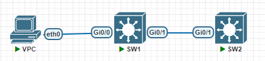
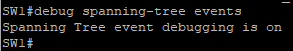

# Spanning-Tree PortFast

**한국어** | [English](README/01-PortFast.en.md) | [日本語](README/01-PortFast.ja.md) | [简体中文](README/01-PortFast.zh-CN.md) | [Español](README/01-PortFast.es.md) | [Français](README/01-PortFast.fr.md)

**PortFast** 는 spanning-tree 토폴로지 변경 문제를 다루는 Cisco 독자 기능입니다. spanning-tree가 토폴로지 변경에 어떻게 반응하는지 모른다면 [Spanning-Tree Topology Change Notification](../../02-RSTP/03-STP/05-Spanning-Tree-Topology-Change-Notification.md) 을 먼저 읽어 보세요. 왜 PortFast가 필요한지 이해하는 데 도움이 됩니다.

## PortFast가 하는 일

| 동작 | 설명 |
| --- | --- |
| 바로 Forwarding | PortFast가 켜진 인터페이스는 listening과 learning 상태를 건너뛰고 **즉시 forwarding** 으로 갑니다. |
| TCN 생성 안 함 | PortFast가 켜진 인터페이스가 up/down 되어도 스위치는 **TCN(topology change notification)을 만들지 않습니다.** |

호스트(PC, 서버 등)와 연결된 인터페이스는 수시로 up/down 되므로 PortFast를 켜는 것이 좋습니다. 반대로 **다른 허브나 스위치와 연결된 인터페이스에는 켜면 안 됩니다.**

---

## 1. 실습 토폴로지

PortFast가 있을 때와 없을 때의 차이를 다음 토폴로지로 확인합니다.



스위치 두 대가 있고, 호스트(VPC)는 SW1의 Gi0/0에 연결되어 있습니다. 스위치를 두 대 둔 이유는 SW1이 TCN을 보낼 상대 스위치가 필요하기 때문입니다. 먼저 PortFast가 없는 경우부터 보겠습니다.

---

## 2. PortFast를 끈 상태

흥미로운 동작을 보려고 SW1에서 debug를 켭니다.



호스트 케이블을 SW1에 꽂으면 다음과 같이 진행됩니다.


평범한 spanning-tree 동작입니다. Gi0/0이 **listening → learning → forwarding** 순서로 넘어가서, forward delay 15초씩 두 번, 약 30초 뒤에야 forwarding이 됩니다.

케이블을 뽑을 때마다 spanning-tree는 TCN을 만듭니다. 지금까지 몇 번 보냈는지 확인하는 명령어가 있습니다.


VLAN 1에서 토폴로지 변경이 **5번** 있었습니다. 호스트 케이블을 뽑아 보겠습니다.

> 원문은 "4번"이라고 적었지만, 실습 출력은 `Number of topology changes 5` 입니다.


spanning-tree가 SW2 쪽 인터페이스로 TCN을 보내고(Generating TC trap), 카운터가 올라갑니다.


정리하면, 케이블을 뽑을 때마다 스위치는 **TCN** 을 만듭니다. 이제 PortFast를 켜면 무엇이 달라지는지 봅니다.

---

## 3. PortFast를 켠 상태

호스트와 연결된 GigabitEthernet0/0에 PortFast만 켜면 됩니다.


PortFast는 다른 스위치 등과 연결된 인터페이스에 쓰면 안 된다는 **경고**가 크게 나옵니다. PortFast는 **non-trunking(access) 모드** 에서만 동작한다는 메시지도 함께 나옵니다.

인터페이스마다 켜는 대신 전역 명령도 있습니다. 결과는 같지만 **access 모드인 모든 인터페이스** 에 한 번에 켜 줍니다.

```
SW1(config)#spanning-tree portfast default
```

호스트를 다시 연결합니다.


인터페이스가 listening과 learning을 건너뛰고 **바로 forwarding** 으로 갑니다(`jump to forwarding from blocking`). 이제 이 케이블을 뽑아도 스위치는 더 이상 TCN을 만들지 않습니다.

---

## 핵심 정리

- **PortFast** 는 인터페이스를 listening과 learning 없이 **즉시 forwarding** 으로 보내고, 그 인터페이스의 up/down으로 **TCN을 만들지 않습니다.**
- PortFast가 없으면 호스트 포트도 약 30초 동안 listening·learning을 거치고, 케이블을 뽑을 때마다 TCN이 나가서 `Number of topology changes` 가 늘어납니다.
- 인터페이스에서 `spanning-tree portfast`, 전역에서 `spanning-tree portfast default`(access 포트 전체)로 켭니다.
- **호스트 포트에만** 켜고, 허브나 스위치와 연결된 포트에는 켜지 않습니다. 잘못 켜면 일시적인 루프가 생길 수 있습니다.
