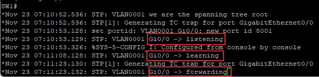
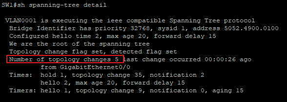
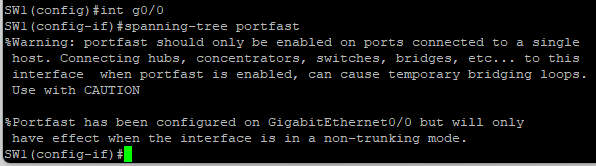

# Spanning-Tree PortFast

[한국어](../01-PortFast.md) | **English** | [日本語](01-PortFast.ja.md) | [简体中文](01-PortFast.zh-CN.md) | [Español](01-PortFast.es.md) | [Français](01-PortFast.fr.md)

**PortFast** is a Cisco proprietary feature for dealing with spanning-tree topology changes. If you don't know how spanning tree reacts to topology changes, read [Spanning-Tree Topology Change Notification](../../../02-RSTP/03-STP/README/05-Spanning-Tree-Topology-Change-Notification.en.md) first. It helps you understand why we need PortFast.

## What PortFast does

| Behavior | Description |
| --- | --- |
| Straight to forwarding | An interface with PortFast skips the listening and learning states and goes to **forwarding immediately**. |
| No TCN | When a PortFast interface goes up or down, the switch **never generates a TCN (topology change notification)**. |

Interfaces connected to hosts (PCs, servers, …) go up and down all the time, so it's a good idea to enable PortFast on them. On the other hand, **don't enable it on interfaces connected to another hub or switch.**

---

## 1. Lab topology

We'll compare an interface with and without PortFast using this topology.


There are two switches, and a host (VPC) is connected to Gi0/0 on SW1. The only reason for the second switch is to give SW1 another switch to send topology change notifications to. Let's start without PortFast.

---

## 2. PortFast disabled

To see the interesting stuff, enable a debug on SW1.


When I plug in the cable to connect the host to SW1, this is what happens:



This is normal spanning-tree behavior. Gi0/0 walks through **listening → learning → forwarding**, so it takes two forward delays of 15 seconds, about 30 seconds, before it forwards.

Each time I unplug the cable, spanning tree generates a TCN. There's a nice command to check how many have been sent so far.



There have been **five** topology changes on VLAN 1. Let's unplug the cable to the host.

> The original text says "four", but the lab output shows `Number of topology changes 5`.


Spanning tree sends a TCN on the interface toward SW2 (Generating TC trap), and the counter goes up.


In short, whenever we unplug the cable, the switch generates a **TCN**. Let's see what changes when we enable PortFast.

---

## 3. PortFast enabled

All we have to do is enable PortFast on the GigabitEthernet0/0 interface that connects our host.



We get a big **warning** that PortFast shouldn't be used on interfaces connected to other switches and so on. There's also a message that PortFast only takes effect in **non-trunking (access) mode**.

Instead of enabling it per interface, there's also a global command. The result is the same, but it enables PortFast on **all interfaces in access mode** at once.

```
SW1(config)#spanning-tree portfast default
```

Let's connect the host again.


The interface skips listening and learning and goes **straight to forwarding** (`jump to forwarding from blocking`). And when you unplug this cable now, the switch no longer generates a TCN.

---

## Summary

- **PortFast** sends an interface **straight to forwarding** without listening and learning, and **no TCN is generated** when that interface goes up or down.
- Without PortFast, even a host port spends about 30 seconds in listening and learning, and every unplug sends a TCN, increasing `Number of topology changes`.
- Enable it with `spanning-tree portfast` on an interface, or `spanning-tree portfast default` globally (all access ports).
- Enable it **only on host ports**, never on ports connected to hubs or switches; doing so can cause temporary loops.
