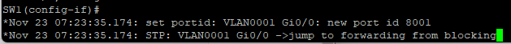

# Spanning-Tree PortFast

[한국어](../01-PortFast.md) | [English](01-PortFast.en.md) | [日本語](01-PortFast.ja.md) | [简体中文](01-PortFast.zh-CN.md) | [Español](01-PortFast.es.md) | **Français**

**PortFast** est une fonction propriétaire Cisco qui permet de gérer les changements de topologie spanning-tree. Si vous ne savez pas comment spanning tree réagit aux changements de topologie, lisez d'abord [Spanning-Tree Topology Change Notification](../../../02-RSTP/03-STP/README/05-Spanning-Tree-Topology-Change-Notification.fr.md). Cela aide à comprendre pourquoi PortFast est utile.

## Ce que fait PortFast

| Comportement | Description |
| --- | --- |
| Forwarding direct | Une interface avec PortFast saute les états listening et learning et passe **immédiatement en forwarding**. |
| Pas de TCN | Quand une interface avec PortFast monte ou tombe, le commutateur **ne génère jamais de TCN (topology change notification)**. |

Les interfaces connectées à des hôtes (PC, serveurs…) montent et tombent sans arrêt, il est donc judicieux d'y activer PortFast. En revanche, **ne l'activez pas sur une interface connectée à un autre hub ou commutateur.**

---

## 1. Topologie du labo

Nous comparons une interface avec et sans PortFast grâce à cette topologie.


Il y a deux commutateurs, et un hôte (VPC) est connecté à Gi0/0 de SW1. Le second commutateur sert uniquement à donner à SW1 un autre commutateur vers lequel envoyer les notifications de changement de topologie. Commençons sans PortFast.

---

## 2. PortFast désactivé

Pour voir ce qui se passe, activons un debug sur SW1.


Quand je branche le câble qui relie l'hôte à SW1, voici ce qui se passe :


C'est le comportement normal de spanning tree. Gi0/0 passe par **listening → learning → forwarding** : il faut deux forward delay de 15 secondes, soit environ 30 secondes, avant qu'il transmette.

Chaque fois que je débranche le câble, spanning tree génère une TCN. Une commande pratique permet de voir combien ont été envoyées jusqu'ici.


Il y a eu **cinq** changements de topologie sur la VLAN 1. Débranchons le câble de l'hôte.

> Le texte d'origine indique « quatre », mais la sortie du labo affiche `Number of topology changes 5`.


Spanning tree envoie une TCN sur l'interface vers SW2 (Generating TC trap), et le compteur augmente.


En bref, chaque fois qu'on débranche le câble, le commutateur génère une **TCN**. Voyons ce qui change quand on active PortFast.

---

## 3. PortFast activé

Il suffit d'activer PortFast sur l'interface GigabitEthernet0/0 qui relie l'hôte.


Un gros **avertissement** rappelle que PortFast ne doit pas être utilisé sur des interfaces connectées à d'autres commutateurs, etc. Un message indique aussi que PortFast ne fonctionne qu'en **mode non-trunking (access)**.

Au lieu de l'activer interface par interface, il existe aussi une commande globale. Le résultat est le même, mais elle active PortFast sur **toutes les interfaces en mode access** d'un coup.

```
SW1(config)#spanning-tree portfast default
```

Reconnectons l'hôte.



L'interface saute listening et learning et passe **directement en forwarding** (`jump to forwarding from blocking`). Et désormais, quand on débranche ce câble, le commutateur ne génère plus de TCN.

---

## Résumé

- **PortFast** fait passer une interface **directement en forwarding** sans listening ni learning, et **aucune TCN n'est générée** quand cette interface monte ou tombe.
- Sans PortFast, même un port d'hôte passe environ 30 secondes en listening et learning, et chaque débranchement envoie une TCN qui augmente `Number of topology changes`.
- On l'active avec `spanning-tree portfast` sur une interface, ou avec `spanning-tree portfast default` en global (tous les ports access).
- Activez-le **uniquement sur les ports d'hôte**, jamais sur des ports connectés à des hubs ou des commutateurs, sous peine de boucles temporaires.
