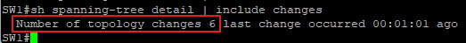

# Spanning-Tree PortFast

[한국어](../01-PortFast.md) | [English](01-PortFast.en.md) | **日本語** | [简体中文](01-PortFast.zh-CN.md) | [Español](01-PortFast.es.md) | [Français](01-PortFast.fr.md)

**PortFast** は、spanning-tree のトポロジー変更の問題に対処する Cisco 独自の機能です。spanning-tree がトポロジー変更にどう反応するかを知らない場合は、先に [Spanning-Tree Topology Change Notification](../../../02-RSTP/03-STP/README/05-Spanning-Tree-Topology-Change-Notification.ja.md) を読んでください。なぜ PortFast が必要なのかを理解するのに役立ちます。

## PortFast がすること

| 動作 | 説明 |
| --- | --- |
| すぐに Forwarding | PortFast を有効にしたインターフェイスは、listening と learning の状態を飛ばして**すぐに forwarding** になります。 |
| TCN を生成しない | PortFast を有効にしたインターフェイスが up/down しても、スイッチは **TCN（topology change notification）を生成しません**。 |

ホスト（PC、サーバーなど）につながるインターフェイスは頻繁に up/down するので、PortFast を有効にするのがよいでしょう。逆に、**別のハブやスイッチにつながるインターフェイスでは有効にしてはいけません**。

---

## 1. 実習のトポロジー

PortFast があるときとないときの違いを、次のトポロジーで確認します。


スイッチが 2 台あり、ホスト（VPC）は SW1 の Gi0/0 につながっています。スイッチを 2 台にしたのは、SW1 が TCN を送る相手のスイッチが必要だからです。まず PortFast がない場合から見ていきます。

---

## 2. PortFast を無効にした状態

興味深い動作を見るために、SW1 で debug を有効にします。


ホストのケーブルを SW1 に差し込むと、次のように進みます。


ごく普通の spanning-tree の動作です。Gi0/0 は **listening → learning → forwarding** の順に進むので、forward delay 15 秒を 2 回、約 30 秒たってようやく forwarding になります。

ケーブルを抜くたびに、spanning-tree は TCN を生成します。これまでに何回送ったかを確認できる便利なコマンドがあります。


VLAN 1 でトポロジー変更が **5 回**ありました。ホストのケーブルを抜いてみます。

> 原文では「4 回」となっていますが、実習出力は `Number of topology changes 5` です。


spanning-tree は SW2 側のインターフェイスに TCN を送り（Generating TC trap）、カウンターが増えます。



まとめると、ケーブルを抜くたびにスイッチは **TCN** を生成します。では PortFast を有効にすると何が変わるか見てみましょう。

---

## 3. PortFast を有効にした状態

ホストにつながる GigabitEthernet0/0 で PortFast を有効にするだけです。


PortFast はほかのスイッチなどにつながるインターフェイスで使ってはいけないという大きな**警告**が出ます。PortFast は **non-trunking（access）モード**でしか動作しないというメッセージも一緒に出ます。

インターフェイスごとに有効にする代わりに、グローバルコマンドもあります。結果は同じですが、**access モードのすべてのインターフェイス**で一度に有効にできます。

```
SW1(config)#spanning-tree portfast default
```

ホストをもう一度つなぎます。


インターフェイスは listening と learning を飛ばして**すぐに forwarding** になります（`jump to forwarding from blocking`）。これで、このケーブルを抜いてもスイッチは TCN を生成しなくなります。

---

## まとめ

- **PortFast** はインターフェイスを listening と learning なしで**すぐに forwarding** にし、そのインターフェイスの up/down で **TCN を生成しません**。
- PortFast がないと、ホストのポートでも約 30 秒 listening と learning を経由し、ケーブルを抜くたびに TCN が出て `Number of topology changes` が増えます。
- インターフェイスでは `spanning-tree portfast`、グローバルでは `spanning-tree portfast default`（access ポート全体）で有効にします。
- **ホストのポートだけ**で有効にし、ハブやスイッチにつながるポートでは有効にしません。誤って有効にすると一時的なループが起きることがあります。
