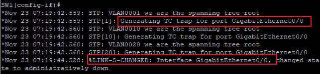

# Spanning-Tree PortFast

[한국어](../01-PortFast.md) | [English](01-PortFast.en.md) | [日本語](01-PortFast.ja.md) | **简体中文** | [Español](01-PortFast.es.md) | [Français](01-PortFast.fr.md)

**PortFast** 是 Cisco 专有的功能，用来应对 spanning-tree 拓扑变化带来的问题。如果你还不了解 spanning-tree 如何应对拓扑变化，请先阅读 [Spanning-Tree Topology Change Notification](../../../02-RSTP/03-STP/README/05-Spanning-Tree-Topology-Change-Notification.zh-CN.md)。这有助于理解为什么需要 PortFast。

## PortFast 的作用

| 行为 | 说明 |
| --- | --- |
| 直接转发 | 启用 PortFast 的接口会跳过 listening 和 learning 状态，**立即进入 forwarding**。 |
| 不产生 TCN | 启用 PortFast 的接口 up/down 时，交换机**不会产生 TCN（topology change notification）**。 |

连接主机（PC、服务器等）的接口经常 up/down，因此最好在这些接口上启用 PortFast。反之，**不要在连接其他集线器或交换机的接口上启用**。

---

## 1. 实验拓扑

用下面的拓扑比较有无 PortFast 的区别。


这里有两台交换机，主机（VPC）连接在 SW1 的 Gi0/0 上。之所以用两台交换机，是因为 SW1 需要另一台交换机来接收它发出的 TCN。先看没有 PortFast 的情况。

---

## 2. 未启用 PortFast

为了观察有趣的现象，在 SW1 上开启 debug。


把主机的网线插到 SW1 上，过程如下：


这是普通的 spanning-tree 行为。Gi0/0 依次经过 **listening → learning → forwarding**，要经过两次 15 秒的 forward delay，大约 30 秒后才进入 forwarding。

每次拔掉网线，spanning-tree 都会产生 TCN。有一个很好用的命令可以查看到目前为止发送了多少次。


VLAN 1 上发生了 **5 次**拓扑变化。拔掉主机的网线看看。

> 原文写的是“4 次”，但实验输出是 `Number of topology changes 5`。



spanning-tree 向连接 SW2 的接口发送 TCN（Generating TC trap），计数器随之增加。


总之，每次拔掉网线，交换机都会产生 **TCN**。下面看看启用 PortFast 后有什么不同。

---

## 3. 启用 PortFast

只需在连接主机的 GigabitEthernet0/0 上启用 PortFast。


系统会给出醒目的**警告**：不要在连接其他交换机等设备的接口上使用 PortFast。同时还提示 PortFast 只在 **non-trunking（access）模式**下生效。

除了逐个接口启用，也有全局命令。效果相同，但可以一次性在**所有 access 模式的接口**上启用 PortFast。

```
SW1(config)#spanning-tree portfast default
```

再次连接主机。


接口跳过 listening 和 learning，**直接进入 forwarding**（`jump to forwarding from blocking`）。现在再拔掉这根网线，交换机也不会再产生 TCN 了。

---

## 总结

- **PortFast** 让接口不经过 listening 和 learning **立即进入 forwarding**，该接口 up/down 时**不会产生 TCN**。
- 没有 PortFast 时，即使是主机端口也要经过约 30 秒的 listening 和 learning，每次拔线都会发送 TCN，`Number of topology changes` 随之增加。
- 在接口上用 `spanning-tree portfast`，全局用 `spanning-tree portfast default`（所有 access 端口）启用。
- **只在主机端口上**启用，不要在连接集线器或交换机的端口上启用，否则可能产生临时环路。
