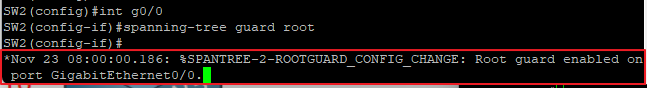
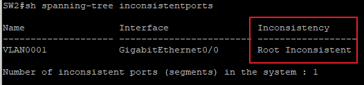

# Spanning-Tree Root Guard

**한국어** | [English](README/02-Root-Guard.en.md) | [日本語](README/02-Root-Guard.ja.md) | [简体中文](README/02-Root-Guard.zh-CN.md) | [Español](README/02-Root-Guard.es.md) | [Français](README/02-Root-Guard.fr.md)

**Root Guard** 는 특정 스위치를 root bridge로 받아들이지 않도록 막는 기능입니다. BPDU는 평소처럼 보내고 처리하지만, 어떤 스위치가 갑자기 **더 좋은(superior) bridge ID** 를 담은 BPDU를 보내면 그 스위치를 root bridge로 인정하지 않습니다. 원래라면 bridge ID가 가장 좋은 스위치가 root bridge가 되겠지만, Root Guard가 켜진 포트에서는 그런 일이 일어나지 않습니다.

## Root Guard 동작 요약

| 상황 | 동작 |
| --- | --- |
| 평소 | BPDU를 정상적으로 주고받습니다. |
| Root Guard 포트로 superior BPDU 수신 | 그 VLAN에서 포트를 **root-inconsistent** 상태로 막습니다. |
| superior BPDU가 더 이상 오지 않음 | 자동으로 원래 상태로 돌아옵니다. |

---

## 1. 실습 토폴로지

다음 토폴로지로 확인합니다.

SW2와 SW3로 설정합니다. 먼저 SW3가 root bridge가 **되지 않도록** SW2의 priority를 낮춰서 SW2를 root bridge로 만듭니다.

---

## 2. Root Guard 설정

SW2에서 SW3와 연결된 인터페이스에 Root Guard를 켭니다.

Root Guard가 켜졌다는 메시지(`ROOTGUARD_CONFIG_CHANGE`)가 나옵니다.

> 원문은 Fastethernet0/16을 썼고 토폴로지 그림에는 SW2–SW3 링크가 Gi0/1로 표시되어 있지만, 실습 출력에서 SW3와 연결된 포트는 **Gi0/0** 입니다. 이 문서는 실습 출력을 기준으로 적었습니다.

무슨 일이 일어나는지 보려고 debug를 켭니다.

---

## 3. superior BPDU를 보내면?

이제 SW3의 priority를 가장 낮은 값(0)으로 바꿔서 SW2를 '화나게' 해 보겠습니다. 원래라면 SW3가 root bridge가 되어야 합니다.

SW2는 어떻게 반응할까요?

SW2는 Gi0/0에서 더 좋은 root(`1-505b.2e00.0200`)를 들었지만, SW3를 root bridge로 **받아들이지 않습니다.** 대신 이 VLAN에서 인터페이스를 막습니다(`ROOTGUARD_BLOCK`). 확인에 유용한 명령어가 하나 더 있습니다.

GigabitEthernet0/0이 VLAN 1에서 **Root Inconsistent** 상태라고 알려 줍니다.

Root Guard는 **코어나 distribution 계층 스위치**에 켜 두면 유용합니다. 아래 계층의 스위치가 root bridge로 뽑히는 일을 막을 수 있습니다.

---

## 핵심 정리

- **Root Guard** 는 포트로 들어온 superior BPDU를 근거로 새 root bridge를 인정하지 않고, 그 포트를 **root-inconsistent** 로 막습니다.
- 설정은 인터페이스에서 `spanning-tree guard root` 입니다. 켜지면 `ROOTGUARD_CONFIG_CHANGE`, 막히면 `ROOTGUARD_BLOCK` 메시지가 나옵니다.
- `show spanning-tree inconsistentports` 로 막힌 포트와 VLAN(`Root Inconsistent`)을 확인합니다.
- 코어·distribution 스위치에서 **아래쪽(access) 스위치로 향하는 포트**에 켜서, root bridge 위치를 지킵니다.
