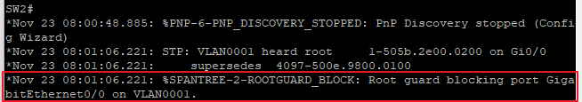

# Spanning-Tree Root Guard

[한국어](../02-Root-Guard.md) | [English](02-Root-Guard.en.md) | [日本語](02-Root-Guard.ja.md) | [简体中文](02-Root-Guard.zh-CN.md) | [Español](02-Root-Guard.es.md) | **Français**

**Root Guard** garantit qu'un certain commutateur ne sera pas accepté comme root bridge. Les BPDU sont envoyées et traitées normalement, mais si un commutateur envoie soudain une BPDU avec un **bridge ID supérieur**, il ne sera pas accepté comme root bridge. Normalement, le commutateur ayant le meilleur bridge ID deviendrait root bridge, mais cela n'arrive pas sur un port avec Root Guard.

## Root Guard en bref

| Situation | Comportement |
| --- | --- |
| En temps normal | Les BPDU sont envoyées et reçues comme d'habitude. |
| BPDU supérieure reçue sur un port Root Guard | Le port est bloqué à l'état **root-inconsistent** pour cette VLAN. |
| Les BPDU supérieures cessent | Le port se rétablit automatiquement. |

---

## 1. Topologie du labo

Nous utilisons cette topologie.

La configuration utilise SW2 et SW3. D'abord, assurons-nous que SW3 **n'est pas** le root bridge en abaissant la priority de SW2 pour que SW2 devienne root bridge.

---

## 2. Configurer Root Guard

Activons Root Guard sur l'interface de SW2 vers SW3.

Un message (`ROOTGUARD_CONFIG_CHANGE`) indique que Root Guard est activé.

> L'original utilise Fastethernet0/16 et le schéma de topologie marque le lien SW2–SW3 comme Gi0/1, mais dans la sortie du labo le port vers SW3 est **Gi0/0**. Cette page suit la sortie du labo.

Activons un debug pour voir ce qui se passe.

---

## 3. Que se passe-t-il avec une BPDU supérieure ?

« Provoquons » maintenant SW2 en réglant la priority de SW3 sur la valeur la plus basse possible (0). Normalement, SW3 devrait devenir root bridge.

Qu'en pense SW2 ?

SW2 entend un meilleur root (`1-505b.2e00.0200`) sur Gi0/0, mais il **n'accepte pas** SW3 comme root bridge. Il bloque plutôt l'interface pour cette VLAN (`ROOTGUARD_BLOCK`). Voici une autre commande utile pour le vérifier :

Elle indique que GigabitEthernet0/0 est **Root Inconsistent** pour la VLAN 1.

Root Guard est utile sur les **commutateurs de cœur ou de distribution**, pour que les commutateurs situés en dessous ne soient jamais élus root bridge.

---

## Résumé

- **Root Guard** refuse d'accepter un nouveau root bridge à partir d'une BPDU supérieure reçue sur le port, et bloque ce port à l'état **root-inconsistent**.
- On le configure avec `spanning-tree guard root` sur l'interface. `ROOTGUARD_CONFIG_CHANGE` s'affiche à l'activation et `ROOTGUARD_BLOCK` lors du blocage.
- `show spanning-tree inconsistentports` affiche le port bloqué et la VLAN (`Root Inconsistent`).
- Activez-le sur les commutateurs de cœur/distribution, sur les **ports vers les commutateurs inférieurs (access)**, pour protéger l'emplacement du root bridge.
