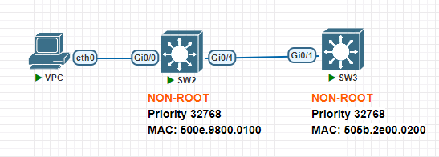
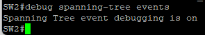

# Spanning-Tree Root Guard

[한국어](../02-Root-Guard.md) | [English](02-Root-Guard.en.md) | **日本語** | [简体中文](02-Root-Guard.zh-CN.md) | [Español](02-Root-Guard.es.md) | [Français](02-Root-Guard.fr.md)

**Root Guard** は、特定のスイッチを root bridge として受け入れないようにする機能です。BPDU は通常どおり送受信・処理しますが、あるスイッチが突然**よりよい（superior）bridge ID** を持つ BPDU を送ってきても、そのスイッチを root bridge とは認めません。本来なら bridge ID が最もよいスイッチが root bridge になりますが、Root Guard を有効にしたポートではそうなりません。

## Root Guard の動作のまとめ

| 状況 | 動作 |
| --- | --- |
| 通常時 | BPDU を通常どおり送受信します。 |
| Root Guard のポートで superior BPDU を受信 | その VLAN でポートを **root-inconsistent** 状態にしてブロックします。 |
| superior BPDU が来なくなる | 自動で元の状態に戻ります。 |

---

## 1. 実習のトポロジー

次のトポロジーで確認します。

SW2 と SW3 で設定します。まず SW3 が root bridge に**ならない**ように、SW2 の priority を下げて SW2 を root bridge にします。

---

## 2. Root Guard の設定

SW2 で、SW3 につながるインターフェイスに Root Guard を有効にします。

Root Guard が有効になったというメッセージ（`ROOTGUARD_CONFIG_CHANGE`）が出ます。

> 原文は Fastethernet0/16 を使い、トポロジー図では SW2–SW3 のリンクが Gi0/1 と表示されていますが、実習出力で SW3 につながるポートは **Gi0/0** です。このページは実習出力に合わせています。

何が起きるかを見るために debug を有効にします。

---

## 3. superior BPDU を送ると？

では SW3 の priority を最小値（0）にして、SW2 を「怒らせて」みます。本来なら SW3 が root bridge になるはずです。

SW2 はどう反応するでしょうか？

SW2 は Gi0/0 でよりよい root（`1-505b.2e00.0200`）を受け取りましたが、SW3 を root bridge として**受け入れません**。代わりに、この VLAN でインターフェイスをブロックします（`ROOTGUARD_BLOCK`）。確認に便利なコマンドがもう 1 つあります。

GigabitEthernet0/0 が VLAN 1 で **Root Inconsistent** の状態だと教えてくれます。

Root Guard は**コアや distribution 層のスイッチ**で有効にしておくと便利です。下の層のスイッチが root bridge に選ばれるのを防げます。

---

## まとめ

- **Root Guard** は、ポートで受け取った superior BPDU をもとに新しい root bridge を認めず、そのポートを **root-inconsistent** でブロックします。
- 設定はインターフェイスで `spanning-tree guard root` です。有効にすると `ROOTGUARD_CONFIG_CHANGE`、ブロックすると `ROOTGUARD_BLOCK` メッセージが出ます。
- `show spanning-tree inconsistentports` でブロックされたポートと VLAN（`Root Inconsistent`）を確認します。
- コア・distribution スイッチの**下位（access）スイッチに向かうポート**で有効にして、root bridge の位置を守ります。
