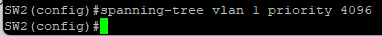
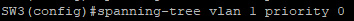

# Spanning-Tree Root Guard

[한국어](../02-Root-Guard.md) | [English](02-Root-Guard.en.md) | [日本語](02-Root-Guard.ja.md) | **简体中文** | [Español](02-Root-Guard.es.md) | [Français](02-Root-Guard.fr.md)

**Root Guard** 用来确保你不会把某台交换机接受为 root bridge。BPDU 照常发送和处理，但如果某台交换机突然发来带有**更优（superior）bridge ID** 的 BPDU，你不会承认它是 root bridge。正常情况下，bridge ID 最好的交换机会成为 root bridge，但在启用了 Root Guard 的端口上这不会发生。

## Root Guard 行为概要

| 情况 | 行为 |
| --- | --- |
| 平时 | 正常收发 BPDU。 |
| Root Guard 端口收到 superior BPDU | 在该 VLAN 中把端口置为 **root-inconsistent** 状态并阻塞。 |
| 不再收到 superior BPDU | 自动恢复原来的状态。 |

---

## 1. 实验拓扑

用下面的拓扑进行验证。

使用 SW2 和 SW3 进行配置。首先，为了确保 SW3 **不会**成为 root bridge，降低 SW2 的 priority，让 SW2 成为 root bridge。

---

## 2. 配置 Root Guard

在 SW2 连接 SW3 的接口上启用 Root Guard。

系统提示 Root Guard 已启用（`ROOTGUARD_CONFIG_CHANGE`）。

> 原文使用的是 Fastethernet0/16，拓扑图中 SW2–SW3 链路标为 Gi0/1，但实验输出中连接 SW3 的端口是 **Gi0/0**。本文以实验输出为准。

为了观察发生了什么，开启 debug。

---

## 3. 发送 superior BPDU 会怎样？

现在把 SW3 的 priority 改成最低值（0），“惹恼”SW2。正常情况下，SW3 应该成为 root bridge。

SW2 会怎么反应？

SW2 在 Gi0/0 上收到了更好的 root（`1-505b.2e00.0200`），但它**不接受** SW3 作为 root bridge，而是在这个 VLAN 中阻塞该接口（`ROOTGUARD_BLOCK`）。还有一个便于验证的命令：

它告诉我们 GigabitEthernet0/0 在 VLAN 1 中处于 **Root Inconsistent** 状态。

Root Guard 适合在**核心层或分布层交换机**上启用，这样下层的交换机永远不会被选为 root bridge。

---

## 总结

- **Root Guard** 不会根据端口收到的 superior BPDU 承认新的 root bridge，而是把该端口阻塞为 **root-inconsistent**。
- 在接口上用 `spanning-tree guard root` 配置。启用时出现 `ROOTGUARD_CONFIG_CHANGE`，阻塞时出现 `ROOTGUARD_BLOCK` 消息。
- 用 `show spanning-tree inconsistentports` 查看被阻塞的端口和 VLAN（`Root Inconsistent`）。
- 在核心/分布层交换机**面向下层（access）交换机的端口**上启用，以守住 root bridge 的位置。
