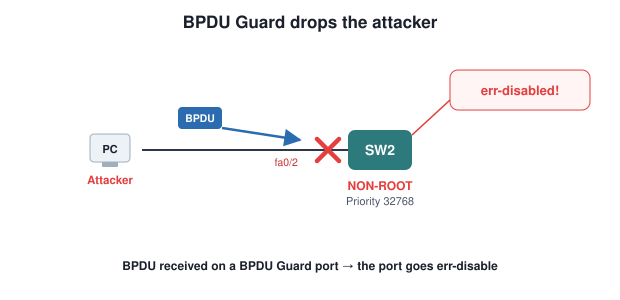

# Spanning-Tree BPDU Guard

**한국어** | [English](README/03-BPDU-Guard.en.md) | [日本語](README/03-BPDU-Guard.ja.md) | [简体中文](README/03-BPDU-Guard.zh-CN.md) | [Español](README/03-BPDU-Guard.es.md) | [Français](README/03-BPDU-Guard.fr.md)

**BPDU Guard** 는 spanning-tree 토폴로지를 보호하는 기능 중 하나입니다. BPDU Guard가 켜진 인터페이스로 **BPDU가 들어오면 그 인터페이스를 err-disable 상태로** 만듭니다. 왜 필요한지 예를 들어 보겠습니다.

## BPDU Guard 설정 방법

| 위치 | 명령어 | 적용 대상 |
| --- | --- | --- |
| 인터페이스 | `spanning-tree bpduguard enable` | 그 인터페이스 |
| 전역 | `spanning-tree portfast bpduguard default` | PortFast가 켜진 모든 인터페이스 |

---

## 1. 왜 BPDU Guard가 필요한가?


위 토폴로지에서 spanning-tree는 잘 동작하고 있습니다. 기본적으로 spanning-tree는 **모든 인터페이스에서 BPDU를 주고받습니다.** 예시에서 SW2의 fa0/2에는 컴퓨터가 연결되어 있습니다. 호기심이 많거나 나쁜 의도를 가진 사람이 **더 좋은(superior) bridge ID를 담은 BPDU** 를 만드는 도구를 실행할 수 있습니다. 그러면 스위치들은 root bridge가 SW2를 거쳐 있다고 믿고, spanning-tree를 **다시 계산** 합니다. 좋은 일이 아니겠죠? 무엇이 잘못될 수 있는지 보겠습니다.


아무도 모르게 **중간자 공격(man-in-the-middle)** 을 할 수도 있습니다. 공격자가 컴퓨터를 스위치 두 대에 연결하고 root bridge가 되면, 스위치 사이를 오가는 트래픽이 모두 공격자의 컴퓨터를 지나갑니다. Wireshark를 켜 두기만 하면 됩니다.

BPDU Guard를 쓰면 이런 일을 막을 수 있습니다. BPDU가 들어오는 순간 인터페이스를 막아 버리기 때문입니다.



BPDU Guard는 인터페이스로 BPDU를 받으면 그 인터페이스를 **err-disable** 모드로 만듭니다. 설정 방법을 보겠습니다.

---

## 2. 인터페이스에 설정하기

다음 토폴로지를 씁니다.


스위치 두 대로 BPDU Guard를 확인합니다. SW2의 Gi0/0이 SW3로부터 BPDU를 받으면 err-disable 모드가 되도록 설정합니다.


인터페이스에 켜는 방법입니다. 실제로는 스위치 사이 링크에 이렇게 하지 않습니다. **컴퓨터와 연결된 access 모드 인터페이스** 에 설정해야 합니다.


예상대로 인터페이스가 꺼졌습니다. Gi0/0으로 BPDU를 받자 `BLOCK_BPDUGUARD` 메시지와 함께 **err-disable** 상태가 되고, line protocol도 down 됩니다. BPDU Guard를 지우고 인터페이스를 `shutdown` / `no shutdown` 해서 되살립니다.


---

## 3. 전역으로 설정하기

인터페이스마다 켜는 대신 **전역**으로 켤 수도 있습니다. 실습 장비(IOSv)에는 이 명령이 없어서, 이 부분은 **Packet Tracer** 에서 진행했습니다.

```
SW2(config)#spanning-tree portfast bpduguard default
```

이 명령은 **PortFast가 켜진 모든 인터페이스** 에 BPDU Guard를 켭니다. 그래서 보통 PortFast도 전역으로 함께 켭니다.

```
SW2(config)#spanning-tree portfast default
```

설정을 확인하는 유용한 명령어입니다.

```
SW2#sh spanning-tree summary
Switch is in pvst mode
Root bridge for:
Extended system ID           is enabled
Portfast Default             is enabled
PortFast BPDU Guard Default  is enabled
Portfast BPDU Filter Default is disabled
Loopguard Default            is disabled
EtherChannel misconfig guard is disabled
UplinkFast                   is disabled
BackboneFast                 is disabled
Configured Pathcost method used is short
```

**Portfast Default** 와 **PortFast BPDU Guard Default** 가 전역으로 켜진 것을 볼 수 있습니다.

---

## 핵심 정리

- 기본적으로 모든 인터페이스가 BPDU를 주고받기 때문에, 호스트 포트에서 **superior BPDU** 를 보내면 spanning-tree가 다시 계산되고 공격자가 root bridge가 되어 **중간자 공격** 을 할 수 있습니다.
- **BPDU Guard** 는 BPDU를 받은 인터페이스를 **err-disable** 로 만듭니다(`BLOCK_BPDUGUARD`, `ERR_DISABLE` 메시지).
- 인터페이스: `spanning-tree bpduguard enable` / 전역: `spanning-tree portfast bpduguard default`(PortFast 포트 전체).
- 스위치 사이 링크가 아니라 **컴퓨터와 연결된 access 포트**에 씁니다. err-disable된 포트는 원인을 없앤 뒤 `shutdown` / `no shutdown` 으로 살립니다.
- `show spanning-tree summary` 로 전역 PortFast와 BPDU Guard 설정을 확인합니다.
