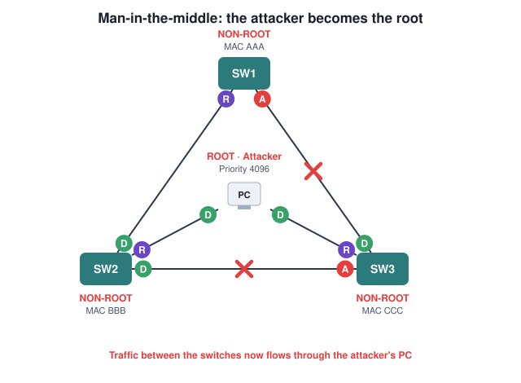
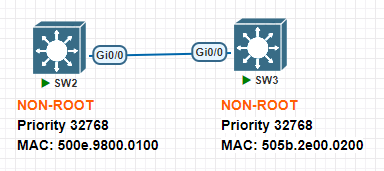
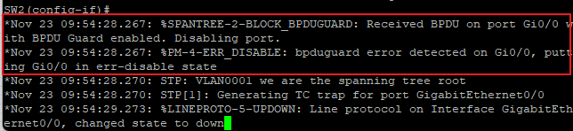

# Spanning-Tree BPDU Guard

[한국어](../03-BPDU-Guard.md) | **English** | [日本語](03-BPDU-Guard.ja.md) | [简体中文](03-BPDU-Guard.zh-CN.md) | [Español](03-BPDU-Guard.es.md) | [Français](03-BPDU-Guard.fr.md)

**BPDU Guard** is one of the features that help you protect your spanning-tree topology. When a **BPDU arrives on an interface with BPDU Guard, the interface goes into err-disable**. Let me show you why you'd want this with an example.

## How to configure BPDU Guard

| Where | Command | Applies to |
| --- | --- | --- |
| Interface | `spanning-tree bpduguard enable` | That interface |
| Global | `spanning-tree portfast bpduguard default` | All interfaces with PortFast enabled |

---

## 1. Why do we need BPDU Guard?


In the topology above, spanning tree is working perfectly. By default, spanning tree **sends and receives BPDUs on all interfaces**. In this example, a computer is connected to fa0/2 on SW2. Someone with curious or hostile intentions could start a tool that generates **BPDUs with a superior bridge ID**. Our switches would then believe the root bridge can now be reached through SW2, and spanning tree would be **recalculated**. That doesn't sound like a good idea, right? Here's what could go wrong:



You could even do a **man-in-the-middle attack** without anyone knowing. Imagine the attacker connects a computer to two switches and becomes the root bridge: all traffic between the switches now flows through the attacker's computer. Just run Wireshark and wait for the magic to happen.

BPDU Guard prevents this, because it blocks the interface as soon as a BPDU arrives.


When BPDU Guard receives a BPDU on an interface, it puts the interface into **err-disable** mode. Let's see how to configure it.

---

## 2. Configuring it on an interface

We'll use this topology.



Two switches are enough to demonstrate BPDU Guard. I'll configure Gi0/0 on SW2 to go into err-disable mode when it receives a BPDU from SW3.


This is how you enable it on the interface. In real life you'd never do this between switches; configure it on **access-mode interfaces connected to computers**.



As expected, there goes our interface. When Gi0/0 receives a BPDU, the `BLOCK_BPDUGUARD` message appears, the port goes **err-disable**, and the line protocol goes down. Let's remove BPDU Guard and bring the interface back with `shutdown` / `no shutdown`.


---

## 3. Configuring it globally

Instead of enabling BPDU Guard per interface, you can also enable it **globally**. The lab device (IOSv) doesn't have this command, so this part was done in **Packet Tracer**.

```
SW2(config)#spanning-tree portfast bpduguard default
```

This enables BPDU Guard on **all interfaces with PortFast enabled**, which is why PortFast is usually enabled globally too:

```
SW2(config)#spanning-tree portfast default
```

Here's a useful command to verify your configuration:

```
SW2#sh spanning-tree summary
Switch is in pvst mode
Root bridge for:
Extended system ID           is enabled
Portfast Default             is enabled
PortFast BPDU Guard Default  is enabled
Portfast BPDU Filter Default is disabled
Loopguard Default            is disabled
EtherChannel misconfig guard is disabled
UplinkFast                   is disabled
BackboneFast                 is disabled
Configured Pathcost method used is short
```

You can see that **Portfast Default** and **PortFast BPDU Guard Default** are enabled globally.

---

## Summary

- By default every interface sends and receives BPDUs, so a **superior BPDU** sent from a host port triggers a recalculation and can make an attacker the root bridge, enabling a **man-in-the-middle attack**.
- **BPDU Guard** puts an interface that receives a BPDU into **err-disable** (`BLOCK_BPDUGUARD`, `ERR_DISABLE` messages).
- Interface: `spanning-tree bpduguard enable` / global: `spanning-tree portfast bpduguard default` (all PortFast ports).
- Use it on **access ports connected to computers**, not on links between switches. Bring an err-disabled port back with `shutdown` / `no shutdown` after removing the cause.
- `show spanning-tree summary` shows the global PortFast and BPDU Guard settings.
