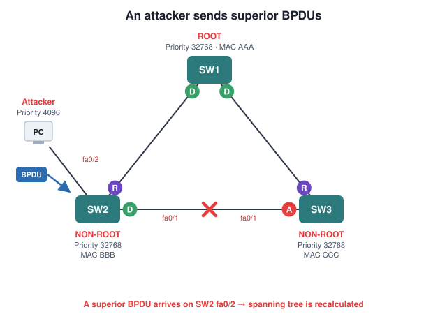
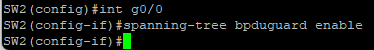
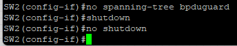

# Spanning-Tree BPDU Guard

[한국어](../03-BPDU-Guard.md) | [English](03-BPDU-Guard.en.md) | [日本語](03-BPDU-Guard.ja.md) | [简体中文](03-BPDU-Guard.zh-CN.md) | [Español](03-BPDU-Guard.es.md) | **Français**

**BPDU Guard** fait partie des fonctions qui protègent la topologie spanning-tree. Quand une **BPDU arrive sur une interface avec BPDU Guard, l'interface passe en err-disable**. Voyons sur un exemple pourquoi c'est utile.

## Configurer BPDU Guard

| Où | Commande | S'applique à |
| --- | --- | --- |
| Interface | `spanning-tree bpduguard enable` | Cette interface |
| Global | `spanning-tree portfast bpduguard default` | Toutes les interfaces avec PortFast activé |

---

## 1. Pourquoi BPDU Guard ?



Dans la topologie ci-dessus, spanning tree fonctionne parfaitement. Par défaut, spanning tree **envoie et reçoit des BPDU sur toutes les interfaces**. Dans cet exemple, un ordinateur est connecté à fa0/2 de SW2. Une personne curieuse ou malveillante pourrait lancer un outil qui génère des **BPDU avec un bridge ID supérieur**. Nos commutateurs croiraient alors que le root bridge est désormais joignable via SW2, et spanning tree serait **recalculé**. Ce n'est pas une bonne idée, n'est-ce pas ? Voici ce qui pourrait mal tourner :


On pourrait même mener une **attaque de l'homme du milieu (man-in-the-middle)** sans que personne ne s'en aperçoive. Imaginez que l'attaquant connecte un ordinateur à deux commutateurs et devienne root bridge : tout le trafic entre les commutateurs passe alors par l'ordinateur de l'attaquant. Il suffit de lancer Wireshark et d'attendre.

BPDU Guard empêche cela, car il bloque l'interface dès qu'une BPDU arrive.


Quand BPDU Guard reçoit une BPDU sur une interface, il met l'interface en mode **err-disable**. Voyons comment le configurer.

---

## 2. Configuration sur une interface

Nous utilisons cette topologie.


Deux commutateurs suffisent pour montrer BPDU Guard. Je configure Gi0/0 de SW2 pour qu'elle passe en err-disable si elle reçoit une BPDU de SW3.



Voici comment l'activer sur l'interface. En pratique, on ne fait jamais cela entre commutateurs ; on le configure sur les **interfaces en mode access connectées à des ordinateurs**.


Comme prévu, notre interface tombe. Quand Gi0/0 reçoit une BPDU, le message `BLOCK_BPDUGUARD` apparaît, le port passe en **err-disable** et le line protocol tombe. Retirons BPDU Guard et rétablissons l'interface avec `shutdown` / `no shutdown`.



---

## 3. Configuration globale

Au lieu d'activer BPDU Guard interface par interface, on peut aussi l'activer **globalement**. L'équipement du labo (IOSv) ne dispose pas de cette commande, cette partie a donc été réalisée dans **Packet Tracer**.

```
SW2(config)#spanning-tree portfast bpduguard default
```

Cette commande active BPDU Guard sur **toutes les interfaces où PortFast est activé** ; c'est pourquoi on active généralement PortFast en global aussi :

```
SW2(config)#spanning-tree portfast default
```

Voici une commande utile pour vérifier la configuration :

```
SW2#sh spanning-tree summary
Switch is in pvst mode
Root bridge for:
Extended system ID           is enabled
Portfast Default             is enabled
PortFast BPDU Guard Default  is enabled
Portfast BPDU Filter Default is disabled
Loopguard Default            is disabled
EtherChannel misconfig guard is disabled
UplinkFast                   is disabled
BackboneFast                 is disabled
Configured Pathcost method used is short
```

On voit que **Portfast Default** et **PortFast BPDU Guard Default** sont activés globalement.

---

## Résumé

- Par défaut, toutes les interfaces envoient et reçoivent des BPDU : une **BPDU supérieure** envoyée depuis un port d'hôte déclenche un recalcul et peut faire de l'attaquant le root bridge, ce qui permet une **attaque de l'homme du milieu**.
- **BPDU Guard** met en **err-disable** l'interface qui reçoit une BPDU (messages `BLOCK_BPDUGUARD`, `ERR_DISABLE`).
- Interface : `spanning-tree bpduguard enable` / global : `spanning-tree portfast bpduguard default` (tous les ports PortFast).
- Utilisez-le sur les **ports access connectés à des ordinateurs**, pas sur les liens entre commutateurs. Un port en err-disable se rétablit avec `shutdown` / `no shutdown` après avoir éliminé la cause.
- `show spanning-tree summary` affiche les réglages globaux de PortFast et de BPDU Guard.
