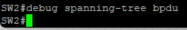

# Spanning-Tree BPDU Filter

**한국어** | [English](README/04-BPDU-Filter.en.md) | [日本語](README/04-BPDU-Filter.ja.md) | [简体中文](README/04-BPDU-Filter.zh-CN.md) | [Español](README/04-BPDU-Filter.es.md) | [Français](README/04-BPDU-Filter.fr.md)

**BPDU Filter** 는 [BPDU Guard](../03-BPDU-Guard/03-BPDU-Guard.md) 처럼 악의적인 BPDU를 막는 데 쓸 수 있습니다. 차이는 BPDU Guard가 BPDU를 받은 인터페이스를 **err-disable** 로 만드는 반면, BPDU Filter는 BPDU를 그냥 **걸러 낸다(filter)** 는 점입니다. 이 문서에서는 BPDU Filter가 어떻게 동작하는지 자세히 살펴봅니다.

## 전역 설정과 인터페이스 설정의 차이

BPDU Filter는 전역이나 인터페이스에서 설정할 수 있는데, 둘의 동작이 다릅니다.

| 설정 위치 | 명령어 | 동작 |
| --- | --- | --- |
| 전역 | `spanning-tree portfast bpdufilter default` | **PortFast가 켜진 인터페이스** 가 BPDU를 보내지도 받지도 않습니다. 그런데 이 인터페이스로 BPDU가 들어오면 **PortFast 상태를 잃고 BPDU Filter도 꺼져서** 일반 인터페이스처럼 동작합니다. |
| 인터페이스 | `spanning-tree bpdufilter enable` | 들어오는 BPDU를 **무시** 하고, BPDU를 **보내지도 않습니다.** 사실상 그 인터페이스에서 **spanning-tree를 끄는 것** 과 같습니다. |

인터페이스에 BPDU Filter를 켤 때는 조심해야 합니다. 컴퓨터와 연결된 access 모드 인터페이스에는 써도 되지만, **다른 스위치와 연결된 인터페이스에는 절대 설정하면 안 됩니다.** 그러면 루프가 생길 수 있습니다.

---

## 1. 실습 토폴로지

다음 토폴로지로 BPDU Filter를 확인합니다.


---

## 2. 인터페이스에 설정하기

SW2의 인터페이스에 PortFast를 켜고 BPDU Filter를 켭니다.


실습 링크가 trunk라서 PortFast는 `spanning-tree portfast trunk` 로 켰습니다. 이제 SW2는 이 인터페이스로 BPDU를 보내지 않고, 들어오는 BPDU도 무시합니다. 어떻게 동작하는지 debug로 확인합니다.



BPDU debug를 켜도 **아무것도 나오지 않습니다.** SW2는 더 이상 BPDU를 보내지도, 처리하지도 않기 때문입니다. 원하면 SW3에서도 BPDU debug를 켜 보세요. SW2로부터 BPDU가 하나도 오지 않는 것을 볼 수 있습니다. 인터페이스 명령을 지웁니다.


---

## 3. 전역으로 설정하기

이번에는 BPDU Filter를 전역으로 켭니다.

```
SW2(config)#spanning-tree portfast bpdufilter default
```

> PDF에는 이 단계의 캡처가 바로 앞의 `no spanning-tree bpdufilter enable` 캡처와 같은 화면으로 들어가 있어서, 전역 명령은 코드 블록으로 적었습니다.

이 명령은 **PortFast가 켜진 모든 인터페이스** 에 BPDU Filter를 켭니다.

이것으로 끝입니다. 하지만 보통은 **BPDU Guard를 쓰는 편이 낫습니다.** BPDU가 들어오면 안 되는 인터페이스라면, 조용히 걸러서 무슨 일이 있었는지 모르는 것보다 err-disable로 **알림을 받는 것** 이 더 좋기 때문입니다.

---

## 핵심 정리

- **BPDU Filter** 는 BPDU를 err-disable 없이 **걸러 냅니다.** BPDU Guard는 포트를 err-disable로 만든다는 점이 다릅니다.
- **전역**(`spanning-tree portfast bpdufilter default`): PortFast 포트가 BPDU를 주고받지 않다가, BPDU를 받으면 PortFast와 BPDU Filter가 풀려 일반 포트가 됩니다.
- **인터페이스**(`spanning-tree bpdufilter enable`): BPDU를 무시하고 보내지도 않으므로 사실상 그 포트의 **spanning-tree를 끄는 것** 입니다.
- 다른 스위치와 연결된 포트에 쓰면 **루프** 가 생길 수 있습니다. 호스트 포트에만 쓰고, 가능하면 알림을 주는 **BPDU Guard** 를 씁니다.
