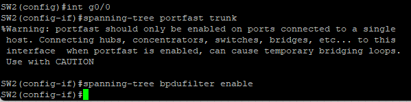
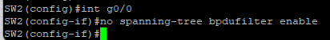

# Spanning-Tree BPDU Filter

[한국어](../04-BPDU-Filter.md) | [English](04-BPDU-Filter.en.md) | [日本語](04-BPDU-Filter.ja.md) | [简体中文](04-BPDU-Filter.zh-CN.md) | **Español** | [Français](04-BPDU-Filter.fr.md)

El **BPDU Filter** funciona de forma parecida a [BPDU Guard](../../03-BPDU-Guard/README/03-BPDU-Guard.es.md), ya que permite bloquear BPDU maliciosas. La diferencia es que BPDU Guard pone en **err-disable** la interfaz que recibe la BPDU, mientras que BPDU Filter simplemente la **filtra**. En esta lección veremos con detalle cómo funciona BPDU Filter.

## Configuración global frente a configuración por interfaz

BPDU Filter se puede configurar de forma global o en la interfaz, y el comportamiento es distinto.

| Dónde | Comando | Comportamiento |
| --- | --- | --- |
| Global | `spanning-tree portfast bpdufilter default` | Las **interfaces con PortFast activado** no envían ni reciben BPDU. Pero si llega una BPDU a una de ellas, **pierde el estado PortFast, se desactiva BPDU Filter** y actúa como una interfaz normal. |
| Interfaz | `spanning-tree bpdufilter enable` | **Ignora** las BPDU entrantes y **no envía ninguna**. En la práctica equivale a **desactivar spanning tree** en esa interfaz. |

Ten cuidado al activar BPDU Filter en interfaces. Puedes usarlo en interfaces en modo access conectadas a ordenadores, pero **nunca lo configures en interfaces conectadas a otros switches**; si lo haces, podrías acabar con un bucle.

---

## 1. Topología del laboratorio

Usaremos esta topología para demostrar BPDU Filter.


---

## 2. Configurarlo en una interfaz

Activamos PortFast en la interfaz de SW2 y después BPDU Filter.



El enlace del laboratorio es un trunk, así que PortFast se activó con `spanning-tree portfast trunk`. SW2 deja de enviar BPDU por esta interfaz e ignora lo que recibe. Activemos un debug para ver qué hace.


Con el debug de BPDU activado **no verás nada**, porque SW2 ya no envía ni procesa BPDU. Si quieres, activa también el debug de BPDU en SW3; verás que no recibe ninguna de SW2. Quitemos el comando de la interfaz.



---

## 3. Configurarlo de forma global

Ahora activamos BPDU Filter de forma global.

```
SW2(config)#spanning-tree portfast bpdufilter default
```

> En el PDF, la captura de este paso es la misma pantalla que la captura anterior de `no spanning-tree bpdufilter enable`, así que el comando global se muestra como bloque de código.

Esto activa BPDU Filter en **todas las interfaces con PortFast activado**.

Eso es todo. Aun así, probablemente sea **mejor usar BPDU Guard**. Si no esperas BPDU en una interfaz, es mejor **recibir un aviso** mediante err-disable que filtrarlas en silencio sin saber qué está pasando.

---

## Resumen

- **BPDU Filter** **filtra** las BPDU sin err-disable; BPDU Guard, en cambio, pone el puerto en err-disable.
- **Global** (`spanning-tree portfast bpdufilter default`): los puertos PortFast no envían ni reciben BPDU, pero al recibir una pierden PortFast y BPDU Filter y pasan a ser puertos normales.
- **Interfaz** (`spanning-tree bpdufilter enable`): ignora las BPDU y no envía ninguna; en la práctica **desactiva spanning tree** en ese puerto.
- Usarlo en puertos conectados a otros switches puede provocar **bucles**. Úsalo solo en puertos de host y, mejor aún, usa **BPDU Guard**, que te avisa.
