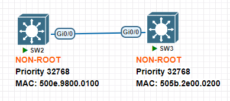

# Spanning-Tree BPDU Filter

[한국어](../04-BPDU-Filter.md) | [English](04-BPDU-Filter.en.md) | **日本語** | [简体中文](04-BPDU-Filter.zh-CN.md) | [Español](04-BPDU-Filter.es.md) | [Français](04-BPDU-Filter.fr.md)

**BPDU Filter** は、[BPDU Guard](../../03-BPDU-Guard/README/03-BPDU-Guard.ja.md) と同じように悪意のある BPDU を防ぐのに使えます。違いは、BPDU Guard が BPDU を受け取ったインターフェイスを **err-disable** にするのに対し、BPDU Filter は BPDU をただ**フィルターする（取り除く）** だけという点です。このページでは BPDU Filter の動作を詳しく見ていきます。

## グローバル設定とインターフェイス設定の違い

BPDU Filter はグローバルでもインターフェイスでも設定できますが、動作が違います。

| 設定場所 | コマンド | 動作 |
| --- | --- | --- |
| グローバル | `spanning-tree portfast bpdufilter default` | **PortFast が有効なインターフェイス**は BPDU を送りも受け取りもしません。ただし、そのインターフェイスで BPDU を受け取ると **PortFast の状態を失い、BPDU Filter も無効になって**通常のインターフェイスとして動作します。 |
| インターフェイス | `spanning-tree bpdufilter enable` | 入ってくる BPDU を**無視**し、BPDU を**送りもしません**。事実上、そのインターフェイスで **spanning-tree を無効にする**のと同じです。 |

インターフェイスで BPDU Filter を有効にするときは注意が必要です。コンピューターにつながる access モードのインターフェイスでは使ってかまいませんが、**ほかのスイッチにつながるインターフェイスには絶対に設定してはいけません**。ループが起きるおそれがあります。

---

## 1. 実習のトポロジー

次のトポロジーで BPDU Filter を確認します。



---

## 2. インターフェイスに設定する

SW2 のインターフェイスで PortFast を有効にし、BPDU Filter を有効にします。


実習のリンクは trunk なので、PortFast は `spanning-tree portfast trunk` で有効にしました。これで SW2 はこのインターフェイスで BPDU を送らず、入ってくる BPDU も無視します。動作を debug で確認します。


BPDU の debug を有効にしても**何も表示されません**。SW2 はもう BPDU を送りも処理もしないからです。必要なら SW3 でも BPDU の debug を有効にしてみてください。SW2 から BPDU が 1 つも届かないことがわかります。インターフェイスのコマンドを削除します。


---

## 3. グローバルに設定する

今度は BPDU Filter をグローバルで有効にします。

```
SW2(config)#spanning-tree portfast bpdufilter default
```

> PDF ではこの手順のキャプチャーが直前の `no spanning-tree bpdufilter enable` のキャプチャーと同じ画面になっていたため、グローバルコマンドはコードブロックで記載しました。

このコマンドは **PortFast が有効なすべてのインターフェイス**で BPDU Filter を有効にします。

これで終わりです。ただし、通常は **BPDU Guard を使うほうがよい**でしょう。BPDU が来るはずのないインターフェイスなら、黙ってフィルターして何が起きたかわからないよりも、err-disable で**通知を受けるほう**がよいからです。

---

## まとめ

- **BPDU Filter** は err-disable にせずに BPDU を**フィルター**します。ポートを err-disable にする BPDU Guard とはそこが違います。
- **グローバル**（`spanning-tree portfast bpdufilter default`）: PortFast のポートは BPDU を送受信しませんが、BPDU を受け取ると PortFast と BPDU Filter が解除されて通常のポートになります。
- **インターフェイス**（`spanning-tree bpdufilter enable`）: BPDU を無視し、送りもしないので、事実上そのポートの **spanning-tree を無効にする**ことになります。
- ほかのスイッチにつながるポートで使うと**ループ**が起きることがあります。ホストのポートだけで使い、できれば通知してくれる **BPDU Guard** を使います。
