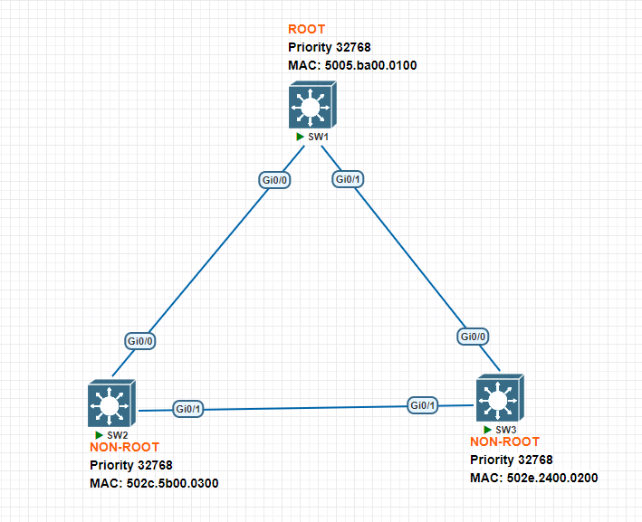
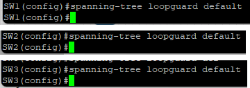
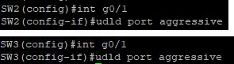
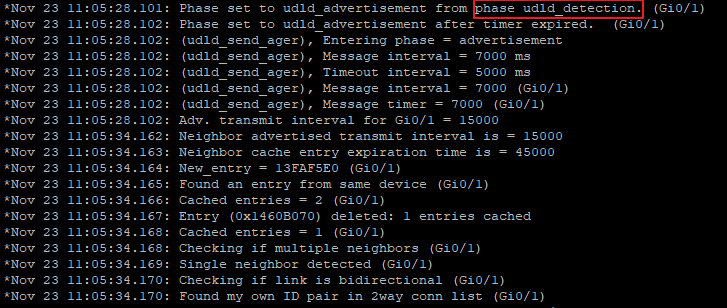

# Spanning-Tree UDLD and Loop Guard

**한국어** | [English](README/05-UDLD-and-Loop-Guard.en.md) | [日本語](README/05-UDLD-and-Loop-Guard.ja.md) | [简体中文](README/05-UDLD-and-Loop-Guard.zh-CN.md) | [Español](README/05-UDLD-and-Loop-Guard.es.md) | [Français](README/05-UDLD-and-Loop-Guard.fr.md)

광케이블을 써 봤다면 송신(transmit)과 수신(receive)에 커넥터가 따로 있다는 것을 알 것입니다. 이 중 한 가닥(송신이나 수신)만 고장 나면 **단방향 링크 장애(unidirectional link failure)** 가 생기고, 이것이 spanning-tree **루프** 를 일으킬 수 있습니다. 이 문제는 두 프로토콜로 해결할 수 있습니다.

- **Loop Guard**
- **UDLD** (UniDirectional Link Detection)


---

## 1. 단방향 링크 장애가 생기면?

먼저 단방향 링크 장애가 생기면 어떤 일이 일어나는지 자세히 보겠습니다.


스위치 사이 링크가 광 링크라고 생각해 보세요. 실제로는 송신과 수신 커넥터가 따로 있습니다. SW3는 SW2로부터 BPDU를 받고 있어서, 그 인터페이스는 **alternate port** 가 되어 blocking 상태입니다.


그런데 문제가 생겼습니다. SW2에서 SW3로 가는 **송신 커넥터** 가 알 수 없는 이유로 고장 났습니다. 그래서 SW3는 SW2로부터 BPDU를 받지 못하지만, SW2로 트래픽을 보내는 것은 여전히 가능합니다.

SW3는 alternate port로 BPDU를 더 이상 받지 못하므로 그 포트를 **forwarding** 으로 바꿉니다. 이제 초록색 화살표처럼 **한 방향 루프** 가 생깁니다.

---

## 2. Loop Guard

단방향 링크 장애를 해결하는 방법 중 하나가 **Loop Guard** 입니다. 스위치가 인터페이스로 BPDU를 **보내고는 있지만 받지 못하면**, Loop Guard는 그 인터페이스를 **loop-inconsistent** 상태로 두고 모든 트래픽을 막습니다.


실제 스위치에서는 어떻게 보이는지 확인해 보겠습니다. 같은 모양의 토폴로지를 씁니다.



> 원문은 SW2와 SW3 사이에 Fa0/16을 썼지만, 실습에서는 **Gi0/1** 로 연결했습니다. SW1이 root bridge이고, SW3의 Gi0/1이 alternate port입니다.

세 스위치 모두 Loop Guard를 켭니다.



`spanning-tree loopguard default` 명령은 Loop Guard를 **전역** 으로 켭니다. 광 커넥터가 없어서 실제 단방향 링크 장애를 만들 수는 없지만, SW2의 Gi0/1에 **BPDU Filter** 를 켜서 흉내 낼 수 있습니다. 그러면 SW3는 alternate port로 BPDU를 더 이상 받지 못하고, 원래라면 forwarding 상태로 바뀝니다.


결과는 이렇습니다.


원래라면 루프가 생겼겠지만, 다행히 Loop Guard가 있습니다. 콘솔에 `LOOPGUARD_BLOCK` 메시지가 나오고 SW3의 Gi0/1이 막힙니다. 문제가 해결됐습니다!

Loop Guard를 꼭 전역으로 켤 필요는 없습니다. 인터페이스 단위로도 이렇게 켤 수 있습니다.


---

## 3. UDLD

단방향 링크 장애를 다루는 또 다른 프로토콜이 **UDLD(UniDirectional Link Detection)** 입니다. spanning-tree 기능은 아니지만 루프를 막는 데 도움이 됩니다.

간단히 말해 UDLD는 **keepalive처럼 동작하는 L2 프로토콜** 입니다. hello 메시지를 보내고 받으면 문제가 없습니다. 그런데 hello를 보내고는 있는데 **더 이상 받지 못하면** 뭔가 잘못된 것이므로 인터페이스를 막습니다.

같은 토폴로지에서 이번에는 UDLD를 설정합니다. 먼저 Loop Guard를 지우는 것을 잊지 마세요.

UDLD를 설정하는 방법은 여러 가지입니다. `udld` 명령으로 전역에서 켤 수도 있지만, 이 방법은 **광 포트에만** UDLD를 켭니다.


UDLD에는 두 가지 모드가 있습니다.

| 모드 | 동작 |
| --- | --- |
| Normal (기본값) | 문제가 생기면 포트를 **undetermined** 로 표시만 하고 인터페이스를 끄지는 않습니다. 알려 주기만 할 뿐 루프는 막지 못합니다. |
| Aggressive | 이웃과 연결이 끊기면 UDLD 프레임을 **1초에 한 번씩 8초 동안** 보냅니다. 그래도 이웃이 응답하지 않으면 인터페이스를 **err-disable** 로 만듭니다. |

**Aggressive** 가 더 좋은 해결책입니다. 스위치 두 대로 UDLD를 확인합니다.


문제가 생기면 인터페이스가 내려가는 것을 보려고 SW2와 SW3의 Gi0/1에 **aggressive** 모드를 씁니다. 실시간으로 보기 위해 debug도 켭니다.



정상일 때는 이웃을 찾고 링크가 양방향인지 확인합니다(`Found my own ID pair in 2way conn list`).


이제 어려운 부분은 단방향 링크 장애를 흉내 내는 것입니다. Loop Guard는 BPDU를 기반으로 하니 쉬웠습니다. UDLD는 자체 L2 프로토콜이므로, SW3에서 **MAC access-list** 로 SW2가 보내는 프레임(SW2의 MAC `502c.5b00.0300`)을 막아서 UDLD 트래픽을 차단합니다.


> 원문은 `502c.5b00.0300` 을 UDLD 전용 MAC 주소라고 설명했지만, 실습 토폴로지에서 이 주소는 **SW2의 MAC** 입니다. 실습은 SW3에서 SW2가 보내는 프레임을 막는 방식으로 UDLD를 차단했습니다.

한쪽에서 UDLD 프레임을 걸러 내는 창의적인 방법입니다. 이렇게 하면 단방향 링크 장애가 생겼다고 판단합니다. 결과는 다음과 같습니다.



debug 메시지가 잔뜩 지나가고, 출력에서 **`phase udld_detection`** 단계로 넘어간 것을 볼 수 있습니다. 원문에 따르면 최종적으로 포트는 **err-disable** 상태가 됩니다. 다음 명령어로 확인할 수 있습니다.

```
SW2#show udld
SW2#show interfaces status err-disabled
```

---

## 4. Loop Guard vs UDLD

Loop Guard와 UDLD는 둘 다 **단방향 링크 장애** 라는 같은 문제를 해결합니다. 겹치는 부분도 있지만 차이도 있습니다.

| 항목 | Loop Guard | UDLD |
| --- | --- | --- |
| 설정 | 전역 / 포트별 | 전역(광 포트용) / 포트별 |
| VLAN별 동작 | 예 | 아니요, 포트 단위 |
| 자동 복구 | 예 | 예 – err-disable timeout 설정 필요 |
| 단방향 링크 장애로 인한 STP 장애 방지 | 예 – 모든 root·alternate 포트에 켜야 함 | 예 – 모든 인터페이스에 켜야 함 |
| BPDU가 전송되지 않아 생기는 STP 장애 방지 | 예 | 아니요 |
| 잘못된 배선(miswiring) 방지 | 아니요 | 예 |

---

## 핵심 정리

- 광 링크는 송신과 수신 가닥이 따로라서, 한쪽만 고장 나면 **단방향 링크 장애** 가 생깁니다. BPDU를 못 받은 alternate port가 forwarding이 되면서 **한 방향 루프** 가 생길 수 있습니다.
- **Loop Guard** 는 BPDU를 보내는데 받지 못하는 포트를 **loop-inconsistent** 로 막습니다. 전역 `spanning-tree loopguard default`, 인터페이스 `spanning-tree guard loop`. 막히면 `LOOPGUARD_BLOCK` 메시지가 나옵니다.
- **UDLD** 는 hello를 주고받는 L2 keepalive 프로토콜입니다. 전역 `udld` 명령은 광 포트에만 적용되고, 포트에서는 `udld port [aggressive]` 로 켭니다.
- UDLD **normal** 은 알림(undetermined)만, **aggressive** 는 8초 동안 확인 후 **err-disable** 로 포트를 막습니다.
- Loop Guard는 VLAN별로 동작하고 BPDU가 안 오는 장애까지 막으며, UDLD는 포트 단위로 동작하고 **잘못된 배선** 까지 잡아 줍니다. 둘을 함께 쓰면 서로를 보완합니다.
