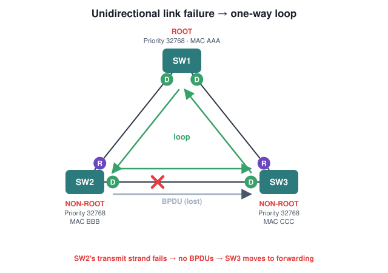
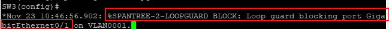

# Spanning-Tree UDLD and Loop Guard

[한국어](../05-UDLD-and-Loop-Guard.md) | **English** | [日本語](05-UDLD-and-Loop-Guard.ja.md) | [简体中文](05-UDLD-and-Loop-Guard.zh-CN.md) | [Español](05-UDLD-and-Loop-Guard.es.md) | [Français](05-UDLD-and-Loop-Guard.fr.md)

If you've ever used fiber cables, you might have noticed that there's a different connector for transmit and receive. If one of them (transmit or receive) fails, we have a **unidirectional link failure**, and this can cause spanning-tree **loops**. Two protocols can take care of this problem:

- **Loop Guard**
- **UDLD** (UniDirectional Link Detection)


---

## 1. What happens with a unidirectional link failure?

Let's start by taking a close look at what happens when we have a unidirectional link failure.


Imagine the links between the switches are fiber links. In reality there's a separate connector for transmit and receive. SW3 is receiving BPDUs from SW2, so its interface has become an **alternate port** in blocking mode.



Now something goes wrong: the **transmit connector** on SW2 toward SW3 fails for unknown reasons. As a result, SW3 no longer receives BPDUs from SW2, but it can still send traffic to SW2.

Because SW3 isn't receiving BPDUs on its alternate port anymore, it moves the port to **forwarding**. We now have a **one-way loop**, as shown by the green arrows.

---

## 2. Loop Guard

One way to solve a unidirectional link failure is **Loop Guard**. When a switch is **sending but not receiving** BPDUs on an interface, Loop Guard puts the interface in the **loop-inconsistent** state and blocks all traffic.


Let's see what this looks like on real switches, using the same shape of topology.


> The original uses Fa0/16 between SW2 and SW3, but the lab uses **Gi0/1**. SW1 is the root bridge, and Gi0/1 on SW3 is the alternate port.

Enable Loop Guard on all three switches.


`spanning-tree loopguard default` enables Loop Guard **globally**. I don't have fiber connectors, so I can't create a real unidirectional link failure, but I can simulate one with **BPDU Filter** on SW2's Gi0/1. SW3 then stops receiving BPDUs on its alternate port, which would normally move it to forwarding.


Here's what happens:



Normally this would cause a loop, but luckily we have Loop Guard. The `LOOPGUARD_BLOCK` message appears on the console and Gi0/1 on SW3 is blocked. Problem solved!

You don't have to enable Loop Guard globally; you can also do it per interface like this:


---

## 3. UDLD

The other protocol for dealing with unidirectional link failures is **UDLD (UniDirectional Link Detection)**. It isn't part of the spanning-tree toolkit, but it does help prevent loops.

Simply put, UDLD is a **layer 2 protocol that works like a keepalive**. You send hello messages, you receive them, and life is good. As soon as you're still sending hellos but **no longer receiving** them, you know something is wrong, and the interface is blocked.

We'll use the same topology but configure UDLD this time. Don't forget to remove Loop Guard first.

There are several ways to configure UDLD. You can enable it globally with the `udld` command, but that only activates UDLD **on fiber ports**.


UDLD has two modes:

| Mode | Behavior |
| --- | --- |
| Normal (default) | Marks the port as **undetermined** when something is wrong but doesn't shut the interface. It only informs you; it won't stop loops. |
| Aggressive | When it loses connectivity to the neighbor, it sends a UDLD frame **once a second for 8 seconds**. If the neighbor still doesn't respond, the interface is put in **err-disable**. |

**Aggressive** is the better solution. Let's use two switches to demonstrate UDLD.


To see the interface go down when something is wrong, we use **aggressive** mode on Gi0/1 of SW2 and SW3. We also enable a debug to watch it in real time.


Normally UDLD finds the neighbor and checks that the link is bidirectional (`Found my own ID pair in 2way conn list`).


The tricky part is simulating a unidirectional link failure. Loop Guard was easy because it's based on BPDUs. UDLD runs its own layer 2 protocol, so on SW3 we block the frames SW2 sends (SW2's MAC `502c.5b00.0300`) with a **MAC access-list** to block the UDLD traffic.


> The original describes `502c.5b00.0300` as UDLD's proprietary MAC address, but in this lab topology that address is **SW2's MAC**. The lab blocks UDLD by dropping the frames SW2 sends, on SW3.

This is a creative way to cause trouble: by filtering UDLD on one side, it concludes there's a unidirectional link failure. Here's what you'll see:


Lots of debug information flies by, and the output shows the move into the **`phase udld_detection`** stage. According to the original, the port ends up in the **err-disable** state. You can check it with these commands:

```
SW2#show udld
SW2#show interfaces status err-disabled
```

---

## 4. Loop Guard vs UDLD

Loop Guard and UDLD both solve the same problem: **unidirectional link failures**. They overlap, but there are some differences:

| Item | Loop Guard | UDLD |
| --- | --- | --- |
| Configuration | Global / per port | Global (for fiber) / per port |
| Per VLAN? | Yes | No, per port |
| Autorecovery | Yes | Yes – requires err-disable timeout |
| Protection against STP failures because of unidirectional link failures | Yes – need to enable it on all root and alternate ports | Yes – need to enable it on all interfaces |
| Protection against STP failures because no BPDUs are sent | Yes | No |
| Protection against miswiring | No | Yes |

---

## Summary

- Fiber links have separate transmit and receive strands, so if one fails you get a **unidirectional link failure**. An alternate port that stops receiving BPDUs moves to forwarding and can create a **one-way loop**.
- **Loop Guard** blocks a port that sends but doesn't receive BPDUs as **loop-inconsistent**. Global `spanning-tree loopguard default`, interface `spanning-tree guard loop`. Blocking shows a `LOOPGUARD_BLOCK` message.
- **UDLD** is a layer 2 keepalive protocol exchanging hellos. The global `udld` command applies only to fiber ports; on a port use `udld port [aggressive]`.
- UDLD **normal** only informs (undetermined); **aggressive** checks for 8 seconds and then blocks the port with **err-disable**.
- Loop Guard works per VLAN and also catches failures where no BPDUs are sent; UDLD works per port and also catches **miswiring**. Used together they complement each other.
