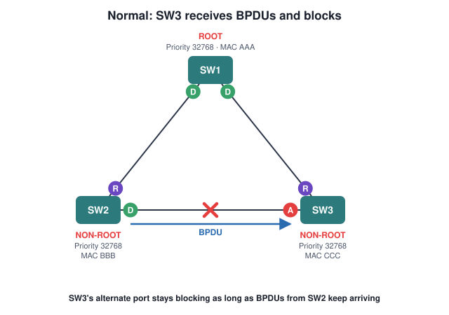
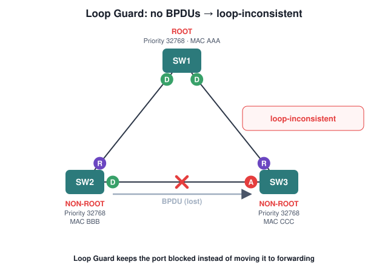
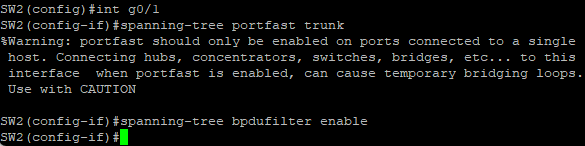
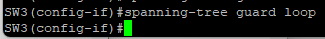
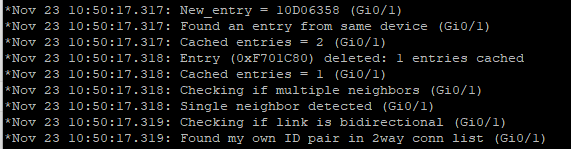
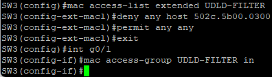

# Spanning-Tree UDLD and Loop Guard

[한국어](../05-UDLD-and-Loop-Guard.md) | [English](05-UDLD-and-Loop-Guard.en.md) | [日本語](05-UDLD-and-Loop-Guard.ja.md) | [简体中文](05-UDLD-and-Loop-Guard.zh-CN.md) | **Español** | [Français](05-UDLD-and-Loop-Guard.fr.md)

Si alguna vez has usado cables de fibra, habrás notado que hay un conector distinto para transmitir y para recibir. Si uno de ellos (transmisión o recepción) falla, tenemos un **fallo de enlace unidireccional (unidirectional link failure)**, y eso puede provocar **bucles** de spanning tree. Dos protocolos pueden ocuparse de este problema:

- **Loop Guard**
- **UDLD** (UniDirectional Link Detection)


---

## 1. ¿Qué pasa con un fallo de enlace unidireccional?

Empecemos viendo con detalle qué ocurre cuando hay un fallo de enlace unidireccional.



Imagina que los enlaces entre los switches son de fibra. En realidad hay un conector distinto para transmitir y para recibir. SW3 recibe BPDU de SW2, así que su interfaz se ha convertido en un **alternate port** en estado blocking.


Ahora algo sale mal: el **conector de transmisión** de SW2 hacia SW3 falla por motivos desconocidos. Como resultado, SW3 ya no recibe BPDU de SW2, pero todavía puede enviar tráfico a SW2.

Como SW3 ya no recibe BPDU en su alternate port, pasa el puerto a **forwarding**. Ahora tenemos un **bucle en un solo sentido**, como muestran las flechas verdes.

---

## 2. Loop Guard

Una forma de resolver un fallo de enlace unidireccional es **Loop Guard**. Cuando un switch **envía pero no recibe** BPDU en una interfaz, Loop Guard pone la interfaz en estado **loop-inconsistent** y bloquea todo el tráfico.



Veamos cómo se ve en switches reales, con una topología de la misma forma.


> El original usa Fa0/16 entre SW2 y SW3, pero el laboratorio usa **Gi0/1**. SW1 es el root bridge y Gi0/1 de SW3 es el alternate port.

Activamos Loop Guard en los tres switches.


`spanning-tree loopguard default` activa Loop Guard **de forma global**. No tengo conectores de fibra, así que no puedo crear un fallo unidireccional real, pero puedo simularlo con **BPDU Filter** en Gi0/1 de SW2. SW3 deja entonces de recibir BPDU en su alternate port, lo que normalmente lo pasaría a forwarding.



Esto es lo que ocurre:


Normalmente esto causaría un bucle, pero por suerte tenemos Loop Guard. Aparece el mensaje `LOOPGUARD_BLOCK` en la consola y Gi0/1 de SW3 queda bloqueado. ¡Problema resuelto!

No hace falta activar Loop Guard de forma global; también puedes hacerlo por interfaz así:



---

## 3. UDLD

El otro protocolo para tratar los fallos de enlace unidireccional es **UDLD (UniDirectional Link Detection)**. No forma parte de las herramientas de spanning tree, pero ayuda a evitar bucles.

Dicho de forma sencilla, UDLD es un **protocolo de capa 2 que funciona como un keepalive**. Envías mensajes hello, los recibes y todo va bien. En cuanto sigues enviando hello pero **dejas de recibirlos**, sabes que algo va mal y la interfaz se bloquea.

Usamos la misma topología pero esta vez configuramos UDLD. No olvides quitar primero Loop Guard.

Hay varias formas de configurar UDLD. Puedes activarlo globalmente con el comando `udld`, pero eso solo activa UDLD **en los puertos de fibra**.


UDLD tiene dos modos:

| Modo | Comportamiento |
| --- | --- |
| Normal (por defecto) | Marca el puerto como **undetermined** cuando algo va mal, pero no apaga la interfaz. Solo informa; no detiene los bucles. |
| Aggressive | Cuando pierde la conectividad con el vecino, envía una trama UDLD **una vez por segundo durante 8 segundos**. Si el vecino sigue sin responder, pone la interfaz en **err-disable**. |

**Aggressive** es la mejor solución. Usemos dos switches para demostrar UDLD.


Para ver cómo cae la interfaz cuando algo va mal, usamos el modo **aggressive** en Gi0/1 de SW2 y SW3. También activamos un debug para verlo en tiempo real.


En condiciones normales, UDLD encuentra al vecino y comprueba que el enlace es bidireccional (`Found my own ID pair in 2way conn list`).



Lo difícil es simular un fallo de enlace unidireccional. Con Loop Guard era fácil porque se basa en BPDU. UDLD usa su propio protocolo de capa 2, así que en SW3 bloqueamos con una **MAC access-list** las tramas que envía SW2 (la MAC de SW2, `502c.5b00.0300`) para cortar el tráfico UDLD.



> El original describe `502c.5b00.0300` como la dirección MAC propietaria de UDLD, pero en esta topología esa dirección es **la MAC de SW2**. El laboratorio bloquea UDLD descartando en SW3 las tramas que envía SW2.

Es una forma creativa de provocar problemas: al filtrar UDLD en un lado, concluye que hay un fallo de enlace unidireccional. Esto es lo que verás:


Pasa mucha información de debug, y la salida muestra el paso a la fase **`phase udld_detection`**. Según el original, el puerto acaba en estado **err-disable**. Puedes comprobarlo con estos comandos:

```
SW2#show udld
SW2#show interfaces status err-disabled
```

---

## 4. Loop Guard frente a UDLD

Loop Guard y UDLD resuelven el mismo problema: los **fallos de enlace unidireccional**. Se solapan, pero tienen algunas diferencias:

| Elemento | Loop Guard | UDLD |
| --- | --- | --- |
| Configuración | Global / por puerto | Global (para fibra) / por puerto |
| ¿Por VLAN? | Sí | No, por puerto |
| Recuperación automática | Sí | Sí – requiere el err-disable timeout |
| Protección contra fallos de STP por enlaces unidireccionales | Sí – hay que activarlo en todos los puertos root y alternate | Sí – hay que activarlo en todas las interfaces |
| Protección contra fallos de STP porque no se envían BPDU | Sí | No |
| Protección contra cableado erróneo (miswiring) | No | Sí |

---

## Resumen

- Los enlaces de fibra tienen hilos separados para transmitir y recibir, así que si uno falla se produce un **fallo de enlace unidireccional**. Un alternate port que deja de recibir BPDU pasa a forwarding y puede crear un **bucle en un solo sentido**.
- **Loop Guard** bloquea como **loop-inconsistent** un puerto que envía pero no recibe BPDU. Global `spanning-tree loopguard default`, interfaz `spanning-tree guard loop`. Al bloquear aparece el mensaje `LOOPGUARD_BLOCK`.
- **UDLD** es un protocolo keepalive de capa 2 que intercambia hello. El comando global `udld` solo se aplica a puertos de fibra; en un puerto se usa `udld port [aggressive]`.
- UDLD **normal** solo informa (undetermined); **aggressive** comprueba durante 8 segundos y luego bloquea el puerto con **err-disable**.
- Loop Guard funciona por VLAN y también detecta fallos en los que no se envían BPDU; UDLD funciona por puerto y también detecta el **cableado erróneo**. Usados juntos se complementan.
