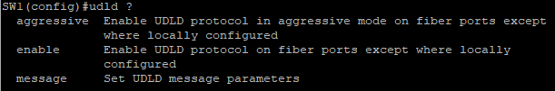

# Spanning-Tree UDLD and Loop Guard

[한국어](../05-UDLD-and-Loop-Guard.md) | [English](05-UDLD-and-Loop-Guard.en.md) | [日本語](05-UDLD-and-Loop-Guard.ja.md) | [简体中文](05-UDLD-and-Loop-Guard.zh-CN.md) | [Español](05-UDLD-and-Loop-Guard.es.md) | **Français**

Si vous avez déjà utilisé des câbles en fibre, vous avez peut-être remarqué qu'il y a un connecteur différent pour l'émission et pour la réception. Si l'un d'eux (émission ou réception) tombe en panne, on a une **panne de liaison unidirectionnelle (unidirectional link failure)**, qui peut provoquer des **boucles** spanning tree. Deux protocoles permettent de régler ce problème :

- **Loop Guard**
- **UDLD** (UniDirectional Link Detection)


---

## 1. Que se passe-t-il en cas de panne unidirectionnelle ?

Commençons par examiner de près ce qui se passe lors d'une panne de liaison unidirectionnelle.


Imaginez que les liens entre les commutateurs sont en fibre. En réalité, il y a un connecteur distinct pour l'émission et pour la réception. SW3 reçoit les BPDU de SW2, son interface est donc devenue un **alternate port** à l'état blocking.


Puis quelque chose tourne mal : le **connecteur d'émission** de SW2 vers SW3 tombe en panne pour une raison inconnue. SW3 ne reçoit donc plus de BPDU de SW2, mais il peut toujours envoyer du trafic vers SW2.

Comme SW3 ne reçoit plus de BPDU sur son alternate port, il fait passer ce port en **forwarding**. On a alors une **boucle à sens unique**, comme le montrent les flèches vertes.

---

## 2. Loop Guard

L'une des façons de régler une panne de liaison unidirectionnelle est **Loop Guard**. Quand un commutateur **envoie des BPDU sur une interface sans en recevoir**, Loop Guard place l'interface à l'état **loop-inconsistent** et bloque tout le trafic.


Voyons à quoi cela ressemble sur de vrais commutateurs, avec une topologie de même forme.


> L'original utilise Fa0/16 entre SW2 et SW3, mais le labo utilise **Gi0/1**. SW1 est le root bridge, et Gi0/1 sur SW3 est l'alternate port.

Activons Loop Guard sur les trois commutateurs.


`spanning-tree loopguard default` active Loop Guard **globalement**. Je n'ai pas de connecteurs fibre, donc je ne peux pas créer une vraie panne unidirectionnelle, mais je peux la simuler avec **BPDU Filter** sur Gi0/1 de SW2. SW3 ne reçoit alors plus de BPDU sur son alternate port, ce qui le ferait normalement passer en forwarding.


Voici ce qui se passe :


Normalement, cela provoquerait une boucle, mais heureusement Loop Guard est configuré. Le message `LOOPGUARD_BLOCK` apparaît sur la console et Gi0/1 de SW3 est bloqué. Problème résolu !

Il n'est pas obligatoire d'activer Loop Guard globalement ; on peut aussi le faire par interface, comme ceci :


---

## 3. UDLD

L'autre protocole pour gérer les pannes de liaison unidirectionnelle est **UDLD (UniDirectional Link Detection)**. Il ne fait pas partie de la boîte à outils spanning tree, mais il aide à éviter les boucles.

En bref, UDLD est un **protocole de couche 2 qui fonctionne comme un keepalive**. On envoie des messages hello, on les reçoit, et tout va bien. Dès qu'on envoie encore des hello mais qu'on **n'en reçoit plus**, on sait qu'il y a un problème, et l'interface est bloquée.

Reprenons la même topologie, mais cette fois avec UDLD. N'oubliez pas de retirer d'abord Loop Guard.

Il existe plusieurs façons de configurer UDLD. On peut l'activer globalement avec la commande `udld`, mais cela n'active UDLD **que sur les ports fibre**.



UDLD a deux modes :

| Mode | Comportement |
| --- | --- |
| Normal (par défaut) | Marque le port comme **undetermined** en cas de problème, mais n'arrête pas l'interface. Il se contente d'informer ; il n'arrête pas les boucles. |
| Aggressive | Quand il perd la connectivité avec le voisin, il envoie une trame UDLD **une fois par seconde pendant 8 secondes**. Si le voisin ne répond toujours pas, l'interface est mise en **err-disable**. |

**Aggressive** est la meilleure solution. Utilisons deux commutateurs pour montrer UDLD.


Pour voir l'interface tomber en cas de problème, nous utilisons le mode **aggressive** sur Gi0/1 de SW2 et SW3. Nous activons aussi un debug pour suivre en temps réel.


En temps normal, UDLD trouve le voisin et vérifie que le lien est bidirectionnel (`Found my own ID pair in 2way conn list`).


Le plus délicat est de simuler une panne unidirectionnelle. Loop Guard était facile car il repose sur les BPDU. UDLD utilise son propre protocole de couche 2 ; sur SW3, on bloque donc avec une **MAC access-list** les trames envoyées par SW2 (la MAC de SW2, `502c.5b00.0300`) pour couper le trafic UDLD.


> L'original présente `502c.5b00.0300` comme l'adresse MAC propriétaire d'UDLD, mais dans cette topologie de labo, cette adresse est **la MAC de SW2**. Le labo bloque UDLD en rejetant sur SW3 les trames envoyées par SW2.

C'est une façon créative de provoquer une panne : en filtrant UDLD d'un côté, il conclut à une panne de liaison unidirectionnelle. Voici ce que vous verrez :


Beaucoup d'informations de debug défilent, et la sortie montre le passage à la phase **`phase udld_detection`**. D'après l'original, le port finit à l'état **err-disable**. Vous pouvez le vérifier avec ces commandes :

```
SW2#show udld
SW2#show interfaces status err-disabled
```

---

## 4. Loop Guard ou UDLD

Loop Guard et UDLD résolvent le même problème : les **pannes de liaison unidirectionnelle**. Ils se recoupent en partie, mais présentent quelques différences :

| Élément | Loop Guard | UDLD |
| --- | --- | --- |
| Configuration | Global / par port | Global (pour la fibre) / par port |
| Par VLAN ? | Oui | Non, par port |
| Récupération automatique | Oui | Oui – nécessite l'err-disable timeout |
| Protection contre les pannes STP dues aux liaisons unidirectionnelles | Oui – à activer sur tous les ports root et alternate | Oui – à activer sur toutes les interfaces |
| Protection contre les pannes STP dues à l'absence d'envoi de BPDU | Oui | Non |
| Protection contre les erreurs de câblage (miswiring) | Non | Oui |

---

## Résumé

- Les liens en fibre ont des brins séparés pour l'émission et la réception : si l'un tombe en panne, on obtient une **panne de liaison unidirectionnelle**. Un alternate port qui ne reçoit plus de BPDU passe en forwarding et peut créer une **boucle à sens unique**.
- **Loop Guard** bloque à l'état **loop-inconsistent** un port qui envoie mais ne reçoit pas de BPDU. Global `spanning-tree loopguard default`, interface `spanning-tree guard loop`. Le blocage affiche le message `LOOPGUARD_BLOCK`.
- **UDLD** est un protocole keepalive de couche 2 qui échange des hello. La commande globale `udld` ne s'applique qu'aux ports fibre ; sur un port, on utilise `udld port [aggressive]`.
- UDLD **normal** se contente d'informer (undetermined) ; **aggressive** vérifie pendant 8 secondes puis bloque le port en **err-disable**.
- Loop Guard fonctionne par VLAN et détecte aussi les pannes où aucune BPDU n'est envoyée ; UDLD fonctionne par port et détecte aussi les **erreurs de câblage**. Utilisés ensemble, ils se complètent.
