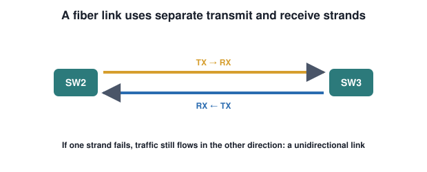
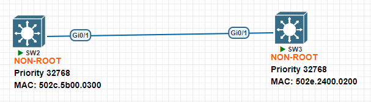

# Spanning-Tree UDLD and Loop Guard

[한국어](../05-UDLD-and-Loop-Guard.md) | [English](05-UDLD-and-Loop-Guard.en.md) | [日本語](05-UDLD-and-Loop-Guard.ja.md) | **简体中文** | [Español](05-UDLD-and-Loop-Guard.es.md) | [Français](05-UDLD-and-Loop-Guard.fr.md)

如果用过光纤，你可能注意到发送（transmit）和接收（receive）各有一个连接器。如果其中一根（发送或接收）出故障，就会出现**单向链路故障（unidirectional link failure）**，这可能导致 spanning-tree **环路**。有两种协议可以解决这个问题：

- **Loop Guard**
- **UDLD**（UniDirectional Link Detection）



---

## 1. 发生单向链路故障会怎样？

先仔细看看发生单向链路故障时会发生什么。


假设交换机之间都是光纤链路。实际上发送和接收各有一个连接器。SW3 正在从 SW2 接收 BPDU，因此它的接口成为 **alternate port**，处于 blocking 状态。


现在出了问题：SW2 通往 SW3 的**发送连接器**因不明原因坏了。结果 SW3 收不到 SW2 的 BPDU，但仍然可以向 SW2 发送流量。

由于 SW3 的 alternate port 不再收到 BPDU，它会把该端口转为 **forwarding**。于是就出现了绿色箭头所示的**单向环路**。

---

## 2. Loop Guard

解决单向链路故障的方法之一是 **Loop Guard**。当交换机在接口上**发送 BPDU 却收不到 BPDU** 时，Loop Guard 会把该接口置为 **loop-inconsistent** 状态，并阻断所有流量。


来看看在真实交换机上是什么样子。使用同样形状的拓扑。


> 原文在 SW2 和 SW3 之间使用 Fa0/16，但实验中用的是 **Gi0/1**。SW1 是 root bridge，SW3 的 Gi0/1 是 alternate port。

在三台交换机上都启用 Loop Guard。


`spanning-tree loopguard default` 命令会**全局**启用 Loop Guard。我没有光纤连接器，无法制造真正的单向链路故障，但可以在 SW2 的 Gi0/1 上启用 **BPDU Filter** 来模拟。这样 SW3 的 alternate port 就收不到 BPDU，本来会转入 forwarding 状态。


结果如下：


正常情况下这会造成环路，但幸好配置了 Loop Guard。控制台出现 `LOOPGUARD_BLOCK` 消息，SW3 的 Gi0/1 被阻塞。问题解决了！

Loop Guard 不一定要全局配置，也可以像这样在接口上启用：


---

## 3. UDLD

另一个应对单向链路故障的协议是 **UDLD（UniDirectional Link Detection）**。它不属于 spanning-tree 的功能，但能帮助防止环路。

简单来说，UDLD 是**像 keepalive 一样工作的二层协议**。发送 hello 消息，也能收到，一切正常。一旦还在发送 hello 却**再也收不到**，就说明出问题了，接口会被阻断。

使用同一拓扑，这次配置 UDLD。别忘了先删除 Loop Guard。

UDLD 有多种配置方式。可以用 `udld` 命令全局启用，但这样只会在**光纤端口上**启用 UDLD。


UDLD 有两种模式：

| 模式 | 行为 |
| --- | --- |
| Normal（默认） | 出问题时只把端口标记为 **undetermined**，不会关闭接口。它只起到通知作用，无法阻止环路。 |
| Aggressive | 与邻居失去连接时，会**每秒发送一次、持续 8 秒**发送 UDLD 帧。如果邻居仍无响应，就把接口置为 **err-disable**。 |

**Aggressive** 是更好的方案。用两台交换机演示 UDLD。



为了看到出问题时接口被关闭，在 SW2 和 SW3 的 Gi0/1 上使用 **aggressive** 模式。为了实时观察，也开启 debug。


正常时，UDLD 会找到邻居并确认链路是双向的（`Found my own ID pair in 2way conn list`）。


难点在于模拟单向链路故障。Loop Guard 基于 BPDU，所以比较容易。UDLD 运行自己的二层协议，因此在 SW3 上用 **MAC access-list** 阻挡 SW2 发来的帧（SW2 的 MAC `502c.5b00.0300`），从而阻断 UDLD 流量。


> 原文把 `502c.5b00.0300` 说成 UDLD 专用的 MAC 地址，但在本实验拓扑中，这个地址是 **SW2 的 MAC**。实验是在 SW3 上丢弃 SW2 发来的帧来阻断 UDLD 的。

这是一个很有创意的“搞破坏”方法：在一侧过滤 UDLD 帧，它就会认为出现了单向链路故障。结果如下：


大量 debug 信息飞快滚过，输出中可以看到进入了 **`phase udld_detection`** 阶段。按照原文，端口最终会进入 **err-disable** 状态。可以用下面的命令确认：

```
SW2#show udld
SW2#show interfaces status err-disabled
```

---

## 4. Loop Guard vs UDLD

Loop Guard 和 UDLD 解决的是同一个问题：**单向链路故障**。二者有重叠，也有一些区别：

| 项目 | Loop Guard | UDLD |
| --- | --- | --- |
| 配置 | 全局 / 按端口 | 全局（用于光纤）/ 按端口 |
| 按 VLAN 工作？ | 是 | 否，按端口 |
| 自动恢复 | 是 | 是 – 需要设置 err-disable timeout |
| 防止单向链路故障导致的 STP 故障 | 是 – 需要在所有 root 和 alternate 端口上启用 | 是 – 需要在所有接口上启用 |
| 防止因不发送 BPDU 导致的 STP 故障 | 是 | 否 |
| 防止接线错误（miswiring） | 否 | 是 |

---

## 总结

- 光纤链路的发送和接收是分开的两根纤芯，其中一根坏了就会出现**单向链路故障**。收不到 BPDU 的 alternate port 转入 forwarding，可能形成**单向环路**。
- **Loop Guard** 把发送 BPDU 却收不到 BPDU 的端口阻塞为 **loop-inconsistent**。全局 `spanning-tree loopguard default`，接口 `spanning-tree guard loop`。阻塞时出现 `LOOPGUARD_BLOCK` 消息。
- **UDLD** 是互相收发 hello 的二层 keepalive 协议。全局 `udld` 命令只适用于光纤端口，端口上用 `udld port [aggressive]` 启用。
- UDLD **normal** 只做通知（undetermined），**aggressive** 确认 8 秒后用 **err-disable** 阻断端口。
- Loop Guard 按 VLAN 工作，还能防止不发送 BPDU 的故障；UDLD 按端口工作，还能发现**接线错误**。两者一起使用可以互补。
