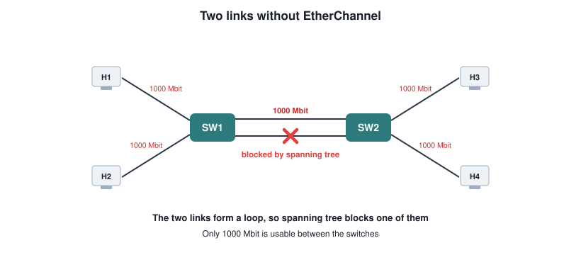
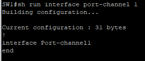
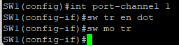
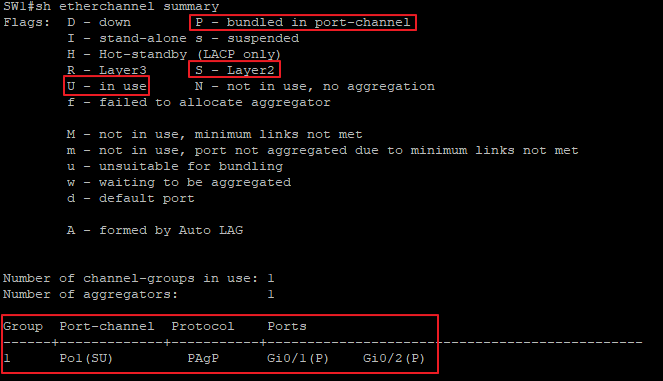
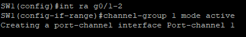
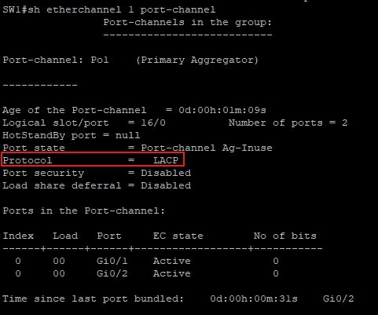
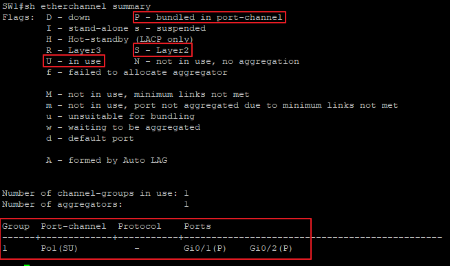

# Introduction to EtherChannel

**한국어** | [English](README/01-Introduction-to-EtherChannel.en.md) | [日本語](README/01-Introduction-to-EtherChannel.ja.md) | [简体中文](README/01-Introduction-to-EtherChannel.zh-CN.md) | [Español](README/01-Introduction-to-EtherChannel.es.md) | [Français](README/01-Introduction-to-EtherChannel.fr.md)

이번 글에서는 **링크 집선(link aggregation)** 이라고도 부르는 **EtherChannel** 을 살펴봅니다. EtherChannel은 **여러 개의 물리 링크를 하나의 논리 링크로 묶는** 기술입니다. 어떻게 동작하는지, 어떤 장점이 있는지 작은 네트워크 예시로 시작하겠습니다.

## EtherChannel 설정 방식 한눈에 보기

| 방식 | 표준 | 모드 | 설명 |
| --- | --- | --- | --- |
| PAgP | Cisco 전용 | `desirable` / `auto` | Cisco 장비끼리만 협상 |
| LACP | IEEE 표준 | `active` / `passive` | 여러 제조사 장비가 지원 |
| 수동 | 없음 | `on` | 협상 없이 묶음 |

---

## 1. 왜 EtherChannel이 필요한가?

위 그림에는 스위치 두 대가 있고, 각 스위치에 컴퓨터가 두 대씩 연결되어 있습니다. 모든 인터페이스는 기가비트 이더넷입니다.

이제 H1이 H3로 800 Mbit, H2가 H4로 600 Mbit의 트래픽을 보낸다고 해 보겠습니다. 그러면 **스위치 사이의 링크가 병목** 이 됩니다. 800 + 600 = 1400 Mbit가 필요한데, 링크는 1000 Mbit뿐입니다.

> 원문에는 "800 + 400 = 1400 Mbit"로 적혀 있지만, H2가 보내는 양이 600 Mbit이므로 800 + 600으로 고쳤습니다.

이 문제를 푸는 방법은 두 가지입니다.

- 스위치 사이의 링크를 더 빠른 링크(예: 10기가비트)로 바꾼다.
- 링크를 여러 개 추가하고 **EtherChannel로 묶는다.**

이 글의 주제는 EtherChannel이니 링크를 추가하는 방법을 보겠습니다.

링크를 하나 더 추가했습니다. 그런데 이렇게 하면 스위치 사이에 **루프** 가 생기므로, **spanning-tree가 두 링크 중 하나를 차단** 합니다. EtherChannel은 이 물리 링크들로 **하나의 가상 링크** 를 만들어서 이 문제를 해결합니다.

Spanning-tree는 이 링크를 **논리 링크 하나** 로 보므로 루프가 없습니다! EtherChannel은 여러 링크에 트래픽을 **로드 밸런싱** 하고, **이중화** 도 처리합니다. 링크 하나가 끊어져도 남은 링크로 계속 동작합니다.

단, 물리 링크의 속도가 여전히 한계라는 점을 기억하세요. **트래픽 흐름 하나는 1000 Mbit(기가비트 링크 하나)를 넘을 수 없습니다.** EtherChannel은 고속도로에 차선을 늘리는 것과 같습니다. 전체 대역폭은 늘어나지만 제한 속도는 그대로입니다.

EtherChannel에는 물리 인터페이스를 **최대 16개** 까지 넣을 수 있지만, 한 번에 **활성화되는 것은 8개** 뿐입니다.

---

## 2. 설정 방식과 조건

EtherChannel을 설정하는 방법은 세 가지입니다.

- **PAgP** (Cisco 전용)
- **LACP** (IEEE 표준)
- **수동(Manual)**

PAgP와 LACP는 EtherChannel을 **자동으로 협상** 하는 프로토콜입니다. PAgP는 Cisco 전용 프로토콜이라 Cisco 장비끼리만 쓸 수 있고, LACP는 IEEE 표준이라 많은 제조사가 지원합니다. 이런 프로토콜 없이 협상을 하지 않는 **정적(static) EtherChannel** 도 설정할 수 있습니다.

EtherChannel을 만들 때는 **모든 인터페이스의 설정이 같아야** 합니다.

- Duplex
- Speed
- Native VLAN과 허용 VLAN
- Switchport 모드(access 또는 trunk)

PAgP와 LACP는 묶으려는 인터페이스들의 설정이 같은지 확인합니다.

---

## 3. PAgP 설정

PAgP 인터페이스는 두 가지 모드 중 하나로 설정합니다.

- **Desirable**: 상대에게 EtherChannel을 만들자고 **먼저 요청** 합니다.
- **Auto**: 상대가 요청하기를 **수동적으로 기다립니다.**

두 모드의 조합에 따라 EtherChannel이 만들어지는지 정리하면 다음과 같습니다.

| | Desirable | Auto |
| --- | --- | --- |
| **Desirable** | 생성됨 | 생성됨 |
| **Auto** | 생성됨 | 생성되지 않음 |

이제 스위치 두 대 사이에 PAgP를 설정해 보겠습니다. SW1과 SW2를 사용합니다.

SW1과 SW2에는 각각 기가비트 인터페이스가 두 개 있고, 이 둘을 논리 링크 하나로 묶겠습니다. 선택할 수 있는 모드는 다음과 같습니다.

인터페이스에서 `channel-group` 명령을 씁니다. 그룹 번호는 아무 숫자나 골라도 되는데, 여기서는 1을 쓰겠습니다. 그리고 auto와 desirable 중 하나를 고릅니다. SW1은 **desirable** 로 설정합니다.

SW1을 PAgP desirable 모드로 설정했으므로 SW1이 SW2에게 EtherChannel을 만들자고 먼저 요청합니다. SW2는 auto나 desirable 중 무엇이든 됩니다. 여기서는 **auto** 를 쓰겠습니다.

auto 모드인 SW2는 들어오는 PAgP 요청에만 응답합니다. 몇 초 뒤 두 스위치에 다음 메시지가 나타납니다.

스위치가 새 **port-channel 인터페이스** 를 자동으로 만듭니다.

지금은 port-channel 인터페이스 아래에 아무 설정도 없습니다.

이 EtherChannel에 속한 두 물리 인터페이스에는 `channel-group` 명령만 있습니다.

EtherChannel을 trunk로 만드는 것처럼 설정을 바꾸려면 **port-channel 인터페이스에서** 해야 합니다. 예를 들면 다음과 같습니다.

이렇게 하면 스위치가 물리 인터페이스에도 같은 명령을 자동으로 추가합니다.

EtherChannel에 속한 물리 인터페이스는 직접 바꾸지 마세요. **항상 port-channel 인터페이스에서 설정** 합니다.

이제 show 명령으로 EtherChannel 상태를 자세히 보겠습니다. 첫 번째 명령입니다.

`show etherchannel summary` 는 모든 EtherChannel을 깔끔하게 보여 줍니다. EtherChannel이 올라왔는지(SU), 어떤 프로토콜을 쓰는지, 포트가 묶였는지(P) 알 수 있습니다. 다른 show 명령도 보겠습니다.

`show etherchannel 1 port-channel` 은 EtherChannel의 개요를 보여 줍니다. 사용 중인 프로토콜과 인터페이스, 논리 인터페이스가 사용 중(Ag-Inuse)인지 알 수 있습니다.

마지막 show 명령입니다.

세 번째 확인 방법은 `show interfaces <인터페이스> etherchannel` 입니다. 여기서는 GigabitEthernet0/1의 정보를 봤습니다. 내 스위치 정보뿐 아니라 **상대 스위치의 인터페이스(Partner's information)** 도 볼 수 있습니다.

---

## 4. LACP 설정

LACP는 PAgP와 비슷하지만 다른 용어를 씁니다.

- **Active**: 상대에게 EtherChannel을 만들자고 **먼저 요청** 합니다.
- **Passive**: 상대가 요청하기를 **수동적으로 기다립니다.**

**적어도 한쪽은 active 모드** 여야 합니다. 양쪽 모두 passive이면 아무 일도 일어나지 않습니다.

| | Active | Passive |
| --- | --- | --- |
| **Active** | 생성됨 | 생성됨 |
| **Passive** | 생성됨 | 생성되지 않음 |

PAgP와 같은 토폴로지를 사용합니다.

SW1은 **active** 모드로 설정합니다.

SW2는 **passive** 모드로 설정합니다.

PAgP에서 쓴 show 명령으로 확인해 보겠습니다.

`show etherchannel 1 port-channel` 도 보겠습니다.

마지막으로 `show interfaces g0/1 etherchannel` 입니다.

보시다시피 이제 프로토콜은 **LACP** 이고, Port-channel 1 인터페이스에 물리 인터페이스 두 개가 들어 있습니다.

---

## 5. 수동(on) 설정

PAgP나 LACP 대신 EtherChannel을 **수동으로 켤** 수도 있습니다. 같은 토폴로지로 보여 드리겠습니다.

설정은 다음과 같습니다. 양쪽 모두 `mode on` 입니다.

이게 전부입니다. show 명령으로 확인해 보겠습니다. 먼저 개요입니다.

위 출력에서 Protocol이 `-` 로, **아무 프로토콜도 쓰지 않는다** 는 것을 알 수 있습니다. Port-channel 인터페이스를 자세히 보겠습니다.

물리 인터페이스 하나를 골라 EtherChannel 정보도 확인할 수 있습니다. Mode가 **On** 입니다.

---

## 6. 로드 밸런싱

EtherChannel에서 마지막으로 볼 것은 **로드 밸런싱** 입니다. 다음 출력을 보세요.

`show etherchannel load-balance` 로 기본 설정을 확인할 수 있습니다. 이 스위치는 **출발지 MAC 주소(src-mac)** 를 기준으로 로드 밸런싱합니다. 원하면 `port-channel load-balance` 명령으로 바꿀 수 있습니다.

출발지·목적지 MAC 주소나 IP 주소, 그리고 그 조합까지 고를 수 있는 옵션이 많습니다.

로드 밸런싱을 왜 신경 써야 할까요? 다음 그림을 보세요.

왼쪽에는 SW1과 컴퓨터 네 대가, 오른쪽에는 SW2와 라우터가 있습니다. 기본 로드 밸런싱 방식은 출발지 MAC 주소입니다. 즉 **한 MAC 주소에서 나온 트래픽은 모두 같은 물리 인터페이스 하나로** 나갑니다. 예를 들면 다음과 같습니다.

- MAC 주소 AAA → SW1의 Gi0/1
- MAC 주소 BBB → SW1의 Gi0/2
- MAC 주소 CCC → SW1의 Gi0/1
- MAC 주소 DDD → SW1의 Gi0/2

컴퓨터가 여러 대이므로 이건 괜찮습니다. SW1의 물리 링크 두 개가 모두 쓰이고, 컴퓨터들이 보내는 양에 따라 거의 1:1 비율이 됩니다.

SW2는 사정이 다릅니다. MAC 주소가 EEE인 라우터 하나뿐이라, 물리 인터페이스 하나를 골라 **라우터의 트래픽을 모두** GigabitEthernet0/1이나 0/2 한쪽으로만 보냅니다. **물리 링크 하나는 전혀 쓰이지 않습니다.**

이런 경우에는 로드 밸런싱 방식을 바꾸는 것이 좋습니다. 예를 들어 SW2에서 다음과 같이 설정할 수 있습니다.

SW2의 로드 밸런싱을 **목적지 MAC 주소** 로 바꾸면, 라우터에서 컴퓨터로 가는 트래픽이 여러 물리 인터페이스에 나뉩니다. 목적지 MAC 주소가 서로 다른 컴퓨터가 여러 대 있기 때문입니다.

---

## 핵심 정리

- **EtherChannel** 은 여러 물리 인터페이스를 묶은 **논리 인터페이스(port-channel)** 입니다.
- Spanning-tree는 EtherChannel을 인터페이스 하나로 보므로 **중복 물리 링크를 차단하지 않습니다.** 링크 하나가 끊겨도 나머지로 계속 동작합니다.
- 설정 방법은 세 가지입니다: **PAgP**(Cisco 전용, desirable/auto), **LACP**(IEEE 표준, active/passive), **수동**(`on`, 프로토콜 없음). PAgP는 한쪽이 desirable, LACP는 한쪽이 active여야 합니다.
- 묶을 인터페이스는 duplex, speed, VLAN, switchport 모드가 모두 같아야 하고, 설정 변경은 **port-channel 인터페이스에서** 합니다.
- 확인 명령: `show etherchannel summary`, `show etherchannel 1 port-channel`, `show interfaces <인터페이스> etherchannel`.
- 로드 밸런싱 방식은 여러 가지입니다(`port-channel load-balance`). 트래픽 패턴에 맞는 방식을 고르세요. 한 흐름은 링크 하나의 속도를 넘지 못합니다.
