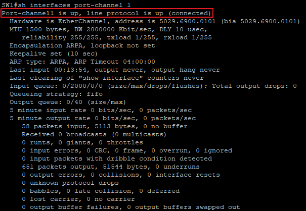
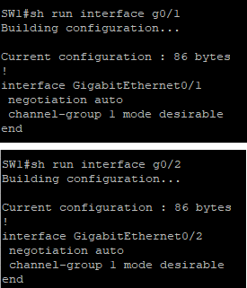
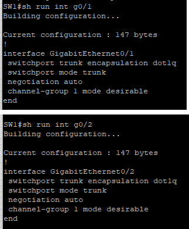
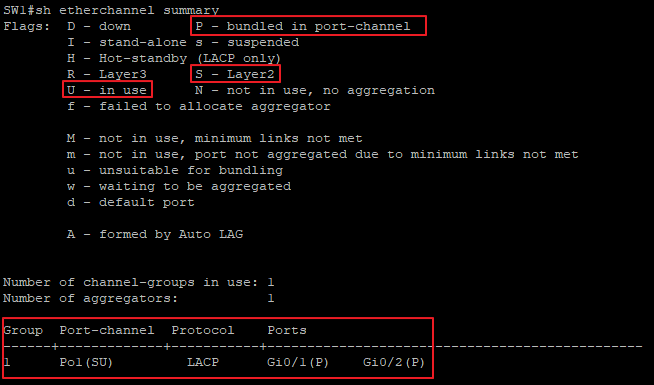

# Introduction to EtherChannel

[한국어](../01-Introduction-to-EtherChannel.md) | **English** | [日本語](01-Introduction-to-EtherChannel.ja.md) | [简体中文](01-Introduction-to-EtherChannel.zh-CN.md) | [Español](01-Introduction-to-EtherChannel.es.md) | [Français](01-Introduction-to-EtherChannel.fr.md)

In this lesson, we'll take a look at **EtherChannel**, which is also known as **link aggregation**. EtherChannel is a technology that lets you **bundle multiple physical links into a single logical link**. We'll look at how it works and what its advantages are, starting with an example of a small network.

## EtherChannel options at a glance

| Option | Standard | Modes | Description |
| --- | --- | --- | --- |
| PAgP | Cisco proprietary | `desirable` / `auto` | Negotiates between Cisco devices only |
| LACP | IEEE standard | `active` / `passive` | Supported by many vendors |
| Manual | None | `on` | Bundles without negotiation |

---

## 1. Why do we need EtherChannel?

In the picture above, I have two switches with two computers connected to each switch. We use Gigabit Ethernet interfaces everywhere.

Now imagine that H1 sends 800 Mbit of traffic to H3 and H2 sends 600 Mbit of traffic to H4. The **link between the switches becomes a bottleneck**. We need 800 + 600 = 1400 Mbit, but we only have a 1000 Mbit link.

> The original says "800 + 400 = 1400 Mbit", but H2 sends 600 Mbit, so this is corrected to 800 + 600.

There are two solutions to this problem:

- Replace the link between the switches with a faster one, for example a 10-Gigabit link.
- Add multiple links and **bundle them into an EtherChannel.**

Since this lesson is about EtherChannel, let's look at adding links.

I've added an extra link. The problem is that we now have a **loop** between the switches, so **spanning-tree blocks one of the two links**. EtherChannel solves this by creating **a single virtual link** out of these physical links.

Spanning-tree sees this as **one logical link**, so there are no loops! EtherChannel **load-balances** traffic over the links and takes care of **redundancy**. When one link fails, it keeps working with the links that are left.

Keep in mind that the physical links are still the limit. **A single traffic flow can't exceed 1000 Mbit (one Gigabit link).** An EtherChannel is like adding more lanes to a highway: the total bandwidth increases, but the speed limit stays the same.

You can assign **up to 16** physical interfaces to an EtherChannel, but only **eight are active** at a time.

---

## 2. Options and requirements

There are three ways to configure an EtherChannel:

- **PAgP** (Cisco proprietary)
- **LACP** (IEEE standard)
- **Manual**

PAgP and LACP are protocols that **negotiate** an EtherChannel dynamically. PAgP is Cisco proprietary, so you can only use it between Cisco devices; LACP is an IEEE standard that many vendors support. You can also configure a **static EtherChannel** without any of these protocols doing the negotiation.

When you create an EtherChannel, **all interfaces must have the same configuration**:

- Duplex
- Speed
- Native and allowed VLANs
- Switchport mode (access or trunk)

PAgP and LACP check whether the interfaces you bundle have the same configuration.

---

## 3. Configuring PAgP

A PAgP interface is configured in one of two modes:

- **Desirable**: the interface **actively asks** the other side to form an EtherChannel.
- **Auto**: the interface **waits passively** for the other side to ask.

Here is whether an EtherChannel forms for each combination:

| | Desirable | Auto |
| --- | --- | --- |
| **Desirable** | Forms | Forms |
| **Auto** | Forms | Does not form |

Let's configure PAgP between two switches. I'll use SW1 and SW2.

SW1 and SW2 each have two Gigabit interfaces, which we'll bundle into a single logical link. Here are our options:

We use the `channel-group` command on the interface. You can pick any group number; I'll use 1. Then we choose auto or desirable. I'll configure SW1 for **desirable** mode.

With PAgP desirable mode, SW1 actively asks SW2 to form an EtherChannel. SW2 can use either auto or desirable mode. I'll use **auto**.

In auto mode, SW2 only responds to incoming PAgP requests. After a few seconds, you'll see this message on both switches:

The switch automatically creates a new **port-channel interface**.

At the moment, nothing is configured under the port-channel interface.

The two physical interfaces that belong to this EtherChannel only have the `channel-group` command.

If you want to make changes, such as configuring the EtherChannel as a trunk, you need to do it **under the port-channel interface**. For example:

When you do this, the switch automatically adds the same commands to the physical interfaces.

Don't change the physical interfaces that belong to the EtherChannel directly. **Always use the port-channel interface.**

Now let's look at the status of the EtherChannel with some show commands. Here's the first one:

`show etherchannel summary` gives a clean overview of all your EtherChannels. It tells you whether the EtherChannel is up (SU), which protocol it uses, and whether the ports are bundled (P). Here's another show command:

`show etherchannel 1 port-channel` gives an overview of the EtherChannel. You can see the protocol and interfaces we use, and whether the logical interface is in use (Ag-Inuse).

Here's the last show command:

The third way to verify is `show interfaces <interface> etherchannel`. Here I'm looking at GigabitEthernet0/1. Besides the local switch, you can also see **the neighbor switch's interface (Partner's information)**.

---

## 4. Configuring LACP

LACP is similar to PAgP but uses different terms:

- **Active**: the interface **actively asks** the other side to form an EtherChannel.
- **Passive**: the interface **waits passively** for the other side to ask.

**At least one switch must use active mode.** When both switches use passive mode, nothing happens.

| | Active | Passive |
| --- | --- | --- |
| **Active** | Forms | Forms |
| **Passive** | Forms | Does not form |

I'll use the same topology as for PAgP.

We'll configure SW1 for **active** mode.

And SW2 for **passive** mode.

Let's verify with the same show commands we used for PAgP.

Now `show etherchannel 1 port-channel`:

And last but not least, `show interfaces g0/1 etherchannel`:

As you can see, the protocol is now **LACP**, and the Port-channel 1 interface has two member physical interfaces.

---

## 5. Manual (on) configuration

Instead of PAgP or LACP, you can also **enable the EtherChannel manually**. I'll use the same topology.

Here's the configuration. Both sides use `mode on`.

That's all there is to it. Let's try our show commands, starting with the overview.

The Protocol column shows `-`: **no protocol is used**. Let's take a closer look at the Port-channel interface.

We can also check one of the physical interfaces for its EtherChannel information. The mode is **On**.

---

## 6. Load balancing

The last thing to look at is **load balancing**. Take a look at this output:

`show etherchannel load-balance` shows the default configuration. This switch load-balances based on the **source MAC address (src-mac)**. You can change this with the `port-channel load-balance` command.

There are plenty of options, including source and/or destination MAC or IP addresses.

Why should you care about load balancing? Take a look at this picture:

On the left, we have SW1 and four computers; on the right, SW2 and a router. The default method is the source MAC address. This means that **all traffic from one MAC address is sent down the same physical interface**, for example:

- MAC address AAA → SW1's Gi0/1
- MAC address BBB → SW1's Gi0/2
- MAC address CCC → SW1's Gi0/1
- MAC address DDD → SW1's Gi0/2

Since we have multiple computers, this is fine. Both physical links on SW1 are used, and depending on how much the computers send, it will be close to a 1:1 ratio.

It's a different story for SW2, because it only has one router with MAC address EEE. It picks one physical interface, so **all traffic from the router** goes down GigabitEthernet0/1 or 0/2. **One physical link isn't used at all.**

In this case, it's better to change the load-balancing method. For example, on SW2:

If we switch SW2 to the **destination MAC address**, traffic from the router to the computers is spread over the physical interfaces, because the computers have different destination MAC addresses.

---

## Key points

- An **EtherChannel** is a **logical interface (port-channel)** that bundles multiple physical interfaces.
- Spanning-tree sees an EtherChannel as one interface, so it **doesn't block the redundant physical links**. If one link fails, the others keep working.
- There are three options: **PAgP** (Cisco proprietary, desirable/auto), **LACP** (IEEE standard, active/passive), and **manual** (`on`, no protocol). PAgP needs one side in desirable; LACP needs one side in active.
- The bundled interfaces must have the same duplex, speed, VLANs and switchport mode, and you make changes **on the port-channel interface**.
- Verify with `show etherchannel summary`, `show etherchannel 1 port-channel` and `show interfaces <interface> etherchannel`.
- There are many load-balancing methods (`port-channel load-balance`). Choose one that matches your traffic. A single flow never exceeds the speed of one link.
