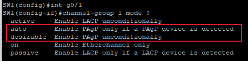
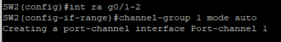
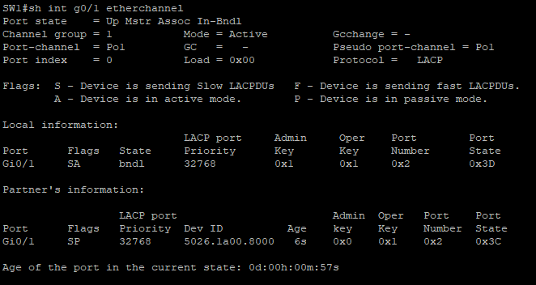
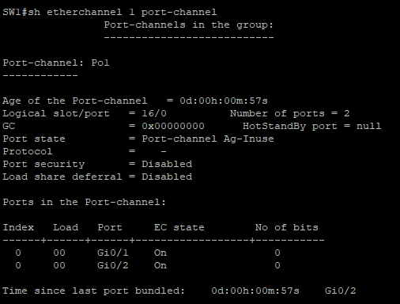
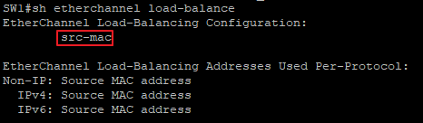
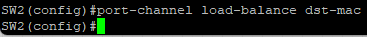

# Introduction to EtherChannel

[한국어](../01-Introduction-to-EtherChannel.md) | [English](01-Introduction-to-EtherChannel.en.md) | [日本語](01-Introduction-to-EtherChannel.ja.md) | [简体中文](01-Introduction-to-EtherChannel.zh-CN.md) | **Español** | [Français](01-Introduction-to-EtherChannel.fr.md)

En esta lección veremos **EtherChannel**, también conocido como **agregación de enlaces (link aggregation)**. EtherChannel es una tecnología que permite **agrupar varios enlaces físicos en un único enlace lógico**. Veremos cómo funciona y qué ventajas tiene, empezando con el ejemplo de una red pequeña.

## Opciones de EtherChannel de un vistazo

| Opción | Estándar | Modos | Descripción |
| --- | --- | --- | --- |
| PAgP | Propietario de Cisco | `desirable` / `auto` | Negocia solo entre equipos Cisco |
| LACP | Estándar IEEE | `active` / `passive` | Lo admiten muchos fabricantes |
| Manual | Ninguno | `on` | Agrupa sin negociación |

---

## 1. ¿Por qué necesitamos EtherChannel?

En la imagen de arriba hay dos switches con dos ordenadores conectados a cada uno. Todas las interfaces son Gigabit Ethernet.

Ahora imagina que H1 envía 800 Mbit de tráfico a H3 y H2 envía 600 Mbit a H4. **El enlace entre los switches se convierte en un cuello de botella.** Necesitamos 800 + 600 = 1400 Mbit, pero el enlace solo tiene 1000 Mbit.

> El original dice "800 + 400 = 1400 Mbit", pero H2 envía 600 Mbit, así que se ha corregido a 800 + 600.

Hay dos soluciones para este problema:

- Sustituir el enlace entre los switches por uno más rápido, por ejemplo de 10 Gigabit.
- Añadir varios enlaces y **agruparlos en un EtherChannel.**

Como esta lección trata de EtherChannel, veamos cómo añadir enlaces.

He añadido un enlace más. El problema es que ahora hay un **bucle** entre los switches, así que **spanning-tree bloquea uno de los dos enlaces**. EtherChannel resuelve esto creando **un único enlace virtual** con estos enlaces físicos.

Spanning-tree ve esto como **un único enlace lógico**, ¡así que no hay bucles! EtherChannel **reparte la carga** del tráfico entre los enlaces y se encarga de la **redundancia**. Si un enlace falla, sigue funcionando con los que quedan.

Ten en cuenta que los enlaces físicos siguen siendo el límite. **Un solo flujo de tráfico no puede superar 1000 Mbit (un enlace Gigabit).** Un EtherChannel es como añadir carriles a una autopista: el ancho de banda total aumenta, pero el límite de velocidad no cambia.

Puedes asignar **hasta 16** interfaces físicas a un EtherChannel, pero solo **ocho están activas** a la vez.

---

## 2. Opciones y requisitos

Hay tres formas de configurar un EtherChannel:

- **PAgP** (propietario de Cisco)
- **LACP** (estándar IEEE)
- **Manual**

PAgP y LACP son protocolos que **negocian** un EtherChannel de forma dinámica. PAgP es propietario de Cisco, así que solo se puede usar entre equipos Cisco; LACP es un estándar IEEE que admiten muchos fabricantes. También se puede configurar un **EtherChannel estático** sin que ninguno de estos protocolos negocie el enlace.

Al crear un EtherChannel, **todas las interfaces deben tener la misma configuración**:

- Duplex
- Speed
- VLAN nativa y VLAN permitidas
- Modo switchport (access o trunk)

PAgP y LACP comprueban si las interfaces que agrupas tienen la misma configuración.

---

## 3. Configurar PAgP

Una interfaz PAgP se configura en uno de estos dos modos:

- **Desirable**: la interfaz **pide activamente** al otro lado formar un EtherChannel.
- **Auto**: la interfaz **espera pasivamente** a que el otro lado lo pida.

Esto es lo que ocurre con cada combinación:

| | Desirable | Auto |
| --- | --- | --- |
| **Desirable** | Se forma | Se forma |
| **Auto** | Se forma | No se forma |

Configuremos PAgP entre dos switches. Usaré SW1 y SW2.

SW1 y SW2 tienen cada uno dos interfaces Gigabit, que agruparemos en un único enlace lógico. Estas son nuestras opciones:

Usamos el comando `channel-group` en la interfaz. Puedes elegir cualquier número de grupo; usaré el 1. Después elegimos auto o desirable. Configuraré SW1 en modo **desirable**.

Con el modo PAgP desirable, SW1 pide activamente a SW2 formar un EtherChannel. SW2 puede usar auto o desirable. Usaré **auto**.

En modo auto, SW2 solo responde a las peticiones PAgP que recibe. Tras unos segundos, verás este mensaje en ambos switches:

El switch crea automáticamente una nueva **interfaz port-channel**.

Por ahora no hay nada configurado en la interfaz port-channel.

Las dos interfaces físicas de este EtherChannel solo tienen el comando `channel-group`.

Si quieres hacer cambios, como configurar el EtherChannel como trunk, debes hacerlo **en la interfaz port-channel**. Por ejemplo:

Al hacerlo, el switch añade automáticamente los mismos comandos a las interfaces físicas.

No modifiques directamente las interfaces físicas que pertenecen al EtherChannel. **Usa siempre la interfaz port-channel.**

Veamos ahora el estado del EtherChannel con algunos comandos show. Este es el primero:

`show etherchannel summary` da una vista clara de todos tus EtherChannels. Indica si el EtherChannel está activo (SU), qué protocolo usa y si los puertos están agrupados (P). Otro comando show:

`show etherchannel 1 port-channel` muestra un resumen del EtherChannel. Puedes ver el protocolo y las interfaces que usamos, y si la interfaz lógica está en uso (Ag-Inuse).

Este es el último comando show:

La tercera forma de verificarlo es `show interfaces <interfaz> etherchannel`. Aquí miro GigabitEthernet0/1. Además del switch local, también puedes ver **la interfaz del switch vecino (Partner's information)**.

---

## 4. Configurar LACP

LACP es parecido a PAgP, pero usa otros términos:

- **Active**: la interfaz **pide activamente** al otro lado formar un EtherChannel.
- **Passive**: la interfaz **espera pasivamente** a que el otro lado lo pida.

**Al menos un switch debe estar en modo active.** Si los dos están en passive, no ocurre nada.

| | Active | Passive |
| --- | --- | --- |
| **Active** | Se forma | Se forma |
| **Passive** | Se forma | No se forma |

Usaré la misma topología que con PAgP.

Configuramos SW1 en modo **active**.

Y SW2 en modo **passive**.

Verifiquemos con los mismos comandos show que usamos con PAgP.

Ahora `show etherchannel 1 port-channel`:

Y por último, `show interfaces g0/1 etherchannel`:

Como ves, el protocolo ahora es **LACP** y la interfaz Port-channel 1 tiene dos interfaces físicas miembro.

---

## 5. Configuración manual (on)

En lugar de PAgP o LACP, también puedes **activar el EtherChannel manualmente**. Usaré la misma topología.

Esta es la configuración. Ambos lados usan `mode on`.

Eso es todo. Probemos los comandos show, empezando por el resumen.

La columna Protocol muestra `-`: **no se usa ningún protocolo**. Veamos más de cerca la interfaz Port-channel.

También podemos revisar una de las interfaces físicas y ver su información de EtherChannel. El modo es **On**.

---

## 6. Balanceo de carga

Lo último que veremos es el **balanceo de carga**. Fíjate en esta salida:

`show etherchannel load-balance` muestra la configuración por defecto. Este switch reparte la carga según la **dirección MAC de origen (src-mac)**. Puedes cambiarlo con el comando `port-channel load-balance`.

Hay muchas opciones, incluidas combinaciones de direcciones MAC o IP de origen y/o destino.

¿Por qué debería importarte el balanceo de carga? Mira esta imagen:

A la izquierda tenemos SW1 y cuatro ordenadores; a la derecha, SW2 y un router. El método por defecto es la dirección MAC de origen. Esto significa que **todo el tráfico de una misma MAC sale por la misma interfaz física**, por ejemplo:

- Dirección MAC AAA → Gi0/1 de SW1
- Dirección MAC BBB → Gi0/2 de SW1
- Dirección MAC CCC → Gi0/1 de SW1
- Dirección MAC DDD → Gi0/2 de SW1

Como hay varios ordenadores, esto está bien. Se usan los dos enlaces físicos de SW1 y, según cuánto envíe cada ordenador, la proporción será cercana a 1:1.

Con SW2 es distinto, porque solo tiene un router con la dirección MAC EEE. Elige una interfaz física, así que **todo el tráfico del router** sale por GigabitEthernet0/1 o por 0/2. **Uno de los enlaces físicos no se usa en absoluto.**

En este caso es mejor cambiar el método de balanceo. Por ejemplo, en SW2:

Si cambiamos SW2 a la **dirección MAC de destino**, el tráfico del router hacia los ordenadores se reparte entre las interfaces físicas, porque los ordenadores tienen direcciones MAC de destino diferentes.

---

## Resumen

- Un **EtherChannel** es una **interfaz lógica (port-channel)** que agrupa varias interfaces físicas.
- Spanning-tree ve un EtherChannel como una sola interfaz, así que **no bloquea los enlaces físicos redundantes**. Si un enlace falla, los demás siguen funcionando.
- Hay tres opciones: **PAgP** (propietario de Cisco, desirable/auto), **LACP** (estándar IEEE, active/passive) y **manual** (`on`, sin protocolo). PAgP necesita un lado en desirable; LACP, un lado en active.
- Las interfaces agrupadas deben tener el mismo duplex, speed, VLAN y modo switchport, y los cambios se hacen **en la interfaz port-channel**.
- Verifica con `show etherchannel summary`, `show etherchannel 1 port-channel` y `show interfaces <interfaz> etherchannel`.
- Hay muchos métodos de balanceo (`port-channel load-balance`). Elige el que encaje con tu tráfico. Un solo flujo nunca supera la velocidad de un enlace.
