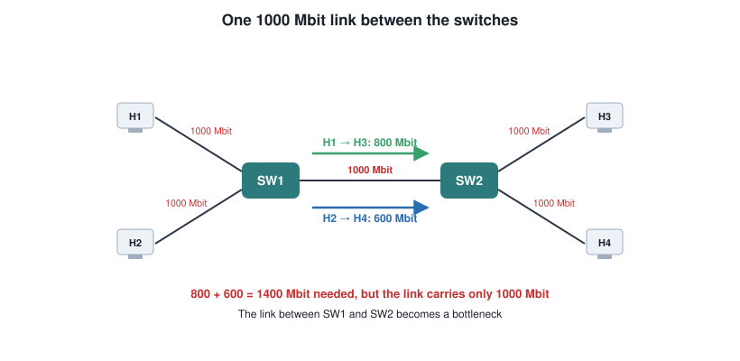
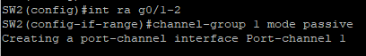
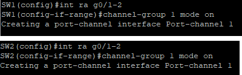
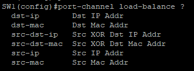
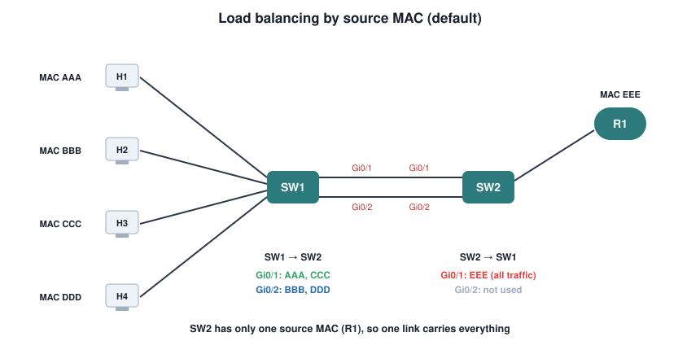

# Introduction to EtherChannel

[한국어](../01-Introduction-to-EtherChannel.md) | [English](01-Introduction-to-EtherChannel.en.md) | [日本語](01-Introduction-to-EtherChannel.ja.md) | [简体中文](01-Introduction-to-EtherChannel.zh-CN.md) | [Español](01-Introduction-to-EtherChannel.es.md) | **Français**

Dans cette leçon, nous allons voir **EtherChannel**, aussi appelé **agrégation de liens (link aggregation)**. EtherChannel est une technologie qui permet de **regrouper plusieurs liens physiques en un seul lien logique**. Nous verrons comment il fonctionne et quels sont ses avantages, en commençant par l'exemple d'un petit réseau.

## Les options d'EtherChannel en un coup d'œil

| Option | Standard | Modes | Description |
| --- | --- | --- | --- |
| PAgP | Propriétaire Cisco | `desirable` / `auto` | Négocie uniquement entre équipements Cisco |
| LACP | Standard IEEE | `active` / `passive` | Pris en charge par de nombreux constructeurs |
| Manuel | Aucun | `on` | Regroupe sans négociation |

---

## 1. Pourquoi a-t-on besoin d'EtherChannel ?

Sur l'image ci-dessus, il y a deux switchs avec deux ordinateurs connectés à chacun. Toutes les interfaces sont en Gigabit Ethernet.

Imaginons maintenant que H1 envoie 800 Mbit de trafic vers H3 et que H2 envoie 600 Mbit vers H4. **Le lien entre les switchs devient un goulot d'étranglement.** Il faut 800 + 600 = 1400 Mbit, mais le lien n'a que 1000 Mbit.

> Le texte d'origine indique « 800 + 400 = 1400 Mbit », mais H2 envoie 600 Mbit, d'où la correction en 800 + 600.

Il y a deux solutions à ce problème :

- Remplacer le lien entre les switchs par un lien plus rapide, par exemple en 10 Gigabit.
- Ajouter plusieurs liens et **les regrouper dans un EtherChannel.**

Comme cette leçon porte sur EtherChannel, voyons comment ajouter des liens.

J'ai ajouté un lien. Le problème, c'est qu'il y a maintenant une **boucle** entre les switchs, donc **spanning-tree bloque l'un des deux liens**. EtherChannel résout ce problème en créant **un seul lien virtuel** à partir de ces liens physiques.

Spanning-tree voit cela comme **un seul lien logique** : il n'y a donc pas de boucle ! EtherChannel **répartit la charge** du trafic entre les liens et assure la **redondance**. Si un lien tombe, il continue de fonctionner avec les liens restants.

Gardez à l'esprit que les liens physiques restent la limite. **Un seul flux de trafic ne peut pas dépasser 1000 Mbit (un lien Gigabit).** Un EtherChannel, c'est comme ajouter des voies à une autoroute : la bande passante totale augmente, mais la limitation de vitesse reste la même.

On peut affecter **jusqu'à 16** interfaces physiques à un EtherChannel, mais seules **huit sont actives** en même temps.

---

## 2. Options et conditions

Il existe trois façons de configurer un EtherChannel :

- **PAgP** (propriétaire Cisco)
- **LACP** (standard IEEE)
- **Manuel**

PAgP et LACP sont des protocoles qui **négocient** un EtherChannel de façon dynamique. PAgP est propriétaire Cisco, on ne peut donc l'utiliser qu'entre équipements Cisco ; LACP est un standard IEEE pris en charge par de nombreux constructeurs. On peut aussi configurer un **EtherChannel statique**, sans qu'aucun de ces protocoles ne négocie le lien.

Pour créer un EtherChannel, **toutes les interfaces doivent avoir la même configuration** :

- Duplex
- Speed
- VLAN natif et VLAN autorisés
- Mode switchport (access ou trunk)

PAgP et LACP vérifient que les interfaces regroupées ont la même configuration.

---

## 3. Configurer PAgP

Une interface PAgP se configure dans l'un de ces deux modes :

- **Desirable** : l'interface **demande activement** à l'autre côté de former un EtherChannel.
- **Auto** : l'interface **attend passivement** que l'autre côté le demande.

Voici, pour chaque combinaison, si un EtherChannel se forme :

| | Desirable | Auto |
| --- | --- | --- |
| **Desirable** | Se forme | Se forme |
| **Auto** | Se forme | Ne se forme pas |

Configurons PAgP entre deux switchs. J'utiliserai SW1 et SW2.

SW1 et SW2 ont chacun deux interfaces Gigabit, que nous allons regrouper en un seul lien logique. Voici les options :

On utilise la commande `channel-group` sur l'interface. Le numéro de groupe est libre ; j'utiliserai 1. Ensuite, on choisit auto ou desirable. Je configure SW1 en mode **desirable**.

En mode PAgP desirable, SW1 demande activement à SW2 de former un EtherChannel. SW2 peut être en auto ou en desirable. J'utiliserai **auto**.

En mode auto, SW2 répond seulement aux demandes PAgP qu'il reçoit. Après quelques secondes, ce message apparaît sur les deux switchs :

Le switch crée automatiquement une nouvelle **interface port-channel**.

Pour l'instant, rien n'est configuré sous l'interface port-channel.

Les deux interfaces physiques de cet EtherChannel n'ont que la commande `channel-group`.

Pour faire des modifications, par exemple configurer l'EtherChannel en trunk, il faut le faire **sous l'interface port-channel**. Par exemple :

Le switch ajoute alors automatiquement les mêmes commandes aux interfaces physiques.

Ne modifiez pas directement les interfaces physiques qui appartiennent à l'EtherChannel. **Utilisez toujours l'interface port-channel.**

Voyons maintenant l'état de l'EtherChannel avec quelques commandes show. Voici la première :

`show etherchannel summary` donne une vue claire de tous vos EtherChannels. Elle indique si l'EtherChannel est actif (SU), quel protocole il utilise et si les ports sont regroupés (P). Une autre commande show :

`show etherchannel 1 port-channel` donne une vue d'ensemble de l'EtherChannel. On voit le protocole et les interfaces utilisés, et si l'interface logique est en service (Ag-Inuse).

Voici la dernière commande show :

La troisième façon de vérifier est `show interfaces <interface> etherchannel`. Ici, je regarde GigabitEthernet0/1. En plus du switch local, on voit aussi **l'interface du switch voisin (Partner's information)**.

---

## 4. Configurer LACP

LACP ressemble à PAgP mais utilise d'autres termes :

- **Active** : l'interface **demande activement** à l'autre côté de former un EtherChannel.
- **Passive** : l'interface **attend passivement** que l'autre côté le demande.

**Au moins un switch doit être en mode active.** Si les deux sont en passive, rien ne se passe.

| | Active | Passive |
| --- | --- | --- |
| **Active** | Se forme | Se forme |
| **Passive** | Se forme | Ne se forme pas |

J'utilise la même topologie que pour PAgP.

On configure SW1 en mode **active**.

Et SW2 en mode **passive**.

Vérifions avec les mêmes commandes show que pour PAgP.

Puis `show etherchannel 1 port-channel` :

Et enfin `show interfaces g0/1 etherchannel` :

Comme on le voit, le protocole est maintenant **LACP**, et l'interface Port-channel 1 contient deux interfaces physiques membres.

---

## 5. Configuration manuelle (on)

Au lieu de PAgP ou LACP, on peut aussi **activer l'EtherChannel manuellement**. J'utilise la même topologie.

Voici la configuration. Les deux côtés utilisent `mode on`.

C'est tout. Essayons les commandes show, en commençant par la vue d'ensemble.

La colonne Protocol affiche `-` : **aucun protocole n'est utilisé**. Regardons de plus près l'interface Port-channel.

On peut aussi vérifier une des interfaces physiques et voir ses informations EtherChannel. Le mode est **On**.

---

## 6. Répartition de charge

Le dernier point à voir est la **répartition de charge**. Regardez cette sortie :

`show etherchannel load-balance` affiche la configuration par défaut. Ce switch répartit la charge selon **l'adresse MAC source (src-mac)**. On peut changer cela avec la commande `port-channel load-balance`.

Il y a beaucoup d'options, y compris des combinaisons d'adresses MAC ou IP source et/ou destination.

Pourquoi s'intéresser à la répartition de charge ? Regardez cette image :

À gauche, il y a SW1 et quatre ordinateurs ; à droite, SW2 et un routeur. La méthode par défaut est l'adresse MAC source. Cela signifie que **tout le trafic d'une même adresse MAC passe par la même interface physique**, par exemple :

- Adresse MAC AAA → Gi0/1 de SW1
- Adresse MAC BBB → Gi0/2 de SW1
- Adresse MAC CCC → Gi0/1 de SW1
- Adresse MAC DDD → Gi0/2 de SW1

Comme il y a plusieurs ordinateurs, cela convient. Les deux liens physiques de SW1 sont utilisés et, selon la quantité envoyée par chaque ordinateur, le rapport sera proche de 1:1.

C'est différent pour SW2, qui n'a qu'un routeur avec l'adresse MAC EEE. Il choisit une interface physique, donc **tout le trafic du routeur** passe par GigabitEthernet0/1 ou 0/2. **L'un des liens physiques n'est pas utilisé du tout.**

Dans ce cas, il vaut mieux changer la méthode de répartition. Par exemple, sur SW2 :

Si SW2 passe à **l'adresse MAC de destination**, le trafic du routeur vers les ordinateurs est réparti sur les interfaces physiques, car les ordinateurs ont des adresses MAC de destination différentes.

---

## Résumé

- Un **EtherChannel** est une **interface logique (port-channel)** qui regroupe plusieurs interfaces physiques.
- Spanning-tree voit un EtherChannel comme une seule interface, il **ne bloque donc pas les liens physiques redondants**. Si un lien tombe, les autres continuent de fonctionner.
- Il y a trois options : **PAgP** (propriétaire Cisco, desirable/auto), **LACP** (standard IEEE, active/passive) et **manuel** (`on`, sans protocole). PAgP exige un côté en desirable ; LACP, un côté en active.
- Les interfaces regroupées doivent avoir le même duplex, la même vitesse, les mêmes VLAN et le même mode switchport, et les modifications se font **sur l'interface port-channel**.
- Vérifiez avec `show etherchannel summary`, `show etherchannel 1 port-channel` et `show interfaces <interface> etherchannel`.
- Il existe de nombreuses méthodes de répartition (`port-channel load-balance`). Choisissez celle qui correspond à votre trafic. Un seul flux ne dépasse jamais la vitesse d'un lien.
