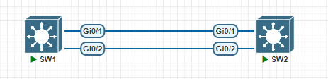
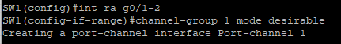
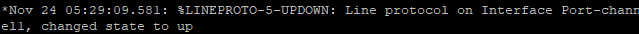
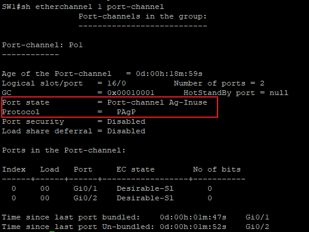
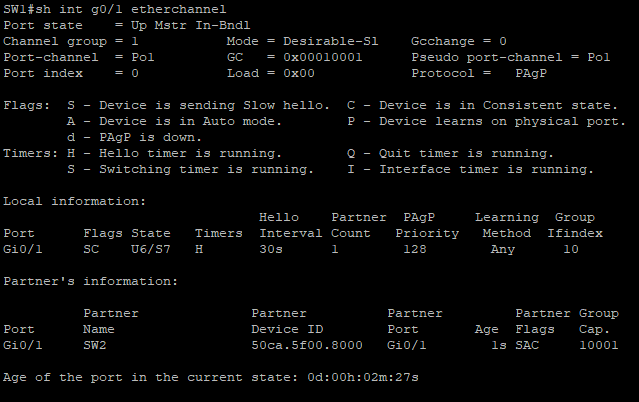
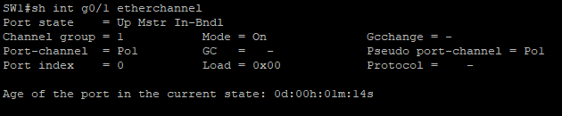

# Introduction to EtherChannel

[한국어](../01-Introduction-to-EtherChannel.md) | [English](01-Introduction-to-EtherChannel.en.md) | **日本語** | [简体中文](01-Introduction-to-EtherChannel.zh-CN.md) | [Español](01-Introduction-to-EtherChannel.es.md) | [Français](01-Introduction-to-EtherChannel.fr.md)

この記事では、**リンクアグリゲーション（link aggregation）** とも呼ばれる **EtherChannel** を見ていきます。EtherChannel は **複数の物理リンクを 1 本の論理リンクに束ねる** 技術です。どのように動作し、どんな利点があるのかを、小さなネットワークの例から始めます。

## EtherChannel の設定方式（一覧）

| 方式 | 標準 | モード | 説明 |
| --- | --- | --- | --- |
| PAgP | Cisco 独自 | `desirable` / `auto` | Cisco 機器同士でのみネゴシエーション |
| LACP | IEEE 標準 | `active` / `passive` | 多くのベンダーがサポート |
| 手動 | なし | `on` | ネゴシエーションなしで束ねる |

---

## 1. なぜ EtherChannel が必要か？

上の図にはスイッチが 2 台あり、それぞれのスイッチにコンピュータが 2 台ずつ接続されています。すべてのインターフェイスはギガビットイーサネットです。

ここで H1 が H3 へ 800 Mbit、H2 が H4 へ 600 Mbit のトラフィックを送るとします。すると **スイッチ間のリンクがボトルネック** になります。800 + 600 = 1400 Mbit が必要なのに、リンクは 1000 Mbit しかありません。

> 原文は「800 + 400 = 1400 Mbit」となっていますが、H2 が送るのは 600 Mbit なので 800 + 600 に修正しました。

この問題の解決方法は 2 つあります。

- スイッチ間のリンクをより高速なリンク（例：10 ギガビット）に置き換える。
- リンクを複数追加して **EtherChannel に束ねる。**

この記事のテーマは EtherChannel なので、リンクを追加する方法を見ていきます。

リンクをもう 1 本追加しました。しかしこうするとスイッチ間に **ループ** ができるため、**spanning-tree が 2 本のうち 1 本をブロック** します。EtherChannel はこれらの物理リンクから **1 本の仮想リンク** を作り、この問題を解決します。

Spanning-tree はこれを **1 本の論理リンク** と見なすので、ループはありません！EtherChannel は複数のリンクにトラフィックを **ロードバランシング** し、**冗長性** も担います。リンクが 1 本切れても、残りのリンクで動作し続けます。

ただし、物理リンクの速度が上限であることは変わりません。**1 つのトラフィックフローは 1000 Mbit（ギガビットリンク 1 本）を超えられません。** EtherChannel は高速道路の車線を増やすようなものです。全体の帯域は増えますが、制限速度は同じです。

EtherChannel には物理インターフェイスを **最大 16 個** まで割り当てられますが、同時に **アクティブになるのは 8 個** だけです。

---

## 2. 設定方式と条件

EtherChannel の設定方法は 3 つあります。

- **PAgP**（Cisco 独自）
- **LACP**（IEEE 標準）
- **手動（Manual）**

PAgP と LACP は EtherChannel を **動的にネゴシエーション** するプロトコルです。PAgP は Cisco 独自なので Cisco 機器同士でしか使えず、LACP は IEEE 標準なので多くのベンダーがサポートしています。これらのプロトコルを使わずにネゴシエーションしない **静的（static）EtherChannel** も設定できます。

EtherChannel を作るときは **すべてのインターフェイスの設定が同じ** でなければなりません。

- Duplex
- Speed
- ネイティブ VLAN と許可 VLAN
- Switchport モード（access または trunk）

PAgP と LACP は、束ねるインターフェイスの設定が同じかどうかを確認します。

---

## 3. PAgP の設定

PAgP インターフェイスは 2 つのモードのどちらかに設定します。

- **Desirable**：相手に EtherChannel を作るよう **積極的に要求** します。
- **Auto**：相手からの要求を **受動的に待ちます。**

2 つのモードの組み合わせで EtherChannel ができるかどうかをまとめると次のとおりです。

| | Desirable | Auto |
| --- | --- | --- |
| **Desirable** | 形成される | 形成される |
| **Auto** | 形成される | 形成されない |

では 2 台のスイッチ間に PAgP を設定してみます。SW1 と SW2 を使います。

SW1 と SW2 にはそれぞれギガビットインターフェイスが 2 つあり、これを 1 本の論理リンクに束ねます。選べるモードは次のとおりです。

インターフェイスで `channel-group` コマンドを使います。グループ番号は好きな数字でよく、ここでは 1 を使います。そして auto と desirable のどちらかを選びます。SW1 は **desirable** に設定します。

SW1 を PAgP desirable モードにしたので、SW1 は SW2 に EtherChannel を作るよう積極的に要求します。SW2 は auto でも desirable でもかまいません。ここでは **auto** を使います。

auto モードの SW2 は、受け取った PAgP 要求に応答するだけです。数秒後、両方のスイッチに次のメッセージが表示されます。

スイッチが新しい **port-channel インターフェイス** を自動的に作成します。

現時点では port-channel インターフェイスの下には何も設定されていません。

この EtherChannel に属する 2 つの物理インターフェイスには `channel-group` コマンドしかありません。

EtherChannel を trunk にするなどの変更は **port-channel インターフェイスで** 行う必要があります。例えば次のとおりです。

こうすると、スイッチが物理インターフェイスにも同じコマンドを自動的に追加します。

EtherChannel に属する物理インターフェイスは直接変更しないでください。**常に port-channel インターフェイスで設定** します。

では show コマンドで EtherChannel の状態を詳しく見てみます。最初のコマンドです。

`show etherchannel summary` はすべての EtherChannel をすっきり表示します。EtherChannel が up か（SU）、どのプロトコルを使っているか、ポートが束ねられているか（P）が分かります。別の show コマンドも見てみます。

`show etherchannel 1 port-channel` は EtherChannel の概要を表示します。使用中のプロトコルとインターフェイス、論理インターフェイスが使用中（Ag-Inuse）かどうかが分かります。

最後の show コマンドです。

3 つ目の確認方法は `show interfaces <インターフェイス> etherchannel` です。ここでは GigabitEthernet0/1 の情報を見ています。自分のスイッチの情報だけでなく、**相手スイッチのインターフェイス（Partner's information）** も確認できます。

---

## 4. LACP の設定

LACP は PAgP と似ていますが、用語が異なります。

- **Active**：相手に EtherChannel を作るよう **積極的に要求** します。
- **Passive**：相手からの要求を **受動的に待ちます。**

**少なくとも一方は active モード** でなければなりません。両方とも passive だと何も起きません。

| | Active | Passive |
| --- | --- | --- |
| **Active** | 形成される | 形成される |
| **Passive** | 形成される | 形成されない |

PAgP と同じトポロジを使います。

SW1 は **active** モードに設定します。

SW2 は **passive** モードに設定します。

PAgP で使った show コマンドで確認してみます。

`show etherchannel 1 port-channel` も見てみます。

最後に `show interfaces g0/1 etherchannel` です。

ご覧のとおり、プロトコルは **LACP** になり、Port-channel 1 インターフェイスには物理インターフェイスが 2 つ入っています。

---

## 5. 手動（on）の設定

PAgP や LACP の代わりに、EtherChannel を **手動で有効にする** こともできます。同じトポロジで説明します。

設定は次のとおりです。両側とも `mode on` です。

これだけです。show コマンドで確認してみます。まずは概要です。

上の出力では Protocol が `-` で、**プロトコルを何も使っていない** ことが分かります。Port-channel インターフェイスを詳しく見てみます。

物理インターフェイスを 1 つ選んで EtherChannel の情報も確認できます。Mode は **On** です。

---

## 6. ロードバランシング

EtherChannel で最後に見るのは **ロードバランシング** です。次の出力を見てください。

`show etherchannel load-balance` でデフォルト設定を確認できます。このスイッチは **送信元 MAC アドレス（src-mac）** を基準にロードバランシングします。必要なら `port-channel load-balance` コマンドで変更できます。

送信元・宛先の MAC アドレスや IP アドレス、その組み合わせなど、多くのオプションがあります。

なぜロードバランシングを気にする必要があるのでしょうか？次の図を見てください。

左側には SW1 とコンピュータ 4 台、右側には SW2 とルータがあります。デフォルトのロードバランシング方式は送信元 MAC アドレスです。つまり **1 つの MAC アドレスから出たトラフィックはすべて同じ物理インターフェイス 1 つ** から送られます。例えば次のとおりです。

- MAC アドレス AAA → SW1 の Gi0/1
- MAC アドレス BBB → SW1 の Gi0/2
- MAC アドレス CCC → SW1 の Gi0/1
- MAC アドレス DDD → SW1 の Gi0/2

コンピュータが複数あるので、これは問題ありません。SW1 の物理リンクは 2 本とも使われ、コンピュータが送る量によってほぼ 1:1 の比率になります。

SW2 は事情が違います。MAC アドレスが EEE のルータが 1 台だけなので、物理インターフェイスを 1 つ選び、**ルータのトラフィックをすべて** GigabitEthernet0/1 か 0/2 のどちらかから送ります。**物理リンクの 1 本はまったく使われません。**

このような場合は、ロードバランシング方式を変えたほうがよいでしょう。例えば SW2 で次のように設定できます。

SW2 のロードバランシングを **宛先 MAC アドレス** に変えると、ルータからコンピュータへのトラフィックが複数の物理インターフェイスに分散されます。宛先 MAC アドレスの異なるコンピュータが複数あるからです。

---

## まとめ

- **EtherChannel** は複数の物理インターフェイスを束ねた **論理インターフェイス（port-channel）** です。
- Spanning-tree は EtherChannel を 1 つのインターフェイスと見なすので、**冗長な物理リンクをブロックしません。** リンクが 1 本切れても残りで動作し続けます。
- 設定方法は 3 つです：**PAgP**（Cisco 独自、desirable/auto）、**LACP**（IEEE 標準、active/passive）、**手動**（`on`、プロトコルなし）。PAgP は一方が desirable、LACP は一方が active である必要があります。
- 束ねるインターフェイスは duplex、speed、VLAN、switchport モードがすべて同じでなければならず、設定変更は **port-channel インターフェイスで** 行います。
- 確認コマンド：`show etherchannel summary`、`show etherchannel 1 port-channel`、`show interfaces <インターフェイス> etherchannel`。
- ロードバランシング方式は複数あります（`port-channel load-balance`）。トラフィックパターンに合った方式を選びましょう。1 つのフローはリンク 1 本の速度を超えません。
