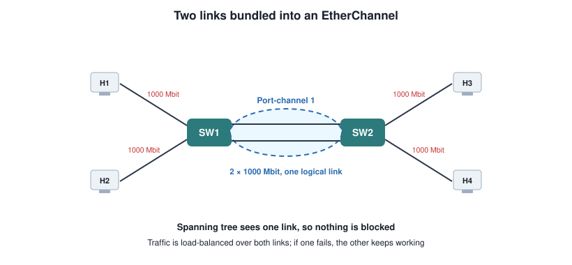
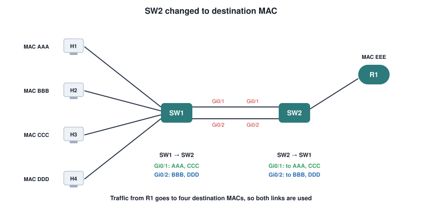

# Introduction to EtherChannel

[한국어](../01-Introduction-to-EtherChannel.md) | [English](01-Introduction-to-EtherChannel.en.md) | [日本語](01-Introduction-to-EtherChannel.ja.md) | **简体中文** | [Español](01-Introduction-to-EtherChannel.es.md) | [Français](01-Introduction-to-EtherChannel.fr.md)

本文介绍 **EtherChannel**，它也称为 **链路聚合（link aggregation）**。EtherChannel 是一种 **把多条物理链路捆绑成一条逻辑链路** 的技术。我们从一个小型网络的例子开始，看看它如何工作、有哪些优点。

## EtherChannel 配置方式一览

| 方式 | 标准 | 模式 | 说明 |
| --- | --- | --- | --- |
| PAgP | Cisco 私有 | `desirable` / `auto` | 只能在 Cisco 设备之间协商 |
| LACP | IEEE 标准 | `active` / `passive` | 许多厂商都支持 |
| 手动 | 无 | `on` | 不协商直接捆绑 |

---

## 1. 为什么需要 EtherChannel？

上图中有两台交换机，每台交换机各连接两台计算机。所有接口都是千兆以太网。

现在假设 H1 向 H3 发送 800 Mbit 流量，H2 向 H4 发送 600 Mbit 流量。这时 **交换机之间的链路就成了瓶颈**。需要 800 + 600 = 1400 Mbit，而链路只有 1000 Mbit。

> 原文写的是“800 + 400 = 1400 Mbit”，但 H2 发送的是 600 Mbit，因此改为 800 + 600。

解决这个问题有两种方法：

- 把交换机之间的链路换成更快的链路（例如万兆链路）。
- 增加多条链路，并 **把它们捆绑成 EtherChannel。**

本文的主题是 EtherChannel，所以我们来看增加链路的方法。

我又增加了一条链路。但这样交换机之间就形成了 **环路**，所以 **spanning-tree 会阻塞两条链路中的一条**。EtherChannel 用这些物理链路组成 **一条虚拟链路**，从而解决这个问题。

Spanning-tree 把它看作 **一条逻辑链路**，所以没有环路！EtherChannel 会在多条链路之间 **负载均衡** 流量，并提供 **冗余**。一条链路断开后，剩下的链路继续工作。

不过要记住，物理链路的速度仍然是上限。**单个流量流不能超过 1000 Mbit（一条千兆链路）。** EtherChannel 就像给高速公路增加车道：总带宽增加了，但限速不变。

一个 EtherChannel 最多可以分配 **16 个** 物理接口，但同时 **只有 8 个处于活动状态**。

---

## 2. 配置方式与条件

配置 EtherChannel 有三种方法：

- **PAgP**（Cisco 私有）
- **LACP**（IEEE 标准）
- **手动（Manual）**

PAgP 和 LACP 是 **动态协商** EtherChannel 的协议。PAgP 是 Cisco 私有协议，只能在 Cisco 设备之间使用；LACP 是 IEEE 标准，许多厂商都支持。也可以不用这些协议，配置不进行协商的 **静态（static）EtherChannel**。

创建 EtherChannel 时，**所有接口的配置必须相同**：

- Duplex
- Speed
- Native VLAN 和允许的 VLAN
- Switchport 模式（access 或 trunk）

PAgP 和 LACP 会检查要捆绑的接口配置是否相同。

---

## 3. 配置 PAgP

PAgP 接口可以配置为以下两种模式之一：

- **Desirable**：**主动请求** 对端组成 EtherChannel。
- **Auto**：**被动等待** 对端发出请求。

两种模式组合后能否形成 EtherChannel，整理如下：

| | Desirable | Auto |
| --- | --- | --- |
| **Desirable** | 形成 | 形成 |
| **Auto** | 形成 | 不形成 |

现在在两台交换机之间配置 PAgP。这里使用 SW1 和 SW2。

SW1 和 SW2 各有两个千兆接口，我们把它们捆绑成一条逻辑链路。可选的模式如下：

在接口下使用 `channel-group` 命令。组号可以任意选择，这里使用 1。然后在 auto 和 desirable 中选一个。SW1 配置为 **desirable**。

SW1 设为 PAgP desirable 模式后，会主动请求 SW2 组成 EtherChannel。SW2 用 auto 或 desirable 都可以。这里使用 **auto**。

auto 模式的 SW2 只响应收到的 PAgP 请求。几秒钟后，两台交换机上都会出现以下消息：

交换机会自动创建一个新的 **port-channel 接口**。

目前 port-channel 接口下没有任何配置。

属于这个 EtherChannel 的两个物理接口上只有 `channel-group` 命令。

如果要做修改，例如把 EtherChannel 配置为 trunk，需要 **在 port-channel 接口下** 进行。例如：

这样做之后，交换机会自动把同样的命令添加到物理接口上。

不要直接修改属于 EtherChannel 的物理接口。**始终在 port-channel 接口上配置。**

现在用 show 命令详细查看 EtherChannel 的状态。第一个命令：

`show etherchannel summary` 能清晰地列出所有 EtherChannel。可以看到 EtherChannel 是否 up（SU）、使用哪种协议、端口是否已捆绑（P）。再看另一个 show 命令：

`show etherchannel 1 port-channel` 显示 EtherChannel 的概况。可以看到使用的协议和接口，以及逻辑接口是否在使用中（Ag-Inuse）。

最后一个 show 命令：

第三种验证方法是 `show interfaces <接口> etherchannel`。这里查看的是 GigabitEthernet0/1。除了本地交换机的信息，还能看到 **邻居交换机的接口（Partner's information）**。

---

## 4. 配置 LACP

LACP 与 PAgP 类似，但术语不同：

- **Active**：**主动请求** 对端组成 EtherChannel。
- **Passive**：**被动等待** 对端发出请求。

**至少一台交换机必须使用 active 模式。** 两台都是 passive 时什么都不会发生。

| | Active | Passive |
| --- | --- | --- |
| **Active** | 形成 | 形成 |
| **Passive** | 形成 | 不形成 |

使用与 PAgP 相同的拓扑。

SW1 配置为 **active** 模式。

SW2 配置为 **passive** 模式。

用 PAgP 时用过的 show 命令来验证。

再看 `show etherchannel 1 port-channel`：

最后是 `show interfaces g0/1 etherchannel`：

可以看到协议现在是 **LACP**，Port-channel 1 接口中有两个物理成员接口。

---

## 5. 手动（on）配置

除了 PAgP 或 LACP，也可以 **手动启用** EtherChannel。仍使用相同的拓扑。

配置如下，两端都是 `mode on`。

就这么简单。用 show 命令验证一下，先看概况。

上面的输出中 Protocol 是 `-`，说明 **没有使用任何协议**。再详细看看 Port-channel 接口。

也可以选一个物理接口查看它的 EtherChannel 信息。Mode 为 **On**。

---

## 6. 负载均衡

EtherChannel 最后要看的是 **负载均衡**。请看下面的输出：

用 `show etherchannel load-balance` 可以查看默认配置。这台交换机按 **源 MAC 地址（src-mac）** 进行负载均衡。需要的话可以用 `port-channel load-balance` 命令修改。

可选项很多，包括源和/或目的 MAC 地址或 IP 地址的组合。

为什么要关心负载均衡？请看下图：

左边是 SW1 和四台计算机，右边是 SW2 和一台路由器。默认的负载均衡方式是源 MAC 地址。也就是说，**来自同一个 MAC 地址的流量都会从同一个物理接口发出**。例如：

- MAC 地址 AAA → SW1 的 Gi0/1
- MAC 地址 BBB → SW1 的 Gi0/2
- MAC 地址 CCC → SW1 的 Gi0/1
- MAC 地址 DDD → SW1 的 Gi0/2

因为有多台计算机，这没有问题。SW1 的两条物理链路都会被使用，根据计算机发送的流量，比例接近 1:1。

SW2 的情况就不同了。它只有一台 MAC 地址为 EEE 的路由器，所以会选一个物理接口，**路由器的全部流量** 都从 GigabitEthernet0/1 或 0/2 其中一个发出。**有一条物理链路完全不被使用。**

这种情况下最好更改负载均衡方式。例如在 SW2 上可以这样配置：

把 SW2 的负载均衡改为 **目的 MAC 地址** 后，从路由器发往计算机的流量就会分散到多个物理接口上，因为有多台目的 MAC 地址不同的计算机。

---

## 总结

- **EtherChannel** 是把多个物理接口捆绑在一起的 **逻辑接口（port-channel）**。
- Spanning-tree 把 EtherChannel 看作一个接口，因此 **不会阻塞冗余的物理链路**。一条链路断开后，其余链路继续工作。
- 配置方法有三种：**PAgP**（Cisco 私有，desirable/auto）、**LACP**（IEEE 标准，active/passive）、**手动**（`on`，无协议）。PAgP 需要一端为 desirable，LACP 需要一端为 active。
- 要捆绑的接口的 duplex、speed、VLAN、switchport 模式都必须相同，修改配置要 **在 port-channel 接口上** 进行。
- 验证命令：`show etherchannel summary`、`show etherchannel 1 port-channel`、`show interfaces <接口> etherchannel`。
- 负载均衡方式有多种（`port-channel load-balance`），请选择符合流量模式的方式。单个流的速度不会超过一条链路。
