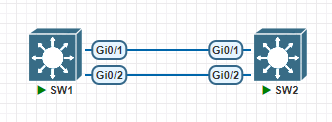
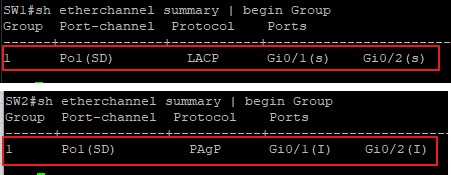
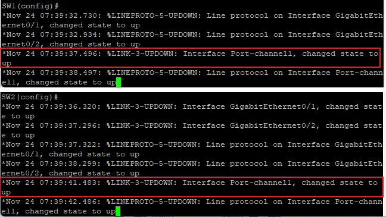
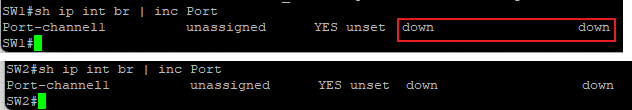
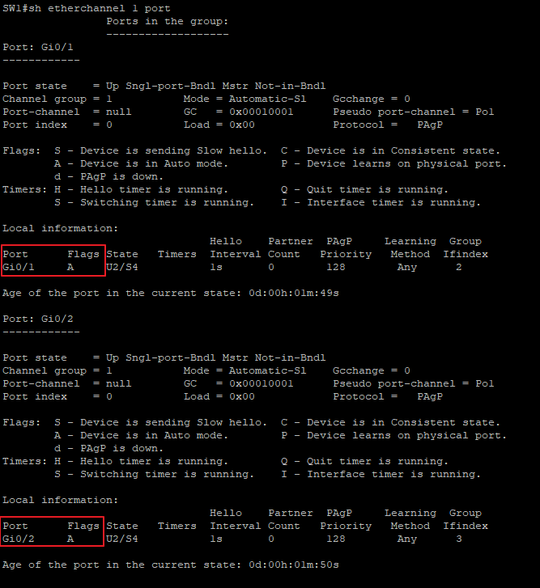
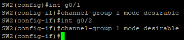
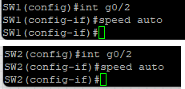

# Troubleshooting EtherChannel

**한국어** | [English](README/02-Troubleshooting-EtherChannel.en.md) | [日本語](README/02-Troubleshooting-EtherChannel.ja.md) | [简体中文](README/02-Troubleshooting-EtherChannel.zh-CN.md) | [Español](README/02-Troubleshooting-EtherChannel.es.md) | [Français](README/02-Troubleshooting-EtherChannel.fr.md)

EtherChannel(링크 집선) 문제는 대부분 **설정 실수** 때문에 생깁니다. **모든 물리 인터페이스의 설정이 같아야 한다** 는 점을 기억하세요. 이번 글에서는 EtherChannel에서 자주 생기는 문제들을 살펴봅니다. EtherChannel 설정은 [Introduction to EtherChannel](../01-Introduction-to-EtherChannel/01-Introduction-to-EtherChannel.md)을 참고하세요.

## 증상별 확인 순서

| 증상 | 먼저 볼 명령어 | 흔한 원인 |
| --- | --- | --- |
| Port-channel이 down | `show etherchannel summary` | 양쪽 프로토콜이 다름(PAgP / LACP) |
| Port-channel이 down, 프로토콜은 같음 | `show etherchannel 1 port` | 양쪽 모두 auto 또는 passive |
| Port-channel은 up인데 느림 | `show interfaces status` | 물리 인터페이스 설정(speed 등) 불일치 |

사용할 토폴로지는 다음과 같습니다.

GigabitEthernet0/1과 0/2를 EtherChannel로 묶으려고 하는데 동작하지 않습니다. 첫 번째 문제부터 보겠습니다.

---

## 1. EtherChannel 모드가 다름

EtherChannel이 동작하지 않습니다. 먼저 인터페이스들이 올라와 있는지 확인합니다.

모든 인터페이스가 동작 중입니다. port-channel 인터페이스가 있는지 확인해 보겠습니다.

port-channel 인터페이스는 만들어졌지만 **down** 입니다. 자세히 보겠습니다.

`show etherchannel summary` 는 port-channel을 확인하기 좋은 명령입니다. **SW1은 LACP, SW2는 PAgP** 로 설정되어 있습니다. 이렇게는 절대 동작하지 않습니다. SW1의 포트는 `s`(suspended), SW2의 포트는 `I`(stand-alone)입니다. 더 자세히 보겠습니다.

가장 좋은 명령은 `show etherchannel detail` 입니다. 정보가 많은데, 그중 LACP가 **passive인지 active인지** 를 봅니다. active 모드 인터페이스는 EtherChannel을 만들려고 **먼저** 시도하고, passive 모드 인터페이스는 LACP 요청에 **응답만** 합니다. SW1은 `A - Device is in active mode` 입니다. SW2도 보겠습니다.

SW2의 `show etherchannel detail` 출력입니다. **PAgP** 로 설정되어 있고 인터페이스는 **desirable** 모드(Desirable-Sl)입니다. auto 모드였다면 `A` 플래그가 보였을 것입니다. SW2를 LACP로 다시 설정하겠습니다.

먼저 port-channel 인터페이스를 지웁니다. 지우지 않으면 인터페이스의 channel-group 모드를 바꿀 때 오류가 납니다. 몇 초 뒤 port-channel 인터페이스가 다시 나타납니다.

설정을 바꾸자 Port-channel1이 올라왔습니다. 해결!

> **교훈:** 양쪽에 **같은 EtherChannel 프로토콜**(PAgP 또는 LACP)을 쓰세요.

---

## 2. PAgP / LACP 협상이 안 됨

같은 토폴로지에서 다른 문제입니다.

이번에도 EtherChannel이 down입니다.

port-channel 인터페이스는 있지만 양쪽 모두 down입니다. EtherChannel 설정을 확인해 보겠습니다.

GigabitEthernet0/1과 0/2가 모두 port-channel에 들어가 있고, 양쪽 모두 **PAgP** 를 씁니다. 프로토콜은 같습니다.

GigabitEthernet 인터페이스들도 정상이므로 문제는 여기에 있지 않습니다. EtherChannel 설정을 더 깊이 보겠습니다.

SW1의 GigabitEthernet0/1과 0/2는 모두 **PAgP auto** 모드입니다(`A` 플래그). SW2는 어떨까요?

SW2의 GigabitEthernet0/1과 0/2도 **PAgP auto** 입니다. 두 스위치 모두 PAgP 메시지를 **기다리기만** 하므로 절대 동작하지 않습니다. SW2의 인터페이스를 desirable로 바꾸겠습니다.

이제 SW2가 SW1에게 PAgP 메시지를 먼저 보내므로 port-channel 협상이 끝납니다.

EtherChannel이 동작합니다. 해결!

> **교훈:** PAgP를 쓸 때는 적어도 한쪽 스위치를 **desirable** 로, LACP를 쓸 때는 적어도 한쪽을 **active** 로 설정하세요.

---

## 3. 인터페이스 설정 불일치

마지막 시나리오도 같은 토폴로지입니다.

SW1과 SW2 사이에 EtherChannel이 설정되어 있는데, 고객이 **링크가 느리다** 고 합니다. 무엇이 문제일까요?

빠르게 확인해 보니 port-channel 인터페이스는 동작 중입니다. 그래도 자세히 보겠습니다.

`show etherchannel detail` 은 출력이 많지만 무슨 일이 일어나는지 알려 줍니다. 이 명령은 인터페이스를 묶지 못했을 때 그 **이유(probable reason)** 를 보여 주므로, `show etherchannel detail | include reason` 처럼 show 명령의 필터를 함께 쓰면 필요한 줄만 볼 수 있습니다.

> 원문은 이 출력에서 GigabitEthernet0/2가 10Mbit로 설정되어 묶이지 못했다는 probable reason을 보여 준다고 설명합니다. 실습 캡처에서는 두 포트가 모두 묶여(In-Bndl, Port state Ag-Inuse) 있어서, 속도 차이는 다음 `show interfaces status` 에서 확인합니다.

양쪽 스위치 모두 **Gi0/2의 속도가 10** 으로 고정되어 있습니다. GigabitEthernet은 1000Mbit이어야 합니다. 두 스위치의 Gi0/2 속도를 바꾸겠습니다.

두 인터페이스가 묶였는지 확인합니다.

> 원문 PDF에서 이 단계의 로그 캡처는 2번 시나리오의 로그(07:47:36~)와 같은 화면이라 넣지 않았습니다.

두 인터페이스가 모두 port-channel에 묶였습니다(`P`). 해결!

> **교훈:** port-channel에 넣을 인터페이스는 **설정이 완전히 같아야** 합니다!

여기까지가 보여 드리고 싶었던 EtherChannel 문제입니다. 가장 흔한 문제는 **물리 인터페이스의 설정이 서로 다른 것** 입니다. 그리고 LACP나 PAgP를 쓴다면 한쪽 스위치는 **적극적으로 협상** 하도록 설정하세요.

---

## 핵심 정리

- EtherChannel 문제는 대부분 **설정 실수** 입니다. 먼저 물리 인터페이스가 up인지, port-channel이 만들어졌는지 확인합니다.
- `show etherchannel summary` 로 프로토콜과 포트 플래그를 봅니다: `P` 묶임, `I` stand-alone, `s` suspended, `SU` 사용 중, `SD` down.
- **프로토콜이 다르면**(한쪽 LACP, 한쪽 PAgP) 묶이지 않습니다. 모드를 바꿀 때는 `no interface port-channel` 로 지운 뒤 다시 설정합니다.
- **양쪽 모두 auto(PAgP) 또는 passive(LACP)** 면 아무도 협상을 시작하지 않습니다. 한쪽을 desirable/active로 바꿉니다.
- port-channel이 up이어도 느리면 **speed, duplex 같은 물리 설정 불일치** 를 의심하고 `show interfaces status`, `show etherchannel detail` 로 확인합니다.
