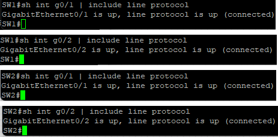
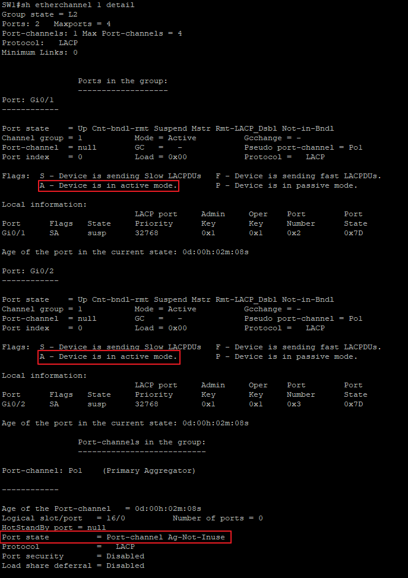
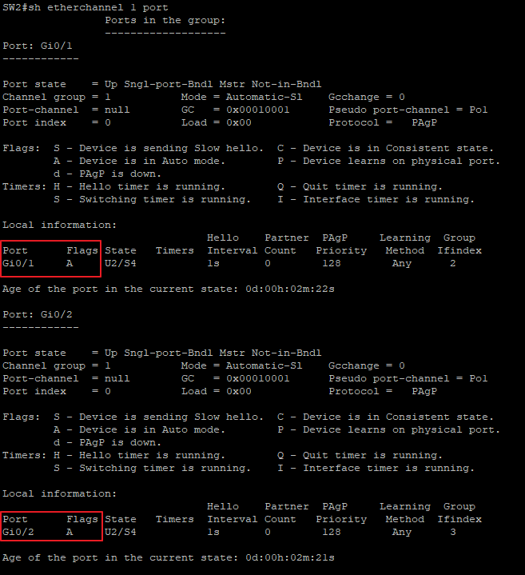
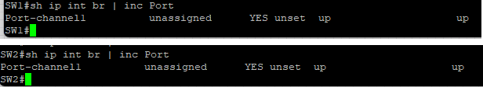

# Troubleshooting EtherChannel

[한국어](../02-Troubleshooting-EtherChannel.md) | **English** | [日本語](02-Troubleshooting-EtherChannel.ja.md) | [简体中文](02-Troubleshooting-EtherChannel.zh-CN.md) | [Español](02-Troubleshooting-EtherChannel.es.md) | [Français](02-Troubleshooting-EtherChannel.fr.md)

Most EtherChannel (link aggregation) issues are caused by **misconfiguration**. Keep in mind that **the configuration of all physical interfaces has to match**. In this lesson, we'll look at some common EtherChannel issues. For EtherChannel configuration, see [Introduction to EtherChannel](../../01-Introduction-to-EtherChannel/README/01-Introduction-to-EtherChannel.en.md).

## What to check for each symptom

| Symptom | Check first | Common cause |
| --- | --- | --- |
| Port-channel is down | `show etherchannel summary` | Different protocols on each side (PAgP / LACP) |
| Port-channel is down, same protocol | `show etherchannel 1 port` | Both sides in auto or passive |
| Port-channel is up but slow | `show interfaces status` | Mismatched physical settings (speed etc.) |

This is the topology I will use:

The idea is to bundle GigabitEthernet0/1 and 0/2 into an EtherChannel, but it isn't working. Let's look at the first issue.

---

## 1. Wrong EtherChannel mode

The EtherChannel is not working. First, we check whether the interfaces are up and running.

All interfaces are operational. Let's check if we have a port-channel interface.

A port-channel interface has been created, but it is **down**. Let's check the details.

`show etherchannel summary` is a nice command to check your port-channels. **SW1 is configured for LACP and SW2 for PAgP**. This is never going to work. SW1's ports show `s` (suspended) and SW2's ports show `I` (stand-alone). Let's take a closer look.

The best command to use is `show etherchannel detail`. It gives a lot of information, but I'm interested in whether LACP is in **passive or active** mode. Interfaces in active mode **actively** try to form an EtherChannel; interfaces in passive mode **only respond** to LACP requests. SW1 shows `A - Device is in active mode`. Let's look at SW2.

This is the `show etherchannel detail` output of SW2. It is configured for **PAgP**, and the interfaces are in **desirable** mode (Desirable-Sl). If they were in auto mode, we would see the `A` flag. Let's reconfigure SW2 to use LACP.

First, remove the port-channel interface. If you don't, you'll get an error when you change the channel-group mode on the interfaces. After a few seconds, the port-channel interface appears again.

After changing the configuration, Port-channel1 goes up. Problem solved!

> **Lesson learned:** Use the **same EtherChannel protocol** (PAgP or LACP) on both sides.

---

## 2. PAgP / LACP negotiation not working

Same topology, different problem.

Once again, the EtherChannel is down.

The port-channel interface exists but is down on both sides. Let's check the EtherChannel configuration.

GigabitEthernet0/1 and 0/2 have both been added to the port-channel, and both sides use **PAgP**. The protocol matches.

The GigabitEthernet interfaces look good too, so this is not the issue. Let's dive deeper into the EtherChannel configuration.

GigabitEthernet0/1 and 0/2 on SW1 are both in **PAgP auto** mode (the `A` flag). What about SW2?

GigabitEthernet0/1 and 0/2 on SW2 are also in **PAgP auto**. This will never work, because both switches only **wait** for PAgP messages. Let's change the SW2 interfaces to desirable.

SW2 now actively sends PAgP messages to SW1, so the port-channel negotiation completes.

The EtherChannel is working. Problem solved!

> **Lesson learned:** With PAgP, make sure at least one switch is in **desirable** mode; with LACP, make sure at least one switch is in **active** mode.

---

## 3. Interface configuration mismatch

One more scenario, same topology.

An EtherChannel is configured between SW1 and SW2, but the customer complains that **the link is slow**. What could be wrong?

A quick check shows that the port-channel interface is operational. Let's take a closer look anyway.

`show etherchannel detail` produces a lot of output, but it tells you what's going on. When the switch can't bundle an interface, it shows the **probable reason**, so a show filter such as `show etherchannel detail | include reason` gives you just the lines you need.

> The original says this output shows a probable reason: GigabitEthernet0/2 is set to 10 Mbit and can't be bundled. In the lab capture both ports are bundled (In-Bndl, port state Ag-Inuse), so the speed difference is found with `show interfaces status` next.

On both switches, **Gi0/2 is fixed at speed 10**. A GigabitEthernet interface should run at 1000 Mbit. Let's change the speed of Gi0/2 on both switches.

Let's see if the two interfaces have been bundled.

> In the original PDF, the log capture for this step is the same screen as the scenario 2 log (07:47:36 onward), so it is left out.

Both interfaces are now bundled in the port-channel (`P`). Problem solved!

> **Lesson learned:** Make sure all interfaces you add to a port-channel have **exactly the same configuration**!

These are the EtherChannel issues I wanted to show you. The most common one is that **the configuration of the physical interfaces doesn't match**. Also, if you use LACP or PAgP, make sure one of the switches is **actively negotiating**.

---

## Key points

- Most EtherChannel issues are **misconfigurations**. First check that the physical interfaces are up and that a port-channel exists.
- `show etherchannel summary` shows the protocol and port flags: `P` bundled, `I` stand-alone, `s` suspended, `SU` in use, `SD` down.
- With **different protocols** (LACP on one side, PAgP on the other), nothing is bundled. To change the mode, remove it with `no interface port-channel` and configure it again.
- When **both sides are auto (PAgP) or passive (LACP)**, nobody starts the negotiation. Change one side to desirable/active.
- If the port-channel is up but slow, suspect **mismatched physical settings such as speed and duplex**, and check with `show interfaces status` and `show etherchannel detail`.
