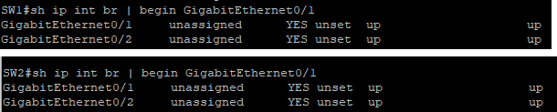

# Troubleshooting EtherChannel

[한국어](../02-Troubleshooting-EtherChannel.md) | [English](02-Troubleshooting-EtherChannel.en.md) | [日本語](02-Troubleshooting-EtherChannel.ja.md) | [简体中文](02-Troubleshooting-EtherChannel.zh-CN.md) | **Español** | [Français](02-Troubleshooting-EtherChannel.fr.md)

La mayoría de los problemas de EtherChannel (agregación de enlaces) se deben a **errores de configuración**. Recuerda que **la configuración de todas las interfaces físicas debe coincidir**. En esta lección veremos algunos problemas habituales de EtherChannel. Para la configuración de EtherChannel, consulta [Introduction to EtherChannel](../../01-Introduction-to-EtherChannel/README/01-Introduction-to-EtherChannel.es.md).

## Qué revisar según el síntoma

| Síntoma | Comando para empezar | Causa habitual |
| --- | --- | --- |
| Port-channel en down | `show etherchannel summary` | Protocolos distintos en cada lado (PAgP / LACP) |
| Port-channel en down, mismo protocolo | `show etherchannel 1 port` | Los dos lados en auto o passive |
| Port-channel activo pero lento | `show interfaces status` | Ajustes físicos distintos (speed, etc.) |

Esta es la topología que usaré:

La idea es agrupar GigabitEthernet0/1 y 0/2 en un EtherChannel, pero no funciona. Veamos el primer problema.

---

## 1. Modo de EtherChannel incorrecto

El EtherChannel no funciona. Primero comprobamos si las interfaces están activas.

Todas las interfaces funcionan. Comprobemos si existe una interfaz port-channel.

Se ha creado una interfaz port-channel, pero está **down**. Veamos los detalles.

`show etherchannel summary` es un buen comando para revisar los port-channels. **SW1 está configurado con LACP y SW2 con PAgP**. Así nunca va a funcionar. Los puertos de SW1 muestran `s` (suspended) y los de SW2 `I` (stand-alone). Miremos más de cerca.

El mejor comando es `show etherchannel detail`. Da mucha información, pero me interesa saber si LACP está en modo **passive o active**. Las interfaces en modo active intentan formar un EtherChannel **activamente**; las de modo passive **solo responden** a las peticiones LACP. SW1 muestra `A - Device is in active mode`. Veamos SW2.

Esta es la salida de `show etherchannel detail` en SW2. Está configurado con **PAgP** y las interfaces están en modo **desirable** (Desirable-Sl). Si estuvieran en auto, veríamos la bandera `A`. Reconfiguremos SW2 para que use LACP.

Primero elimina la interfaz port-channel. Si no lo haces, verás un error al cambiar el modo channel-group de las interfaces. Tras unos segundos, la interfaz port-channel vuelve a aparecer.

Después del cambio, Port-channel1 se activa. ¡Problema resuelto!

> **Lección aprendida:** Usa el **mismo protocolo de EtherChannel** (PAgP o LACP) en ambos lados.

---

## 2. La negociación PAgP / LACP no funciona

Misma topología, otro problema.

Otra vez el EtherChannel está down.

La interfaz port-channel existe, pero está down en ambos lados. Revisemos la configuración del EtherChannel.

GigabitEthernet0/1 y 0/2 se han añadido al port-channel y ambos lados usan **PAgP**. El protocolo coincide.

Las interfaces GigabitEthernet también están bien, así que el problema no está aquí. Profundicemos en la configuración del EtherChannel.

GigabitEthernet0/1 y 0/2 de SW1 están en modo **PAgP auto** (bandera `A`). ¿Y SW2?

GigabitEthernet0/1 y 0/2 de SW2 también están en **PAgP auto**. Esto nunca funcionará, porque los dos switches solo **esperan** mensajes PAgP. Cambiemos las interfaces de SW2 a desirable.

Ahora SW2 envía activamente mensajes PAgP a SW1, así que la negociación del port-channel se completa.

El EtherChannel funciona. ¡Problema resuelto!

> **Lección aprendida:** Con PAgP, asegúrate de que al menos un switch esté en **desirable**; con LACP, de que al menos uno esté en **active**.

---

## 3. Configuración de interfaces distinta

Un último escenario, con la misma topología.

Hay un EtherChannel configurado entre SW1 y SW2, pero el cliente se queja de que **el enlace va lento**. ¿Qué puede estar mal?

Una comprobación rápida muestra que la interfaz port-channel funciona. Aun así, miremos más de cerca.

`show etherchannel detail` produce mucha salida, pero te dice qué está pasando. Cuando el switch no puede agrupar una interfaz, muestra la **razón probable (probable reason)**, así que un filtro como `show etherchannel detail | include reason` te muestra solo las líneas que necesitas.

> El original explica que esta salida muestra una razón probable: GigabitEthernet0/2 está configurada a 10 Mbit y no se puede agrupar. En la captura del laboratorio los dos puertos están agrupados (In-Bndl, Port state Ag-Inuse), así que la diferencia de velocidad se ve a continuación con `show interfaces status`.

En los dos switches, **Gi0/2 está fijada a velocidad 10**. Una interfaz GigabitEthernet debería ir a 1000 Mbit. Cambiemos la velocidad de Gi0/2 en ambos switches.

Veamos si las dos interfaces se han agrupado.

> En el PDF original, la captura de registro de este paso es la misma pantalla que el registro del escenario 2 (desde las 07:47:36), así que no se incluye.

Ahora las dos interfaces están agrupadas en el port-channel (`P`). ¡Problema resuelto!

> **Lección aprendida:** ¡Asegúrate de que todas las interfaces que añades a un port-channel tengan **exactamente la misma configuración**!

Estos son los problemas de EtherChannel que quería mostrarte. El más habitual es que **la configuración de las interfaces físicas no coincida**. Además, si usas LACP o PAgP, asegúrate de que uno de los switches **negocie activamente**.

---

## Resumen

- La mayoría de los problemas de EtherChannel son **errores de configuración**. Primero comprueba que las interfaces físicas estén activas y que exista un port-channel.
- `show etherchannel summary` muestra el protocolo y las banderas de los puertos: `P` agrupado, `I` stand-alone, `s` suspended, `SU` en uso, `SD` down.
- Con **protocolos distintos** (LACP en un lado y PAgP en el otro) no se agrupa nada. Para cambiar el modo, elimina el port-channel con `no interface port-channel` y vuelve a configurarlo.
- Si **los dos lados están en auto (PAgP) o passive (LACP)**, nadie inicia la negociación. Cambia un lado a desirable/active.
- Si el port-channel está activo pero va lento, sospecha de **ajustes físicos distintos como speed y duplex**, y compruébalo con `show interfaces status` y `show etherchannel detail`.
