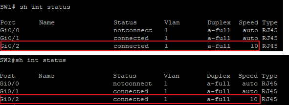

# Troubleshooting EtherChannel

[한국어](../02-Troubleshooting-EtherChannel.md) | [English](02-Troubleshooting-EtherChannel.en.md) | [日本語](02-Troubleshooting-EtherChannel.ja.md) | [简体中文](02-Troubleshooting-EtherChannel.zh-CN.md) | [Español](02-Troubleshooting-EtherChannel.es.md) | **Français**

La plupart des problèmes d'EtherChannel (agrégation de liens) viennent **d'erreurs de configuration**. N'oubliez pas que **la configuration de toutes les interfaces physiques doit être identique**. Dans cette leçon, nous allons voir quelques problèmes courants d'EtherChannel. Pour la configuration d'EtherChannel, voir [Introduction to EtherChannel](../../01-Introduction-to-EtherChannel/README/01-Introduction-to-EtherChannel.fr.md).

## Que vérifier selon le symptôme

| Symptôme | Commande à vérifier d'abord | Cause fréquente |
| --- | --- | --- |
| Port-channel down | `show etherchannel summary` | Protocoles différents de chaque côté (PAgP / LACP) |
| Port-channel down, même protocole | `show etherchannel 1 port` | Les deux côtés en auto ou passive |
| Port-channel actif mais lent | `show interfaces status` | Réglages physiques différents (speed, etc.) |

Voici la topologie que j'utilise :

L'idée est de regrouper GigabitEthernet0/1 et 0/2 dans un EtherChannel, mais cela ne fonctionne pas. Voyons le premier problème.

---

## 1. Mauvais mode d'EtherChannel

L'EtherChannel ne fonctionne pas. On vérifie d'abord que les interfaces sont actives.

Toutes les interfaces fonctionnent. Vérifions s'il existe une interface port-channel.

Une interface port-channel a été créée, mais elle est **down**. Regardons les détails.

`show etherchannel summary` est une bonne commande pour vérifier les port-channels. **SW1 est configuré en LACP et SW2 en PAgP**. Cela ne marchera jamais. Les ports de SW1 affichent `s` (suspended) et ceux de SW2 `I` (stand-alone). Regardons de plus près.

La meilleure commande est `show etherchannel detail`. Elle donne beaucoup d'informations, mais je veux surtout savoir si LACP est en mode **passive ou active**. Les interfaces en mode active essaient **activement** de former un EtherChannel ; celles en mode passive **répondent seulement** aux demandes LACP. SW1 affiche `A - Device is in active mode`. Voyons SW2.

Voici la sortie de `show etherchannel detail` sur SW2. Il est configuré en **PAgP**, et les interfaces sont en mode **desirable** (Desirable-Sl). En mode auto, on verrait le drapeau `A`. Reconfigurons SW2 pour qu'il utilise LACP.

Supprimez d'abord l'interface port-channel. Sinon, vous aurez une erreur en changeant le mode channel-group des interfaces. Après quelques secondes, l'interface port-channel réapparaît.

Après la modification, Port-channel1 passe à up. Problème résolu !

> **Leçon retenue :** Utilisez le **même protocole d'EtherChannel** (PAgP ou LACP) des deux côtés.

---

## 2. La négociation PAgP / LACP ne fonctionne pas

Même topologie, autre problème.

Encore une fois, l'EtherChannel est down.

L'interface port-channel existe, mais elle est down des deux côtés. Vérifions la configuration de l'EtherChannel.

GigabitEthernet0/1 et 0/2 ont été ajoutées au port-channel, et les deux côtés utilisent **PAgP**. Le protocole est le même.

Les interfaces GigabitEthernet sont correctes aussi, le problème n'est donc pas là. Creusons la configuration de l'EtherChannel.

GigabitEthernet0/1 et 0/2 de SW1 sont toutes les deux en mode **PAgP auto** (drapeau `A`). Et SW2 ?

GigabitEthernet0/1 et 0/2 de SW2 sont aussi en **PAgP auto**. Cela ne fonctionnera jamais, car les deux switchs ne font **qu'attendre** des messages PAgP. Passons les interfaces de SW2 en desirable.

SW2 envoie maintenant activement des messages PAgP à SW1, et la négociation du port-channel aboutit.

L'EtherChannel fonctionne. Problème résolu !

> **Leçon retenue :** Avec PAgP, au moins un switch doit être en **desirable** ; avec LACP, au moins un switch doit être en **active**.

---

## 3. Configuration d'interface différente

Un dernier scénario, avec la même topologie.

Un EtherChannel est configuré entre SW1 et SW2, mais le client se plaint que **le lien est lent**. Qu'est-ce qui ne va pas ?

Une vérification rapide montre que l'interface port-channel fonctionne. Regardons quand même de plus près.

`show etherchannel detail` produit beaucoup de sortie, mais elle indique ce qui se passe. Quand le switch ne peut pas regrouper une interface, il affiche la **raison probable (probable reason)** ; un filtre comme `show etherchannel detail | include reason` n'affiche alors que les lignes utiles.

> Le texte d'origine explique que cette sortie affiche une raison probable : GigabitEthernet0/2 est réglée à 10 Mbit et ne peut pas être regroupée. Dans la capture du labo, les deux ports sont regroupés (In-Bndl, Port state Ag-Inuse), donc la différence de vitesse se voit ensuite avec `show interfaces status`.

Sur les deux switchs, **Gi0/2 est fixée à la vitesse 10**. Une interface GigabitEthernet devrait fonctionner à 1000 Mbit. Changeons la vitesse de Gi0/2 sur les deux switchs.

Vérifions si les deux interfaces sont regroupées.

> Dans le PDF d'origine, la capture du journal de cette étape est le même écran que le journal du scénario 2 (à partir de 07:47:36) ; elle n'est donc pas reprise.

Les deux interfaces sont maintenant regroupées dans le port-channel (`P`). Problème résolu !

> **Leçon retenue :** Toutes les interfaces ajoutées à un port-channel doivent avoir **exactement la même configuration** !

Voilà les problèmes d'EtherChannel que je voulais vous montrer. Le plus fréquent est que **la configuration des interfaces physiques ne correspond pas**. Et si vous utilisez LACP ou PAgP, assurez-vous qu'un des switchs **négocie activement**.

---

## Résumé

- La plupart des problèmes d'EtherChannel sont des **erreurs de configuration**. Vérifiez d'abord que les interfaces physiques sont actives et qu'un port-channel existe.
- `show etherchannel summary` affiche le protocole et les drapeaux des ports : `P` regroupé, `I` stand-alone, `s` suspended, `SU` en service, `SD` down.
- Avec des **protocoles différents** (LACP d'un côté, PAgP de l'autre), rien n'est regroupé. Pour changer de mode, supprimez le port-channel avec `no interface port-channel` puis reconfigurez-le.
- Si **les deux côtés sont en auto (PAgP) ou en passive (LACP)**, personne ne lance la négociation. Passez un côté en desirable/active.
- Si le port-channel est actif mais lent, soupçonnez des **réglages physiques différents comme speed et duplex**, et vérifiez avec `show interfaces status` et `show etherchannel detail`.
