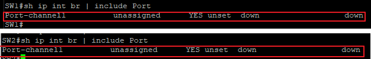
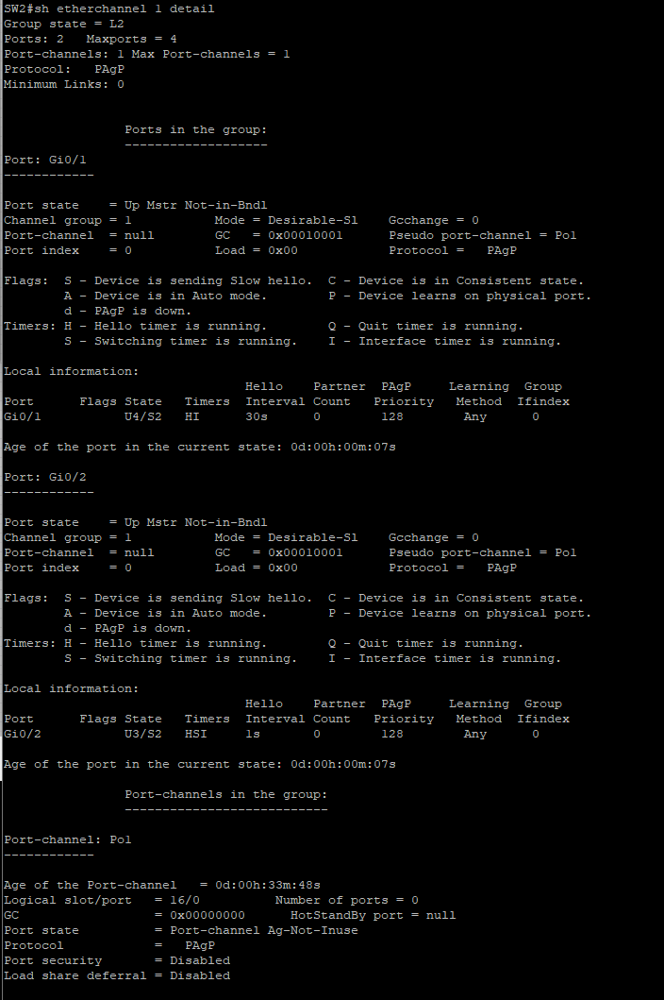
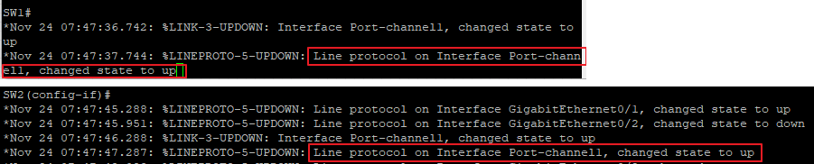
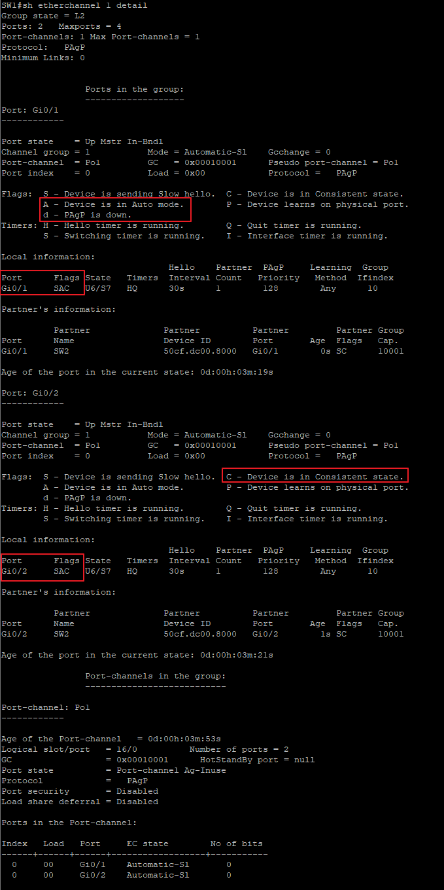
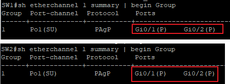

# Troubleshooting EtherChannel

[한국어](../02-Troubleshooting-EtherChannel.md) | [English](02-Troubleshooting-EtherChannel.en.md) | **日本語** | [简体中文](02-Troubleshooting-EtherChannel.zh-CN.md) | [Español](02-Troubleshooting-EtherChannel.es.md) | [Français](02-Troubleshooting-EtherChannel.fr.md)

EtherChannel（リンクアグリゲーション）の問題のほとんどは **設定ミス** が原因です。**すべての物理インターフェイスの設定が一致していなければならない** ことを覚えておいてください。この記事では、EtherChannel でよく起きる問題を見ていきます。EtherChannel の設定は [Introduction to EtherChannel](../../01-Introduction-to-EtherChannel/README/01-Introduction-to-EtherChannel.ja.md) を参照してください。

## 症状別の確認手順

| 症状 | 最初に見るコマンド | よくある原因 |
| --- | --- | --- |
| Port-channel が down | `show etherchannel summary` | 両側のプロトコルが違う（PAgP / LACP） |
| Port-channel が down、プロトコルは同じ | `show etherchannel 1 port` | 両側とも auto または passive |
| Port-channel は up だが遅い | `show interfaces status` | 物理インターフェイス設定（speed など）の不一致 |

使用するトポロジは次のとおりです。

GigabitEthernet0/1 と 0/2 を EtherChannel に束ねたいのですが、動作していません。最初の問題から見ていきます。

---

## 1. EtherChannel のモードが違う

EtherChannel が動作していません。まずインターフェイスが up しているか確認します。

すべてのインターフェイスが動作しています。port-channel インターフェイスがあるか確認してみます。

port-channel インターフェイスは作成されていますが **down** です。詳しく見てみます。

`show etherchannel summary` は port-channel を確認するのに便利なコマンドです。**SW1 は LACP、SW2 は PAgP** に設定されています。これでは絶対に動作しません。SW1 のポートは `s`（suspended）、SW2 のポートは `I`（stand-alone）です。さらに詳しく見てみます。

一番よいコマンドは `show etherchannel detail` です。情報量が多いですが、LACP が **passive か active か** を確認します。active モードのインターフェイスは EtherChannel を作ろうと **積極的に** 試み、passive モードのインターフェイスは LACP 要求に **応答するだけ** です。SW1 は `A - Device is in active mode` です。SW2 も見てみます。

SW2 の `show etherchannel detail` の出力です。**PAgP** に設定され、インターフェイスは **desirable** モード（Desirable-Sl）です。auto モードなら `A` フラグが表示されるはずです。SW2 を LACP に設定し直します。

まず port-channel インターフェイスを削除します。削除しないと、インターフェイスの channel-group モードを変更するときにエラーが出ます。数秒後、port-channel インターフェイスが再び現れます。

設定を変更すると Port-channel1 が up しました。解決！

> **教訓：** 両側で **同じ EtherChannel プロトコル**（PAgP または LACP）を使いましょう。

---

## 2. PAgP / LACP のネゴシエーションができない

同じトポロジで別の問題です。

今回も EtherChannel が down です。

port-channel インターフェイスはありますが、両側とも down です。EtherChannel の設定を確認してみます。

GigabitEthernet0/1 と 0/2 はどちらも port-channel に入っており、両側とも **PAgP** を使っています。プロトコルは同じです。

GigabitEthernet インターフェイスも正常なので、問題はここではありません。EtherChannel の設定をさらに深く見てみます。

SW1 の GigabitEthernet0/1 と 0/2 はどちらも **PAgP auto** モードです（`A` フラグ）。SW2 はどうでしょうか？

SW2 の GigabitEthernet0/1 と 0/2 も **PAgP auto** です。両方のスイッチが PAgP メッセージを **待っているだけ** なので、絶対に動作しません。SW2 のインターフェイスを desirable に変更します。

これで SW2 が SW1 に PAgP メッセージを積極的に送るので、port-channel のネゴシエーションが完了します。

EtherChannel が動作しました。解決！

> **教訓：** PAgP では少なくとも一方のスイッチを **desirable** に、LACP では少なくとも一方を **active** にしましょう。

---

## 3. インターフェイス設定の不一致

最後のシナリオも同じトポロジです。

SW1 と SW2 の間に EtherChannel が設定されていますが、顧客から **リンクが遅い** と言われています。何が問題でしょうか？

簡単に確認すると、port-channel インターフェイスは動作しています。それでも詳しく見てみます。

`show etherchannel detail` は出力が多いですが、何が起きているかを教えてくれます。インターフェイスを束ねられなかったときはその **理由（probable reason）** を表示するので、`show etherchannel detail | include reason` のように show コマンドのフィルタを使えば必要な行だけを見られます。

> 原文では、この出力に GigabitEthernet0/2 が 10Mbit に設定されていて束ねられないという probable reason が表示されると説明しています。実習キャプチャでは両ポートとも束ねられている（In-Bndl、Port state Ag-Inuse）ため、速度の違いは次の `show interfaces status` で確認します。

両方のスイッチで **Gi0/2 の速度が 10 に固定** されています。GigabitEthernet は 1000Mbit であるべきです。両スイッチの Gi0/2 の速度を変更します。

2 つのインターフェイスが束ねられたか確認します。

> 原文 PDF のこの手順のログキャプチャは、シナリオ 2 のログ（07:47:36〜）と同じ画面なので載せていません。

両方のインターフェイスが port-channel に束ねられました（`P`）。解決！

> **教訓：** port-channel に入れるインターフェイスは **設定を完全に同じ** にしましょう！

以上が紹介したかった EtherChannel の問題です。最もよくある問題は **物理インターフェイスの設定が一致していないこと** です。また LACP や PAgP を使う場合は、一方のスイッチが **積極的にネゴシエーション** するようにしてください。

---

## まとめ

- EtherChannel の問題のほとんどは **設定ミス** です。まず物理インターフェイスが up か、port-channel が作られているかを確認します。
- `show etherchannel summary` でプロトコルとポートフラグを確認します：`P` 束ねられている、`I` stand-alone、`s` suspended、`SU` 使用中、`SD` down。
- **プロトコルが違う**（一方が LACP、他方が PAgP）と束ねられません。モードを変えるときは `no interface port-channel` で削除してから設定し直します。
- **両側とも auto（PAgP）または passive（LACP）** だと、誰もネゴシエーションを始めません。一方を desirable/active に変えます。
- port-channel が up でも遅いなら **speed や duplex などの物理設定の不一致** を疑い、`show interfaces status` や `show etherchannel detail` で確認します。
