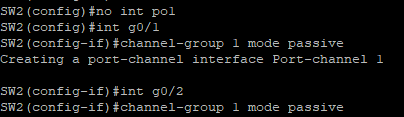
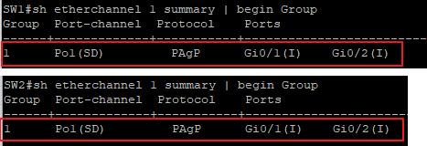

# Troubleshooting EtherChannel

[한국어](../02-Troubleshooting-EtherChannel.md) | [English](02-Troubleshooting-EtherChannel.en.md) | [日本語](02-Troubleshooting-EtherChannel.ja.md) | **简体中文** | [Español](02-Troubleshooting-EtherChannel.es.md) | [Français](02-Troubleshooting-EtherChannel.fr.md)

EtherChannel（链路聚合）的问题大多是 **配置错误** 造成的。请记住，**所有物理接口的配置必须一致**。本文介绍 EtherChannel 中常见的几个问题。EtherChannel 的配置请参考 [Introduction to EtherChannel](../../01-Introduction-to-EtherChannel/README/01-Introduction-to-EtherChannel.zh-CN.md)。

## 按症状排查的顺序

| 症状 | 先看的命令 | 常见原因 |
| --- | --- | --- |
| Port-channel 为 down | `show etherchannel summary` | 两端协议不同（PAgP / LACP） |
| Port-channel 为 down，协议相同 | `show etherchannel 1 port` | 两端都是 auto 或 passive |
| Port-channel 为 up 但速度慢 | `show interfaces status` | 物理接口配置（speed 等）不一致 |

使用的拓扑如下：

我们想把 GigabitEthernet0/1 和 0/2 捆绑成 EtherChannel，但它没有工作。先看第一个问题。

---

## 1. EtherChannel 模式不一致

EtherChannel 没有工作。首先检查接口是否已经 up。

所有接口都在工作。检查一下是否有 port-channel 接口。

port-channel 接口已经创建，但状态是 **down**。查看详细信息。

`show etherchannel summary` 是检查 port-channel 的好命令。**SW1 配置为 LACP，SW2 配置为 PAgP**，这样永远不会工作。SW1 的端口显示 `s`（suspended），SW2 的端口显示 `I`（stand-alone）。再仔细看看。

最好用的命令是 `show etherchannel detail`。信息很多，我们关注 LACP 是 **passive 还是 active**。active 模式的接口会 **主动** 尝试组成 EtherChannel，passive 模式的接口 **只响应** LACP 请求。SW1 显示 `A - Device is in active mode`。再看 SW2。

这是 SW2 的 `show etherchannel detail` 输出。它配置为 **PAgP**，接口是 **desirable** 模式（Desirable-Sl）。如果是 auto 模式，会看到 `A` 标志。把 SW2 重新配置为 LACP。

先删除 port-channel 接口。如果不删除，修改接口的 channel-group 模式时会报错。几秒钟后 port-channel 接口会重新出现。

修改配置后 Port-channel1 变为 up。问题解决！

> **经验：** 两端要使用 **相同的 EtherChannel 协议**（PAgP 或 LACP）。

---

## 2. PAgP / LACP 协商失败

同样的拓扑，不同的问题。

EtherChannel 又是 down。

port-channel 接口存在，但两端都是 down。检查 EtherChannel 配置。

GigabitEthernet0/1 和 0/2 都已加入 port-channel，两端都使用 **PAgP**。协议是一致的。

GigabitEthernet 接口也正常，所以问题不在这里。更深入地查看 EtherChannel 配置。

SW1 的 GigabitEthernet0/1 和 0/2 都是 **PAgP auto** 模式（`A` 标志）。SW2 呢？

SW2 的 GigabitEthernet0/1 和 0/2 也是 **PAgP auto**。两台交换机都只是 **等待** PAgP 消息，所以永远不会工作。把 SW2 的接口改为 desirable。

现在 SW2 主动向 SW1 发送 PAgP 消息，port-channel 协商就能完成。

EtherChannel 开始工作了。问题解决！

> **经验：** 使用 PAgP 时至少让一台交换机为 **desirable**，使用 LACP 时至少让一台为 **active**。

---

## 3. 接口配置不一致

最后一个场景，拓扑相同。

SW1 和 SW2 之间配置了 EtherChannel，但客户抱怨 **链路很慢**。可能是什么问题？

快速检查发现 port-channel 接口在工作。还是仔细看看。

`show etherchannel detail` 的输出很多，但能告诉我们发生了什么。交换机无法捆绑某个接口时会显示 **原因（probable reason）**，所以用 `show etherchannel detail | include reason` 这样的 show 过滤器，就只看需要的行。

> 原文说明这个输出会显示 probable reason：GigabitEthernet0/2 被设置为 10Mbit，因而无法捆绑。但实验截图中两个端口都已捆绑（In-Bndl，Port state Ag-Inuse），所以速度差异在下面的 `show interfaces status` 中确认。

两台交换机上 **Gi0/2 的速度都固定为 10**。GigabitEthernet 应该是 1000Mbit。修改两台交换机 Gi0/2 的速度。

确认两个接口是否已经捆绑。

> 原文 PDF 中这一步的日志截图与场景 2 的日志（07:47:36 起）是同一个画面，因此没有放入。

两个接口都已捆绑到 port-channel 中（`P`）。问题解决！

> **经验：** 加入 port-channel 的接口 **配置必须完全相同**！

以上就是我想介绍的 EtherChannel 问题。最常见的问题是 **物理接口的配置不一致**。另外，如果使用 LACP 或 PAgP，要确保其中一台交换机 **主动协商**。

---

## 总结

- EtherChannel 的问题大多是 **配置错误**。先确认物理接口是否 up、port-channel 是否已创建。
- 用 `show etherchannel summary` 查看协议和端口标志：`P` 已捆绑，`I` stand-alone，`s` suspended，`SU` 使用中，`SD` down。
- **协议不同**（一端 LACP，一端 PAgP）时不会捆绑。更改模式时先用 `no interface port-channel` 删除再重新配置。
- **两端都是 auto（PAgP）或 passive（LACP）** 时，没有一方会发起协商。把一端改为 desirable/active。
- port-channel 为 up 但很慢时，怀疑 **speed、duplex 等物理配置不一致**，用 `show interfaces status` 和 `show etherchannel detail` 确认。
