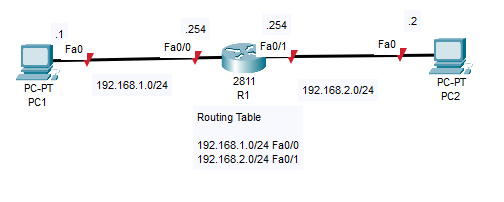
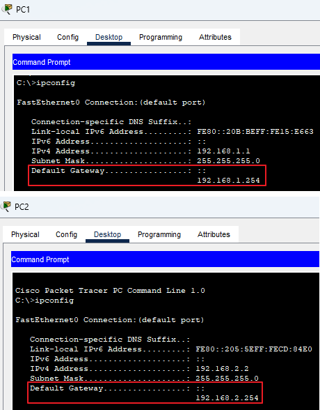

# Introduction to Routers and Routing

**한국어** | [English](README/01-Introduction-to-Routers-and-Routing.en.md) | [日本語](README/01-Introduction-to-Routers-and-Routing.ja.md) | [简体中文](README/01-Introduction-to-Routers-and-Routing.zh-CN.md) | [Español](README/01-Introduction-to-Routers-and-Routing.es.md) | [Français](README/01-Introduction-to-Routers-and-Routing.fr.md)

이번 글에서는 스위치와 라우터의 차이를 살펴보고 **라우팅의 기초** 를 설명합니다. 라우터란 무엇이고, 라우팅이란 정확히 무엇일까요? 스위치는 "스위칭"하고 라우터는 "라우팅"한다고 하는데, 이게 정확히 무슨 뜻인지부터 보겠습니다.

## 스위치와 라우터 한눈에 보기

| 구분 | 스위치 | 라우터 |
| --- | --- | --- |
| 동작 계층 | 데이터 링크 계층(Layer 2) | 네트워크 계층(Layer 3) |
| 보는 주소 | 목적지 MAC 주소 | 목적지 IP 주소 |
| 다루는 단위 | 이더넷 프레임 | IP 패킷 |
| 참고하는 표 | MAC 주소 테이블 | 라우팅 테이블 |

---

## 1. 스위치와 라우터는 무엇이 다른가?

스위치는 **MAC 주소 정보를 보고 "스위칭"** 합니다. 스위치가 신경 쓰는 것은 하나뿐입니다. 이더넷 프레임이 인터페이스로 들어오면, **목적지 MAC 주소** 를 보고 이 프레임을 어느 인터페이스로 보낼지 정합니다. 즉 스위치는 **데이터 링크 계층(Layer 2)** 정보로 판단합니다.

라우터도 하는 일은 비슷하지만, 이번에는 **IP 패킷** 을 봅니다. 기억하시겠지만 IP는 **네트워크 계층(Layer 3)** 에 있습니다. 라우터는 IP 패킷의 **목적지 IP 주소** 를 보고 알맞은 인터페이스로 내보냅니다.

여기서 이런 생각이 들 수 있습니다. 둘이 뭐가 그렇게 다를까요? MAC 주소도 IP 주소도 네트워크 장비마다 고유한데, 왜 어디서나 MAC 주소로 스위칭하지 않고 IP 주소를 보고 라우팅해야 할까요? 좋은 질문입니다. 그림으로 답해 보겠습니다.

---

## 2. 왜 라우팅이 필요한가?


스위치가 두 대 있고, 스위치마다 컴퓨터가 200대씩 연결되어 있습니다. 컴퓨터 400대가 모두 서로 통신하려면 **스위치마다 MAC 주소 400개** 를 배워야 합니다. 왼쪽과 오른쪽 컴퓨터의 MAC 주소를 모두 알아야 하기 때문입니다.

이제 정말 큰 네트워크, 예를 들어 **인터넷** 을 생각해 보세요. 장비가 수백만 대입니다! 인터넷의 모든 장비마다 MAC 주소 테이블 항목을 하나씩, 수백만 개 둘 수 있을까요? 절대 불가능합니다. 스위칭의 문제는 **확장성이 없다** 는 것입니다. 계층 구조 없이 **평평한 48비트 MAC 주소** 만 있기 때문입니다. 같은 예시를 라우터로 바꿔 보겠습니다.


왼쪽의 컴퓨터 200대는 R1에 연결되어 있고 **192.168.1.0/24** 네트워크에 있습니다. R2 뒤에도 컴퓨터가 200대 있고, 이쪽 네트워크는 **192.168.2.0/24** 입니다. 라우터는 **IP 정보를 보고 "라우팅"** 합니다. 이 예에서 R1은 192.168.2.0/24 네트워크가 R2 뒤에 있다는 것만 알면 되고, R2는 192.168.1.0/24 네트워크가 R1 뒤에 있다는 것만 알면 됩니다.

MAC 주소 400개짜리 MAC 주소 테이블 대신, 이제 **라우터마다 상대 네트워크 항목 하나** 면 충분합니다.

---

## 3. 라우팅 테이블과 패킷 전달

스위치가 **MAC 주소 테이블** 로 이더넷 프레임을 전달하듯, 라우터는 **라우팅 테이블** 로 IP 패킷을 어디로 보낼지 알아냅니다. 새 라우터를 상자에서 꺼내면 라우팅 테이블을 만들기는 하지만, 그 안에 있는 정보는 **직접 연결된(directly connected) 인터페이스** 뿐입니다. 간단한 예로 시작하겠습니다.


위 그림에는 라우터 한 대와 컴퓨터 두 대가 있습니다.

- H1은 IP 주소가 192.168.1.1이고, 기본 게이트웨이로 192.168.1.254를 설정했습니다.
- H2는 IP 주소가 192.168.2.2이고, 기본 게이트웨이로 192.168.2.254를 설정했습니다.
- 라우터에는 FastEthernet 0/0에 192.168.1.254, FastEthernet 1/0에 192.168.2.254를 설정했습니다.
- IP 주소와 함께 서브넷 마스크도 설정했으므로, 라우터는 네트워크 주소를 알고 이를 라우팅 테이블에 저장합니다.

H1이 H2에게 무언가를 보낼 때는 다음과 같은 일이 일어납니다.

1. H1이 목적지 IP 주소가 192.168.2.2인 IP 패킷을 보냅니다.
2. H1은 자신의 IP 주소와 서브넷 마스크를 확인하고, 192.168.2.2가 **다른 서브넷** 에 있다고 판단합니다. 그래서 IP 패킷을 **기본 게이트웨이** 로 보냅니다.
3. 라우터는 IP 패킷을 받아 목적지 IP 주소를 확인하고 라우팅 테이블을 살펴봅니다. 192.168.2.2는 **192.168.2.0/24 항목과 일치** 하므로, 라우터는 IP 패킷을 FastEthernet 1/0 인터페이스로 내보냅니다.
4. H2가 IP 패킷을 받습니다. 성공입니다!

---

## 4. 실습: 라우터 하나로 두 네트워크 연결하기

이 시나리오를 실제 라우터에 설정해서 어떻게 보이는지 확인해 보겠습니다. 토폴로지는 다음과 같습니다. 실습 라우터(2811)의 두 번째 인터페이스는 Fa0/1입니다.



먼저 컴퓨터 설정입니다. 각 PC의 IP 주소와 기본 게이트웨이를 확인합니다.



이제 라우터를 설정합니다. 인터페이스에 IP 주소를 설정하고 켭니다.

```
R1(config)#int f0/0
R1(config-if)#no shutdown
R1(config-if)#ip address 192.168.1.254 255.255.255.0
R1(config-if)#exit
R1(config)#int f0/1
R1(config-if)#no shut
R1(config-if)#ip add 192.168.2.254 255.255.255.0
R1(config-if)#
```

이게 전부입니다. 이제 라우팅 테이블을 확인해 보겠습니다.

```
R1#sh ip route
Codes: L - local, C - connected, S - static, R - RIP, M - mobile, B - BGP
       D - EIGRP, EX - EIGRP external, O - OSPF, IA - OSPF inter area
       N1 - OSPF NSSA external type 1, N2 - OSPF NSSA external type 2
       E1 - OSPF external type 1, E2 - OSPF external type 2, E - EGP
       i - IS-IS, L1 - IS-IS level-1, L2 - IS-IS level-2, ia - IS-IS inter area
       * - candidate default, U - per-user static route, o - ODR
       P - periodic downloaded static route

Gateway of last resort is not set

     192.168.1.0/24 is variably subnetted, 2 subnets, 2 masks
C       192.168.1.0/24 is directly connected, FastEthernet0/0
L       192.168.1.254/32 is directly connected, FastEthernet0/0
     192.168.2.0/24 is variably subnetted, 2 subnets, 2 masks
C       192.168.2.0/24 is directly connected, FastEthernet0/1
L       192.168.2.254/32 is directly connected, FastEthernet0/1
```

보시다시피 라우터는 **직접 연결된 두 네트워크** 를 알고 있습니다(`C` 항목). `L` 항목은 라우터 인터페이스 자신의 주소(/32)입니다.

PC1에서 PC2로 ping이 되는지 확인해 보겠습니다.


ping이 성공했습니다! 방금 첫 번째 IP 패킷을 라우팅했습니다. TTL이 127인 것은 라우터 하나를 거치면서 1이 줄었기 때문입니다.

> Windows 컴퓨터끼리 ping을 할 때는 **방화벽이 ICMP 트래픽을 막을 수 있다** 는 점을 기억하세요.

---

## 5. Traceroute로 경로 확인하기

인터넷의 서버에 접속할 때는 목적지에 닿기까지 **여러 라우터** 를 거칩니다. 이 경로는 **traceroute**(Windows에서는 `tracert`)로 볼 수 있습니다. 다음은 PC에서 `www.cisco.com` 까지의 경로를 확인한 결과입니다.


> 원문은 실제 인터넷에서 www.cisco.com까지 라우터 4대를 거치고 라우터 이름도 보인다고 설명하지만, 실습 캡처에서는 www.cisco.com이 실습망의 192.168.3.1로 연결됩니다. 192.168.0.254와 192.168.2.1을 거치고(2번째 홉은 응답 없음) 4번째 홉에서 목적지에 도착하며, 라우터 이름은 표시되지 않습니다.

경로에 있는 라우터의 IP 주소가 홉마다 표시됩니다. 컴퓨터가 이름 조회(hostname lookup)를 하면 라우터 이름도 함께 볼 수 있습니다. Windows의 traceroute는 **ICMP** 를 사용합니다.

다음 글에서는 정적 라우팅과 동적 라우팅을 살펴보겠습니다.

---

## 핵심 정리

- **스위치** 는 Layer 2에서 목적지 **MAC 주소** 로 프레임을, **라우터** 는 Layer 3에서 목적지 **IP 주소** 로 패킷을 전달합니다.
- MAC 주소는 계층 없는 평평한 48비트 주소라 **확장성이 없습니다.** 라우터는 네트워크 단위(예: 192.168.2.0/24) 항목 하나로 많은 장비를 대표합니다.
- 새 라우터의 라우팅 테이블에는 **직접 연결된 네트워크** 만 있습니다. 인터페이스에 IP 주소와 서브넷 마스크를 설정하면 `C`(connected)와 `L`(local) 항목이 생깁니다.
- 호스트는 목적지가 **다른 서브넷** 이면 패킷을 **기본 게이트웨이** 로 보내고, 라우터는 라우팅 테이블에서 일치하는 항목을 찾아 해당 인터페이스로 내보냅니다.
- 확인 명령: `show ip route`, PC의 `ipconfig`, `ping`, `tracert`. Windows 방화벽이 ICMP를 막을 수 있습니다.
