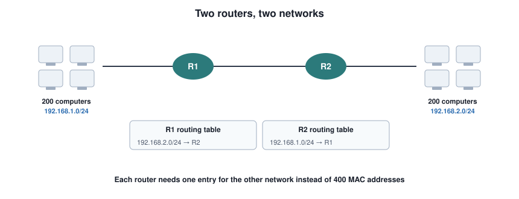
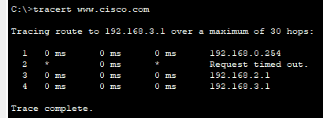

# Introduction to Routers and Routing

[한국어](../01-Introduction-to-Routers-and-Routing.md) | **English** | [日本語](01-Introduction-to-Routers-and-Routing.ja.md) | [简体中文](01-Introduction-to-Routers-and-Routing.zh-CN.md) | [Español](01-Introduction-to-Routers-and-Routing.es.md) | [Français](01-Introduction-to-Routers-and-Routing.fr.md)

In this lesson, we'll look at the difference between switches and routers, and I'll explain **the basics of routing**. What is a router, and what exactly is routing? A switch "switches" and a router "routes," but what does that actually mean? Let's start there.

## Switches and routers at a glance

| | Switch | Router |
| --- | --- | --- |
| Layer | Data Link layer (Layer 2) | Network layer (Layer 3) |
| Address it looks at | Destination MAC address | Destination IP address |
| What it forwards | Ethernet frames | IP packets |
| Table it uses | MAC address table | Routing table |

---

## 1. How are switches and routers different?

A switch **"switches" based on MAC address information**. It only cares about one thing: when an Ethernet frame enters one of its interfaces, it looks at the **destination MAC address** to decide where to send the frame. In other words, switches make decisions based on **Data Link layer (Layer 2)** information.

Routers have a similar job, but this time we look at **IP packets**. As you might recall, IP is on the **Network layer (Layer 3)**. Routers look at the **destination IP address** in an IP packet and send it out the correct interface.

You might be thinking: what's the big difference? MAC addresses and IP addresses are both unique per network device, so why not use MAC addresses everywhere and switch? Why do we need to look at IP addresses and route? Good question. Let me answer it with a picture.

---

## 2. Why do we need routing?


We have two switches, with 200 computers connected to each. If all 400 computers want to talk to each other, **each switch has to learn 400 MAC addresses**: it needs the MAC addresses of the computers on both the left and the right.

Now think about a really large network, for example **the Internet**. There are millions of devices! Could you have millions of entries in your MAC address table, one for every device on the Internet? No way! The problem with switching is that **it doesn't scale**: there is no hierarchy, just **flat 48-bit MAC addresses**. Let's look at the same example with routers.



The 200 computers on the left are connected to R1 and are in the **192.168.1.0/24** network. R2 has 200 computers behind it, and the network there is **192.168.2.0/24**. Routers **"route" based on IP information**. In this example, R1 only has to know that network 192.168.2.0/24 is behind R2, and R2 only has to know that 192.168.1.0/24 is behind R1.

Instead of a MAC address table with 400 MAC addresses, we now need just **a single entry on each router for the other network**.

---

## 3. The routing table and packet forwarding

Just as switches use a **MAC address table** to forward Ethernet frames, routers use a **routing table** to learn where to forward IP packets. When you take a brand-new router out of the box, it builds a routing table, but the only information in it is the **directly connected interfaces**. Let's start with a simple example.


Above, we have one router and two computers:

- H1 has IP address 192.168.1.1 and uses 192.168.1.254 as its default gateway.
- H2 has IP address 192.168.2.2 and uses 192.168.2.254 as its default gateway.
- On the router, we configured 192.168.1.254 on FastEthernet 0/0 and 192.168.2.254 on FastEthernet 1/0.
- Since we also configured a subnet mask with the IP addresses, the router knows the network addresses and stores them in its routing table.

Whenever H1 wants to send something to H2, this happens:

1. H1 sends an IP packet with destination IP address 192.168.2.2.
2. H1 checks its own IP address and subnet mask and concludes that 192.168.2.2 is in **another subnet**. As a result, it forwards the IP packet to its **default gateway**.
3. The router receives the IP packet, checks the destination IP address and scans its routing table. 192.168.2.2 **matches the 192.168.2.0/24 entry**, so the router forwards the IP packet out its FastEthernet 1/0 interface.
4. H2 receives the IP packet. Life is good!

---

## 4. Lab: connecting two networks with one router

Let's configure this scenario on a real router to see what it looks like. Here's the topology. On the lab router (a 2811), the second interface is Fa0/1.


First, the computers. Check each PC's IP address and default gateway.


Now we configure the router: set the IP addresses on the interfaces and enable them.

```
R1(config)#int f0/0
R1(config-if)#no shutdown
R1(config-if)#ip address 192.168.1.254 255.255.255.0
R1(config-if)#exit
R1(config)#int f0/1
R1(config-if)#no shut
R1(config-if)#ip add 192.168.2.254 255.255.255.0
R1(config-if)#
```

That's it. Now we can check the routing table.

```
R1#sh ip route
Codes: L - local, C - connected, S - static, R - RIP, M - mobile, B - BGP
       D - EIGRP, EX - EIGRP external, O - OSPF, IA - OSPF inter area
       N1 - OSPF NSSA external type 1, N2 - OSPF NSSA external type 2
       E1 - OSPF external type 1, E2 - OSPF external type 2, E - EGP
       i - IS-IS, L1 - IS-IS level-1, L2 - IS-IS level-2, ia - IS-IS inter area
       * - candidate default, U - per-user static route, o - ODR
       P - periodic downloaded static route

Gateway of last resort is not set

     192.168.1.0/24 is variably subnetted, 2 subnets, 2 masks
C       192.168.1.0/24 is directly connected, FastEthernet0/0
L       192.168.1.254/32 is directly connected, FastEthernet0/0
     192.168.2.0/24 is variably subnetted, 2 subnets, 2 masks
C       192.168.2.0/24 is directly connected, FastEthernet0/1
L       192.168.2.254/32 is directly connected, FastEthernet0/1
```

As you can see, the router knows about **both directly connected networks** (the `C` entries). The `L` entries are the router's own interface addresses (/32).

Let's see if we can ping from PC1 to PC2.


Excellent, the ping works! We just routed our first IP packet. The TTL is 127 because it went down by one when the packet passed through the router.

> When you ping from one Windows computer to another, keep in mind that **the firewall might block ICMP traffic**.

---

## 5. Checking the path with traceroute

When you reach a server on the Internet, you go through **many routers** to get to the destination. You can see this path with **traceroute** (`tracert` on Windows). Here's the result of tracing the path from a PC to `www.cisco.com`:



> The original says that on the real Internet the trace to www.cisco.com goes through four routers and shows their names. In the lab capture, www.cisco.com resolves to 192.168.3.1 in the lab network: the trace passes 192.168.0.254 and 192.168.2.1 (hop 2 does not answer) and reaches the destination at hop 4, and no router names are shown.

Each hop shows the IP address of a router on the path. If the computer does a hostname lookup, you also see the router names. Traceroute on Windows uses **ICMP**.

In another lesson, we'll look at static and dynamic routing.

---

## Key points

- A **switch** forwards frames by destination **MAC address** at Layer 2; a **router** forwards packets by destination **IP address** at Layer 3.
- MAC addresses are flat 48-bit addresses with no hierarchy, so **they don't scale**. A router uses one entry per network (for example 192.168.2.0/24) to represent many devices.
- A new router's routing table holds only **directly connected networks**. Configuring an IP address and subnet mask on an interface creates the `C` (connected) and `L` (local) entries.
- When the destination is in **another subnet**, a host sends the packet to its **default gateway**; the router finds the matching entry in its routing table and sends the packet out that interface.
- Verify with `show ip route`, and on the PC with `ipconfig`, `ping` and `tracert`. The Windows firewall may block ICMP.
