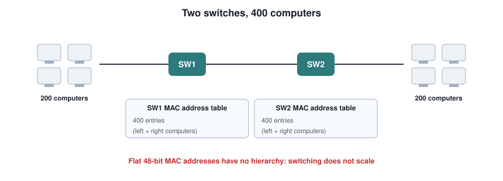

# Introduction to Routers and Routing

[한국어](../01-Introduction-to-Routers-and-Routing.md) | [English](01-Introduction-to-Routers-and-Routing.en.md) | [日本語](01-Introduction-to-Routers-and-Routing.ja.md) | [简体中文](01-Introduction-to-Routers-and-Routing.zh-CN.md) | [Español](01-Introduction-to-Routers-and-Routing.es.md) | **Français**

Dans cette leçon, nous allons voir la différence entre les switchs et les routeurs, et j'expliquerai **les bases du routage**. Qu'est-ce qu'un routeur, et qu'est-ce que le routage exactement ? On dit qu'un switch « commute » et qu'un routeur « route », mais qu'est-ce que cela veut dire ? Commençons par là.

## Switchs et routeurs en un coup d'œil

| | Switch | Routeur |
| --- | --- | --- |
| Couche | Couche liaison de données (couche 2) | Couche réseau (couche 3) |
| Adresse regardée | Adresse MAC de destination | Adresse IP de destination |
| Ce qu'il transmet | Trames Ethernet | Paquets IP |
| Table utilisée | Table d'adresses MAC | Table de routage |

---

## 1. En quoi les switchs et les routeurs sont-ils différents ?

Un switch **« commute » en fonction des adresses MAC**. Une seule chose l'intéresse : quand une trame Ethernet entre par l'une de ses interfaces, il regarde **l'adresse MAC de destination** pour décider où l'envoyer. Autrement dit, les switchs décident avec les informations de la **couche liaison de données (couche 2)**.

Les routeurs ont une tâche similaire, mais cette fois on regarde des **paquets IP**. Comme vous vous en souvenez peut-être, IP se trouve à la **couche réseau (couche 3)**. Les routeurs regardent **l'adresse IP de destination** d'un paquet IP et l'envoient par la bonne interface.

Vous vous demandez peut-être : où est la grande différence ? Les adresses MAC et IP sont toutes deux uniques pour chaque équipement réseau, alors pourquoi ne pas utiliser les adresses MAC partout et commuter ? Pourquoi faut-il regarder les adresses IP et router ? Bonne question. Je vais y répondre avec une image.

---

## 2. Pourquoi a-t-on besoin du routage ?



Nous avons deux switchs, avec 200 ordinateurs connectés à chacun. Si les 400 ordinateurs veulent communiquer entre eux, **chaque switch doit apprendre 400 adresses MAC** : il lui faut les adresses MAC des ordinateurs de gauche et de droite.

Pensez maintenant à un très grand réseau, par exemple **Internet**. Il y a des millions d'équipements ! Pourriez-vous avoir des millions d'entrées dans votre table MAC, une par équipement sur Internet ? Impossible ! Le problème de la commutation, c'est qu'elle **ne passe pas à l'échelle** : il n'y a pas de hiérarchie, seulement des **adresses MAC plates de 48 bits**. Reprenons le même exemple avec des routeurs.


Les 200 ordinateurs de gauche sont connectés à R1 et se trouvent dans le réseau **192.168.1.0/24**. R2 a 200 ordinateurs derrière lui, et le réseau utilisé de ce côté est **192.168.2.0/24**. Les routeurs **« routent » en fonction des informations IP**. Dans cet exemple, R1 doit seulement savoir que le réseau 192.168.2.0/24 se trouve derrière R2, et R2 que 192.168.1.0/24 se trouve derrière R1.

Au lieu d'une table MAC de 400 adresses, il suffit maintenant d'**une seule entrée sur chaque routeur pour le réseau de l'autre**.

---

## 3. La table de routage et la transmission des paquets

Comme les switchs utilisent une **table d'adresses MAC** pour transmettre les trames Ethernet, les routeurs utilisent une **table de routage** pour savoir où transmettre les paquets IP. Quand on sort un routeur neuf de sa boîte, il construit une table de routage, mais elle ne contient que les **interfaces directement connectées**. Commençons par un exemple simple.


Ci-dessus, nous avons un routeur et deux ordinateurs :

- H1 a l'adresse IP 192.168.1.1 et utilise 192.168.1.254 comme passerelle par défaut.
- H2 a l'adresse IP 192.168.2.2 et utilise 192.168.2.254 comme passerelle par défaut.
- Sur le routeur, nous avons configuré 192.168.1.254 sur FastEthernet 0/0 et 192.168.2.254 sur FastEthernet 1/0.
- Comme nous avons aussi configuré un masque de sous-réseau avec les adresses IP, le routeur connaît les adresses réseau et les enregistre dans sa table de routage.

Quand H1 veut envoyer quelque chose à H2, voici ce qui se passe :

1. H1 envoie un paquet IP avec l'adresse IP de destination 192.168.2.2.
2. H1 vérifie sa propre adresse IP et son masque de sous-réseau, et conclut que 192.168.2.2 se trouve dans **un autre sous-réseau**. Il transmet donc le paquet IP à sa **passerelle par défaut**.
3. Le routeur reçoit le paquet IP, vérifie l'adresse IP de destination et parcourt sa table de routage. 192.168.2.2 **correspond à l'entrée 192.168.2.0/24**, donc le routeur transmet le paquet IP par son interface FastEthernet 1/0.
4. H2 reçoit le paquet IP. Tout va bien !

---

## 4. Labo : relier deux réseaux avec un routeur

Configurons ce scénario sur un vrai routeur pour voir à quoi il ressemble. Voici la topologie. Sur le routeur du labo (un 2811), la deuxième interface est Fa0/1.


D'abord, les ordinateurs. Vérifiez l'adresse IP et la passerelle par défaut de chaque PC.


Configurons maintenant le routeur : on attribue les adresses IP aux interfaces et on les active.

```
R1(config)#int f0/0
R1(config-if)#no shutdown
R1(config-if)#ip address 192.168.1.254 255.255.255.0
R1(config-if)#exit
R1(config)#int f0/1
R1(config-if)#no shut
R1(config-if)#ip add 192.168.2.254 255.255.255.0
R1(config-if)#
```

C'est tout. Vérifions maintenant la table de routage.

```
R1#sh ip route
Codes: L - local, C - connected, S - static, R - RIP, M - mobile, B - BGP
       D - EIGRP, EX - EIGRP external, O - OSPF, IA - OSPF inter area
       N1 - OSPF NSSA external type 1, N2 - OSPF NSSA external type 2
       E1 - OSPF external type 1, E2 - OSPF external type 2, E - EGP
       i - IS-IS, L1 - IS-IS level-1, L2 - IS-IS level-2, ia - IS-IS inter area
       * - candidate default, U - per-user static route, o - ODR
       P - periodic downloaded static route

Gateway of last resort is not set

     192.168.1.0/24 is variably subnetted, 2 subnets, 2 masks
C       192.168.1.0/24 is directly connected, FastEthernet0/0
L       192.168.1.254/32 is directly connected, FastEthernet0/0
     192.168.2.0/24 is variably subnetted, 2 subnets, 2 masks
C       192.168.2.0/24 is directly connected, FastEthernet0/1
L       192.168.2.254/32 is directly connected, FastEthernet0/1
```

Comme on le voit, le routeur connaît **les deux réseaux directement connectés** (les entrées `C`). Les entrées `L` sont les adresses des interfaces du routeur lui-même (/32).

Voyons si le ping fonctionne de PC1 vers PC2.


Excellent, le ping fonctionne ! Nous venons de router notre premier paquet IP. Le TTL est de 127 parce qu'il a diminué de un en traversant le routeur.

> Quand vous faites un ping d'un ordinateur Windows vers un autre, n'oubliez pas que **le pare-feu peut bloquer le trafic ICMP**.

---

## 5. Voir le chemin avec traceroute

Pour joindre un serveur sur Internet, on traverse **de nombreux routeurs** avant d'atteindre la destination. On peut voir ce chemin avec **traceroute** (`tracert` sous Windows). Voici le résultat du tracé depuis un PC jusqu'à `www.cisco.com` :


> Le texte d'origine explique que sur l'Internet réel, le tracé vers www.cisco.com traverse quatre routeurs et affiche leurs noms. Dans la capture du labo, www.cisco.com est résolu en 192.168.3.1 dans le réseau du labo : le tracé passe par 192.168.0.254 et 192.168.2.1 (le saut 2 ne répond pas), atteint la destination au saut 4, et aucun nom de routeur n'apparaît.

Chaque saut affiche l'adresse IP d'un routeur du chemin. Si l'ordinateur fait une résolution du nom d'hôte (hostname lookup), on voit aussi le nom des routeurs. Sous Windows, traceroute utilise **ICMP**.

Dans une autre leçon, nous verrons le routage statique et le routage dynamique.

---

## Résumé

- Un **switch** transmet les trames selon **l'adresse MAC** de destination en couche 2 ; un **routeur** transmet les paquets selon **l'adresse IP** de destination en couche 3.
- Les adresses MAC sont plates, sur 48 bits et sans hiérarchie : elles **ne passent pas à l'échelle**. Un routeur utilise une seule entrée par réseau (par exemple 192.168.2.0/24) pour représenter de nombreux équipements.
- La table de routage d'un routeur neuf ne contient que les **réseaux directement connectés**. Configurer une adresse IP et un masque sur une interface crée les entrées `C` (connected) et `L` (local).
- Si la destination est dans **un autre sous-réseau**, l'hôte envoie le paquet à sa **passerelle par défaut** ; le routeur cherche l'entrée correspondante dans sa table et envoie le paquet par cette interface.
- Vérifiez avec `show ip route` et, sur le PC, avec `ipconfig`, `ping` et `tracert`. Le pare-feu Windows peut bloquer ICMP.
