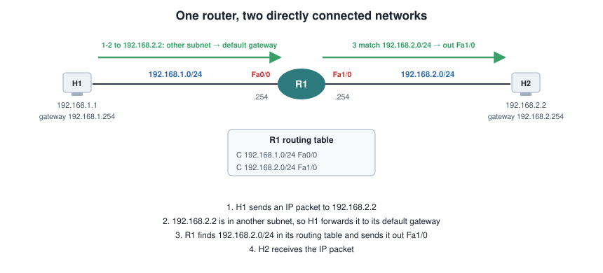

# Introduction to Routers and Routing

[한국어](../01-Introduction-to-Routers-and-Routing.md) | [English](01-Introduction-to-Routers-and-Routing.en.md) | **日本語** | [简体中文](01-Introduction-to-Routers-and-Routing.zh-CN.md) | [Español](01-Introduction-to-Routers-and-Routing.es.md) | [Français](01-Introduction-to-Routers-and-Routing.fr.md)

この記事では、スイッチとルータの違いを見ながら **ルーティングの基本** を説明します。ルータとは何で、ルーティングとは正確には何でしょうか？スイッチは「スイッチング」し、ルータは「ルーティング」すると言いますが、これが何を意味するのかから見ていきます。

## スイッチとルータ（一覧）

| 項目 | スイッチ | ルータ |
| --- | --- | --- |
| 動作する層 | データリンク層（レイヤ 2） | ネットワーク層（レイヤ 3） |
| 見るアドレス | 宛先 MAC アドレス | 宛先 IP アドレス |
| 扱う単位 | イーサネットフレーム | IP パケット |
| 参照する表 | MAC アドレステーブル | ルーティングテーブル |

---

## 1. スイッチとルータは何が違うのか？

スイッチは **MAC アドレス情報を見て「スイッチング」** します。スイッチが気にするのは 1 つだけです。イーサネットフレームがインターフェイスに入ってきたら、**宛先 MAC アドレス** を見て、そのフレームをどのインターフェイスに送るかを決めます。つまりスイッチは **データリンク層（レイヤ 2）** の情報で判断します。

ルータも似た仕事をしますが、今度は **IP パケット** を見ます。覚えているかもしれませんが、IP は **ネットワーク層（レイヤ 3）** にあります。ルータは IP パケットの **宛先 IP アドレス** を見て、正しいインターフェイスから送り出します。

ここで疑問に思うかもしれません。何がそんなに違うのでしょうか？MAC アドレスも IP アドレスもネットワーク機器ごとに一意なのに、なぜどこでも MAC アドレスでスイッチングせず、IP アドレスを見てルーティングする必要があるのでしょうか？良い質問です。図で答えてみます。

---

## 2. なぜルーティングが必要なのか？


スイッチが 2 台あり、それぞれにコンピュータが 200 台ずつ接続されています。400 台すべてが互いに通信するには、**スイッチごとに MAC アドレスを 400 個** 学習しなければなりません。左右両方のコンピュータの MAC アドレスを知る必要があるからです。

では本当に大きなネットワーク、例えば **インターネット** を考えてみてください。機器は数百万台あります！インターネット上のすべての機器ごとに MAC アドレステーブルのエントリを 1 つずつ、数百万個も持てるでしょうか？絶対に無理です。スイッチングの問題は **スケーラビリティがない** ことです。階層構造がなく、**フラットな 48 ビットの MAC アドレス** しかないからです。同じ例をルータで見てみます。


左側のコンピュータ 200 台は R1 に接続され、**192.168.1.0/24** ネットワークにあります。R2 の後ろにもコンピュータが 200 台あり、こちらのネットワークは **192.168.2.0/24** です。ルータは **IP 情報を見て「ルーティング」** します。この例では、R1 は 192.168.2.0/24 ネットワークが R2 の後ろにあることだけを、R2 は 192.168.1.0/24 ネットワークが R1 の後ろにあることだけを知っていればよいのです。

MAC アドレス 400 個の MAC アドレステーブルの代わりに、**ルータごとに相手ネットワークのエントリが 1 つ** あれば十分です。

---

## 3. ルーティングテーブルとパケットの転送

スイッチが **MAC アドレステーブル** でイーサネットフレームを転送するように、ルータは **ルーティングテーブル** で IP パケットをどこに送るかを知ります。新品のルータを箱から出すとルーティングテーブルは作られますが、その中にあるのは **直接接続（directly connected）されたインターフェイス** の情報だけです。簡単な例から始めます。



上の図にはルータが 1 台とコンピュータが 2 台あります。

- H1 は IP アドレスが 192.168.1.1 で、デフォルトゲートウェイに 192.168.1.254 を設定しています。
- H2 は IP アドレスが 192.168.2.2 で、デフォルトゲートウェイに 192.168.2.254 を設定しています。
- ルータには FastEthernet 0/0 に 192.168.1.254、FastEthernet 1/0 に 192.168.2.254 を設定しました。
- IP アドレスと一緒にサブネットマスクも設定したので、ルータはネットワークアドレスを知り、それをルーティングテーブルに保存します。

H1 が H2 に何かを送るときは、次のことが起きます。

1. H1 が宛先 IP アドレス 192.168.2.2 の IP パケットを送ります。
2. H1 は自分の IP アドレスとサブネットマスクを確認し、192.168.2.2 は **別のサブネット** にあると判断します。そのため IP パケットを **デフォルトゲートウェイ** に送ります。
3. ルータは IP パケットを受け取り、宛先 IP アドレスを確認してルーティングテーブルを調べます。192.168.2.2 は **192.168.2.0/24 のエントリに一致** するので、ルータは IP パケットを FastEthernet 1/0 インターフェイスから送り出します。
4. H2 が IP パケットを受け取ります。成功です！

---

## 4. 実習：1 台のルータで 2 つのネットワークをつなぐ

このシナリオを実際のルータに設定して、どう見えるかを確認します。トポロジは次のとおりです。実習ルータ（2811）の 2 つ目のインターフェイスは Fa0/1 です。


まずはコンピュータの設定です。各 PC の IP アドレスとデフォルトゲートウェイを確認します。


次にルータを設定します。インターフェイスに IP アドレスを設定して有効にします。

```
R1(config)#int f0/0
R1(config-if)#no shutdown
R1(config-if)#ip address 192.168.1.254 255.255.255.0
R1(config-if)#exit
R1(config)#int f0/1
R1(config-if)#no shut
R1(config-if)#ip add 192.168.2.254 255.255.255.0
R1(config-if)#
```

これだけです。ではルーティングテーブルを確認してみます。

```
R1#sh ip route
Codes: L - local, C - connected, S - static, R - RIP, M - mobile, B - BGP
       D - EIGRP, EX - EIGRP external, O - OSPF, IA - OSPF inter area
       N1 - OSPF NSSA external type 1, N2 - OSPF NSSA external type 2
       E1 - OSPF external type 1, E2 - OSPF external type 2, E - EGP
       i - IS-IS, L1 - IS-IS level-1, L2 - IS-IS level-2, ia - IS-IS inter area
       * - candidate default, U - per-user static route, o - ODR
       P - periodic downloaded static route

Gateway of last resort is not set

     192.168.1.0/24 is variably subnetted, 2 subnets, 2 masks
C       192.168.1.0/24 is directly connected, FastEthernet0/0
L       192.168.1.254/32 is directly connected, FastEthernet0/0
     192.168.2.0/24 is variably subnetted, 2 subnets, 2 masks
C       192.168.2.0/24 is directly connected, FastEthernet0/1
L       192.168.2.254/32 is directly connected, FastEthernet0/1
```

ご覧のとおり、ルータは **直接接続された 2 つのネットワーク** を知っています（`C` のエントリ）。`L` のエントリはルータのインターフェイス自身のアドレス（/32）です。

PC1 から PC2 へ ping が通るか確認してみます。


ping が成功しました！最初の IP パケットをルーティングできました。TTL が 127 なのは、ルータを 1 台通過して 1 減ったからです。

> Windows のコンピュータ同士で ping をするときは、**ファイアウォールが ICMP トラフィックをブロックすることがある** 点に注意してください。

---

## 5. traceroute で経路を確認する

インターネット上のサーバに接続するときは、宛先にたどり着くまでに **多くのルータ** を通ります。この経路は **traceroute**（Windows では `tracert`）で確認できます。次は PC から `www.cisco.com` までの経路を確認した結果です。


> 原文では、実際のインターネットで www.cisco.com までルータを 4 台通過し、ルータ名も表示されると説明しています。実習キャプチャでは www.cisco.com は実習ネットワークの 192.168.3.1 に解決されます。192.168.0.254 と 192.168.2.1 を通り（2 番目のホップは応答なし）、4 番目のホップで宛先に到着し、ルータ名は表示されません。

経路上のルータの IP アドレスがホップごとに表示されます。コンピュータがホスト名の検索（hostname lookup）を行うと、ルータ名も表示されます。Windows の traceroute は **ICMP** を使います。

別の記事では、スタティックルーティングとダイナミックルーティングを見ていきます。

---

## まとめ

- **スイッチ** はレイヤ 2 で宛先 **MAC アドレス** を見てフレームを、**ルータ** はレイヤ 3 で宛先 **IP アドレス** を見てパケットを転送します。
- MAC アドレスは階層のないフラットな 48 ビットアドレスなので **スケーラビリティがありません。** ルータはネットワーク単位（例：192.168.2.0/24）のエントリ 1 つで多くの機器を代表します。
- 新しいルータのルーティングテーブルには **直接接続されたネットワーク** しかありません。インターフェイスに IP アドレスとサブネットマスクを設定すると `C`（connected）と `L`（local）のエントリができます。
- 宛先が **別のサブネット** なら、ホストはパケットを **デフォルトゲートウェイ** に送り、ルータはルーティングテーブルで一致するエントリを探してそのインターフェイスから送り出します。
- 確認コマンド：`show ip route`、PC の `ipconfig`、`ping`、`tracert`。Windows のファイアウォールが ICMP をブロックすることがあります。
