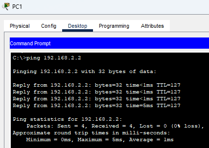

# Introduction to Routers and Routing

[한국어](../01-Introduction-to-Routers-and-Routing.md) | [English](01-Introduction-to-Routers-and-Routing.en.md) | [日本語](01-Introduction-to-Routers-and-Routing.ja.md) | **简体中文** | [Español](01-Introduction-to-Routers-and-Routing.es.md) | [Français](01-Introduction-to-Routers-and-Routing.fr.md)

本文介绍交换机和路由器的区别，并讲解 **路由的基础**。路由器是什么？路由到底是什么？人们说交换机做“交换”、路由器做“路由”，我们先来看看这到底是什么意思。

## 交换机与路由器一览

| 项目 | 交换机 | 路由器 |
| --- | --- | --- |
| 工作层次 | 数据链路层（第 2 层） | 网络层（第 3 层） |
| 查看的地址 | 目的 MAC 地址 | 目的 IP 地址 |
| 处理的单位 | 以太网帧 | IP 数据包 |
| 参考的表 | MAC 地址表 | 路由表 |

---

## 1. 交换机和路由器有什么不同？

交换机 **根据 MAC 地址信息进行“交换”**。交换机只关心一件事：以太网帧从某个接口进来时，查看 **目的 MAC 地址**，决定把这个帧发往哪个接口。也就是说，交换机根据 **数据链路层（第 2 层）** 的信息做决定。

路由器做的事情类似，但这次看的是 **IP 数据包**。你可能还记得，IP 位于 **网络层（第 3 层）**。路由器查看 IP 数据包中的 **目的 IP 地址**，把它从正确的接口发出去。

你也许会想：这有什么大区别？MAC 地址和 IP 地址在每台网络设备上都是唯一的，为什么不在所有地方都用 MAC 地址交换，而要查看 IP 地址进行路由呢？好问题。我用图来回答。

---

## 2. 为什么需要路由？


这里有两台交换机，每台各连接 200 台计算机。如果这 400 台计算机都要互相通信，**每台交换机都必须学习 400 个 MAC 地址**，因为它要知道左右两边所有计算机的 MAC 地址。

现在想想一个真正巨大的网络，比如 **互联网**。设备有数百万台！能为互联网上的每台设备都在 MAC 地址表里放一个条目，放上数百万条吗？绝对不可能。交换的问题在于 **不可扩展**：没有层次结构，只有 **扁平的 48 位 MAC 地址**。把同样的例子换成路由器来看看。


左边的 200 台计算机连接到 R1，位于 **192.168.1.0/24** 网络。R2 后面也有 200 台计算机，那里的网络是 **192.168.2.0/24**。路由器 **根据 IP 信息进行“路由”**。在这个例子中，R1 只需要知道 192.168.2.0/24 网络在 R2 后面，R2 只需要知道 192.168.1.0/24 网络在 R1 后面。

不再需要包含 400 个 MAC 地址的 MAC 地址表，现在 **每台路由器只需要一条对方网络的条目**。

---

## 3. 路由表与数据包转发

就像交换机用 **MAC 地址表** 转发以太网帧一样，路由器用 **路由表** 来决定把 IP 数据包发往哪里。把一台全新的路由器从盒子里拿出来时，它会建立路由表，但里面只有 **直连（directly connected）接口** 的信息。我们从一个简单的例子开始。


上图中有一台路由器和两台计算机：

- H1 的 IP 地址是 192.168.1.1，默认网关设置为 192.168.1.254。
- H2 的 IP 地址是 192.168.2.2，默认网关设置为 192.168.2.254。
- 路由器的 FastEthernet 0/0 配置了 192.168.1.254，FastEthernet 1/0 配置了 192.168.2.254。
- 因为配置 IP 地址时也配置了子网掩码，路由器知道网络地址，并把它们存入路由表。

H1 要向 H2 发送数据时，会发生以下过程：

1. H1 发送一个目的 IP 地址为 192.168.2.2 的 IP 数据包。
2. H1 检查自己的 IP 地址和子网掩码，判断 192.168.2.2 位于 **另一个子网**。因此把 IP 数据包发给 **默认网关**。
3. 路由器收到 IP 数据包，检查目的 IP 地址并查找路由表。192.168.2.2 **匹配 192.168.2.0/24 条目**，所以路由器把 IP 数据包从 FastEthernet 1/0 接口发出。
4. H2 收到 IP 数据包。成功！

---

## 4. 实验：用一台路由器连接两个网络

我们在真实的路由器上配置这个场景，看看效果。拓扑如下。实验路由器（2811）的第二个接口是 Fa0/1。


先看计算机的配置。确认每台 PC 的 IP 地址和默认网关。


接着配置路由器：在接口上配置 IP 地址并启用接口。

```
R1(config)#int f0/0
R1(config-if)#no shutdown
R1(config-if)#ip address 192.168.1.254 255.255.255.0
R1(config-if)#exit
R1(config)#int f0/1
R1(config-if)#no shut
R1(config-if)#ip add 192.168.2.254 255.255.255.0
R1(config-if)#
```

就这些。现在来查看路由表。

```
R1#sh ip route
Codes: L - local, C - connected, S - static, R - RIP, M - mobile, B - BGP
       D - EIGRP, EX - EIGRP external, O - OSPF, IA - OSPF inter area
       N1 - OSPF NSSA external type 1, N2 - OSPF NSSA external type 2
       E1 - OSPF external type 1, E2 - OSPF external type 2, E - EGP
       i - IS-IS, L1 - IS-IS level-1, L2 - IS-IS level-2, ia - IS-IS inter area
       * - candidate default, U - per-user static route, o - ODR
       P - periodic downloaded static route

Gateway of last resort is not set

     192.168.1.0/24 is variably subnetted, 2 subnets, 2 masks
C       192.168.1.0/24 is directly connected, FastEthernet0/0
L       192.168.1.254/32 is directly connected, FastEthernet0/0
     192.168.2.0/24 is variably subnetted, 2 subnets, 2 masks
C       192.168.2.0/24 is directly connected, FastEthernet0/1
L       192.168.2.254/32 is directly connected, FastEthernet0/1
```

可以看到，路由器知道 **两个直连网络**（`C` 条目）。`L` 条目是路由器接口自身的地址（/32）。

看看 PC1 能否 ping 通 PC2。



ping 成功了！我们刚刚路由了第一个 IP 数据包。TTL 是 127，是因为经过一台路由器时减了 1。

> 在两台 Windows 计算机之间 ping 时要注意，**防火墙可能会阻止 ICMP 流量**。

---

## 5. 用 traceroute 查看路径

访问互联网上的服务器时，要经过 **许多路由器** 才能到达目的地。这条路径可以用 **traceroute**（Windows 中为 `tracert`）查看。下面是从 PC 到 `www.cisco.com` 的路径查看结果：


> 原文说明在真实互联网上到 www.cisco.com 要经过 4 台路由器，并且会显示路由器名称。但在实验截图中，www.cisco.com 被解析为实验网络中的 192.168.3.1：经过 192.168.0.254 和 192.168.2.1（第 2 跳无响应），在第 4 跳到达目的地，也没有显示路由器名称。

每一跳都会显示路径上路由器的 IP 地址。如果计算机进行主机名查询（hostname lookup），还能看到路由器名称。Windows 的 traceroute 使用 **ICMP**。

在另一篇文章中，我们会介绍静态路由和动态路由。

---

## 总结

- **交换机** 在第 2 层根据目的 **MAC 地址** 转发帧，**路由器** 在第 3 层根据目的 **IP 地址** 转发数据包。
- MAC 地址是没有层次的扁平 48 位地址，**无法扩展**。路由器用一条网络级条目（例如 192.168.2.0/24）代表大量设备。
- 新路由器的路由表里只有 **直连网络**。在接口上配置 IP 地址和子网掩码后，会生成 `C`（connected）和 `L`（local）条目。
- 目的地位于 **另一个子网** 时，主机把数据包发给 **默认网关**；路由器在路由表中找到匹配条目，从相应接口发出。
- 验证命令：`show ip route`，以及 PC 上的 `ipconfig`、`ping`、`tracert`。Windows 防火墙可能会阻止 ICMP。
