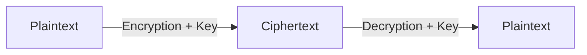
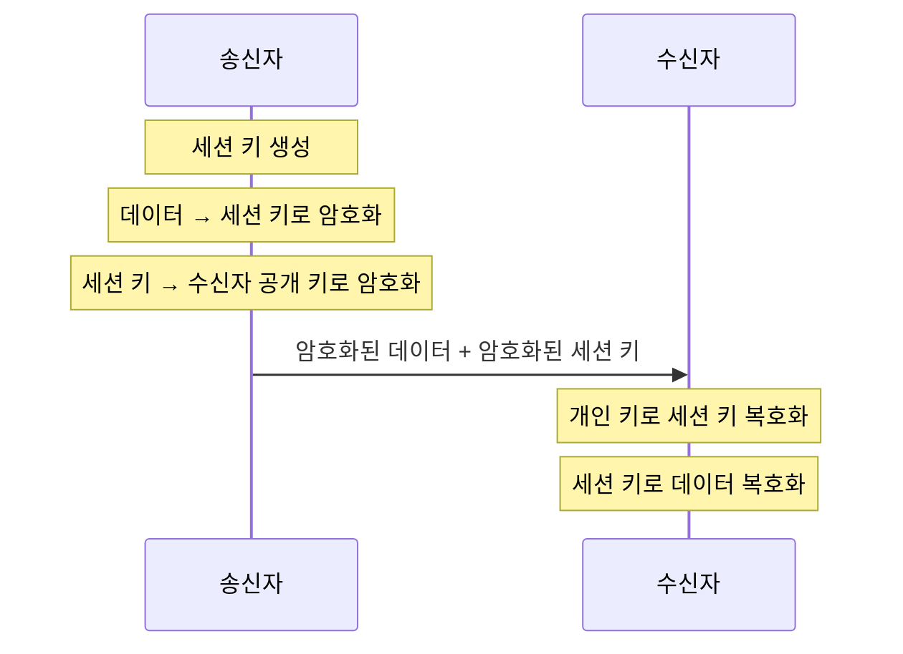
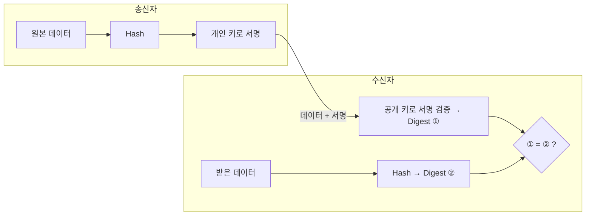
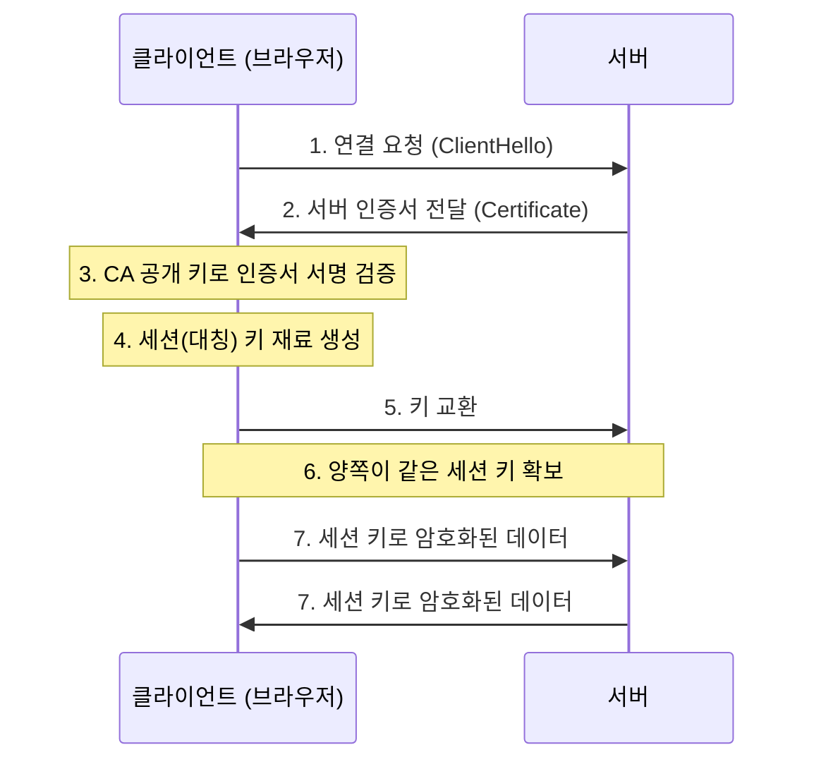

# Cryptography (암호학)

**Cryptography(암호학)** 은 정보를 보호하기 위한 수학적 방법론이다.
기본 용어 → 대칭/비대칭 키 → 해시 → PKI·인증서·서명 → HTTPS 순으로 정리한다.

---

## 1. 기본 용어

| 용어 | 의미 |
|---|---|
| **Plaintext (평문)** | 암호화되지 않은 원본 데이터. 바로 읽을 수 있다 |
| **Ciphertext (암호문)** | 평문을 암호화한 결과. 키 없이는 읽을 수 없다 |
| **Encryption (암호화)** | 평문 → 암호문으로 바꾸는 과정 |
| **Decryption (복호화)** | 암호문 → 평문으로 되돌리는 과정 |
| **Algorithm (알고리즘)** | 암호화·복호화를 수행하는 수학적 절차 (AES, RSA 등) |
| **Key (키)** | 알고리즘이 **어떻게** 동작할지 결정하는 비밀 값 |



> 알고리즘은 공개되어 있어도 된다. 안전성은 **키를 비밀로 지키는 것**에서 나온다 (Kerckhoffs의 원리).

---

## 2. Symmetric Key vs Asymmetric Key

| 구분 | Symmetric Key (대칭 키) | Asymmetric Key (비대칭 키) |
|---|---|---|
| 키 | 암호화 키 = 복호화 키 (**1개**) | **공개 키 + 개인 키** 한 쌍 |
| 속도 | **빠름** | 느림 |
| 약점 | 키를 상대에게 **안전하게 전달**하기 어렵다 | 연산량이 많아 대용량 암호화에 부적합 |
| 키 관리 | 사용자 n명 → 키 **n(n-1)/2개** 필요 | 사람마다 키 쌍 1개 |
| 예시 | AES, ChaCha20, (3DES) | RSA, ECC(ECDSA·ECDH) |

- 대칭 키의 **키 전달 문제**를 해결하기 위해 비대칭 키(공개 키 암호)가 등장했다.
- 비대칭 키는 **암호화**와 **인증(서명)** 둘 다에 쓸 수 있다.

### Public Key & Private Key

| | 공개 키 (Public Key) | 개인 키 (Private Key) |
|---|---|---|
| 공개 여부 | 누구에게나 공개 | **절대 공개 금지** |
| 암호화 용도 | 데이터를 **암호화** | 데이터를 **복호화** |
| 서명 용도 | 서명을 **검증** | 서명을 **생성** |
| 비유 | 계좌 번호 | 계좌 PIN 번호 |

---

## 3. Hybrid Encryption (하이브리드 암호화)

대칭 키의 **속도**와 비대칭 키의 **안전한 키 전달**을 합친 방식. HTTPS(TLS)의 기본 아이디어다.

1. 송신자가 무작위 **대칭 키(세션 키)** 를 만든다.
2. 실제 **데이터는 세션 키로** 암호화한다. (빠름)
3. **세션 키는 수신자의 공개 키로** 암호화한다.
4. 둘을 함께 보낸다.
5. 수신자는 **자신의 개인 키로** 세션 키를 복호화한다.
6. 얻은 세션 키로 데이터를 복호화한다.



---

## 4. CIA Triad

데이터를 안전하게 보호하기 위한 보안의 3요소.

| 요소 | 의미 | 관련 기술 |
|---|---|---|
| **Confidentiality (기밀성)** | 승인된 사람만 정보에 접근 | 암호화, 접근 제어 |
| **Integrity (무결성)** | 데이터가 변조되지 않았음을 보장 | 해시, 디지털 서명, MAC |
| **Availability (가용성)** | 필요할 때 정상적으로 사용 가능 | 이중화, 백업, DDoS 대응 |

---

## 5. One-Way vs Two-Way Encryption

| 구분 | One-Way (단방향) | Two-Way (양방향) |
|---|---|---|
| 복호화 | **불가능** | 가능 |
| 용도 | 비밀번호 저장, 무결성 확인 | 원본 데이터가 필요한 통신·저장 |
| 예시 | SHA-256, bcrypt, Argon2 | AES, RSA, HTTPS(TLS) |

- **비밀번호 검증**: 입력받은 비밀번호를 같은 방식으로 해시해서 저장된 해시와 **비교**한다. DB가 유출돼도 원래 비밀번호를 바로 알 수 없다.
- 양방향 암호화는 다시 **대칭 키 / 비대칭 키** 방식으로 나뉜다.

> 엄밀히 말하면 해시는 "암호화"가 아니라 **단방향 함수**다. 복호화 개념이 없다.
> 비밀번호 저장에는 SHA-256을 그대로 쓰기보다 **salt + bcrypt / scrypt / Argon2** 처럼 일부러 느린 알고리즘을 쓴다.

---

## 6. Hash & Message Digest

**Hash** 는 임의 길이의 입력을 **고정 길이의 값**으로 바꾸는 단방향 함수다.

```
입력: yuseong
SHA-256 → 고정 길이(256bit)의 해시 값
```

| 특징 | 설명 |
|---|---|
| 고정 길이 출력 | 입력 크기와 상관없이 길이가 같다 |
| 단방향 | 해시 값으로 원문을 되돌릴 수 없다 |
| 눈사태 효과 | 입력이 1글자만 달라도 결과가 완전히 바뀐다 |
| 충돌 저항성 | 서로 다른 입력이 같은 값을 내기 어려워야 한다 |

**Message Digest (메시지 요약)**: SHA-256 같은 해시 알고리즘이 파일·메시지를 읽고 만든 **고정 길이 결과값**. 파일이 변조됐는지 확인할 때 쓴다.

> ⚠️ **MD5, SHA-1은 충돌이 발견되어 보안 용도로는 더 이상 안전하지 않다.** SHA-256 이상을 사용한다.

---

## 7. Digital Signature (디지털 서명)

공개 키 암호를 이용해 **누가 보냈는지(인증)**, **변조되지 않았는지(무결성)**, **보낸 걸 부인할 수 없게(부인 방지)** 하는 기술.

**서명 생성 (송신자)**
1. 원본 데이터를 해시해서 **Digest**를 만든다.
2. Digest를 **송신자의 개인 키로 서명**한다. → Signature
3. 원본 데이터 + 서명을 함께 보낸다.

**서명 검증 (수신자)**
1. 받은 서명을 **송신자의 공개 키로 검증**해 Digest ①을 얻는다.
2. 받은 원본 데이터를 **같은 해시 알고리즘**으로 해시해 Digest ②를 만든다.
3. ① = ② 이면 → 송신자 본인이 보냈고, 데이터도 변조되지 않음.



> 그런데 그 **공개 키가 진짜 송신자 것인지**는 어떻게 믿을까? → 그걸 보증해주는 게 **CA와 인증서(PKI)** 다.

---

## 8. PKI (Public Key Infrastructure)

공개 키를 안전하게 쓰기 위한 **정책·절차·시스템 전체**. 디지털 인증서를 발급·관리·폐기하고, 인증서로 사용자를 인증한다. 웹 브라우징, 온라인 뱅킹 등에서 쓰인다.

| 구성 요소 | 역할 |
|---|---|
| **CA (Certificate Authority)** | 인증서를 발급하고 **자신의 개인 키로 서명**해 보증 |
| **RA (Registration Authority)** | 인증서 신청자의 신원 확인 |
| **인증서 (Certificate)** | "이 공개 키는 이 사람/서버의 것"이라는 전자 문서 |
| **CRL / OCSP** | 폐기된 인증서 확인 |

**흐름**
1. 키 쌍(공개 키 + 개인 키) 생성
2. 공개 키를 담아 CA에 인증서 발급 요청 (CSR)
3. CA가 확인 후 **서명한 인증서** 발급 → 공개 키는 인증서와 함께 공개
4. **개인 키는 소유자만 비밀로 보관**

브라우저·OS에는 신뢰할 수 있는 **Root CA의 공개 키가 미리 들어 있다.** 그래서 CA 서명을 검증해 인증서가 진짜인지 확인할 수 있다.

---

## 9. X.509 인증서

신분증·여권이 정해진 양식을 따르듯, 공개 키 인증서의 **표준 양식이 X.509** 다.
"이 공개 키는 진짜 이 사용자의 것"이라고 **공인된 CA가 서명해 보증하는 전자 문서**.

| 구성 | 내용 |
|---|---|
| **TBSCertificate** | 서명 대상 본문 — 버전, 일련번호, 발급자(Issuer), 유효기간, 주체(Subject), **공개 키** 등 |
| **Signature Algorithm** | 서명에 쓴 알고리즘 (예: sha256WithRSAEncryption) |
| **Signature Value** | TBSCertificate를 해시한 값을 **CA의 개인 키로 서명**한 값 |

### 파일 형식

| 형식 | 설명 |
|---|---|
| **PEM** | Base64 텍스트 기반. `-----BEGIN CERTIFICATE-----` 로 시작. 인증서·키 저장에 가장 흔히 씀 |
| **DER** | 바이너리 형식 |
| **PFX / P12** | 인증서 + 개인 키를 묶은 파일 (비밀번호로 보호) |

> 여기서 **인코딩**은 데이터를 다른 표현 방식으로 바꾸는 것이다. Base64는 암호화가 아니라 **누구나 되돌릴 수 있는 인코딩**이라, PEM 파일 안의 개인 키는 그대로 노출된다.

### Self-Signed 인증서

CA가 아니라 **자기 자신이 서명**한 인증서. 신뢰할 수 있는 제3자 보증이 없어 브라우저에 **보안 경고**가 뜬다.
그래도 쓰는 이유: 목적이 신뢰 보증이 아니라 **암호화 자체**일 때 (내부 실습, 테스트 서버 등).

---

## 10. HTTPS 통신 흐름

인증서 검증(비대칭) + 데이터 암호화(대칭)를 합친 **하이브리드 방식**이다.



**3. 인증서 검증 자세히**
- 인증서의 Signature Value를 **CA의 공개 키**로 검증해 해시 값 ①을 얻는다.
- 인증서의 TBSCertificate를 **명시된 같은 알고리즘**으로 해시해 ②를 만든다.
- ① = ② 이면 CA가 보증한 진짜 서버 인증서.

**5. 키 교환 방식**

| 방식 | 동작 |
|---|---|
| **RSA 키 교환** (TLS 1.2 이하, 옛 방식) | 클라이언트가 만든 키를 **서버 공개 키로 암호화**해 전송 → 서버가 개인 키로 복호화 |
| **(EC)DHE** (TLS 1.3 표준) | 양쪽이 값을 주고받아 **같은 세션 키를 각자 계산**. 서버 개인 키는 인증(서명)에만 사용 |

> TLS 1.3은 RSA 키 교환을 없애고 (EC)DHE만 쓴다. 서버 개인 키가 나중에 유출돼도 과거 통신이 풀리지 않는 **Forward Secrecy**를 보장하기 때문이다.

결과적으로 **인증된 서버와 안전하게 통신**하면서, 데이터는 **빠른 대칭 키**로 처리하는 두 가지 장점을 모두 얻는다.

---

## 핵심 정리

- **대칭 키**: 빠르지만 키 전달이 어렵다 / **비대칭 키**: 키 전달은 쉽지만 느리다 → 둘을 합친 게 **하이브리드 (HTTPS)**
- **공개 키**: 암호화·서명 검증 / **개인 키**: 복호화·서명 생성
- **해시**: 고정 길이, 단방향, 무결성 확인. MD5·SHA-1은 쓰지 않는다
- **디지털 서명**: 해시 + 개인 키 → 인증·무결성·부인 방지
- **PKI / CA / X.509**: 공개 키가 진짜 누구 것인지 보증하는 체계
- **개인 키는 어떤 경우에도 공개 저장소에 올리지 않는다**
